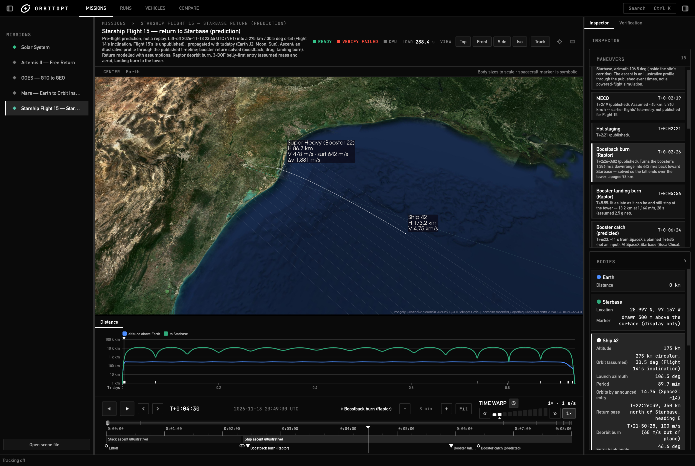

<p align="center">
  
</p>

<h1 align="center">orbitopt</h1>

<div align="center">

[](https://github.com/zangjiucheng/orbitopt/actions/workflows/ci.yml)
[](https://github.com/zangjiucheng/orbitopt/actions/workflows/pages.yml)
[](https://zangjiucheng.github.io/orbitopt/docs/)
[](pyproject.toml)
[](LICENSE)

</div>

orbitopt optimizes trajectories with pykep and pygmo, verifies candidates
with TudatPy, and explores results in **Mission Control**. **Flight Lab**
simulates launch and booster recovery, compares saved runs, and displays
vehicle profiles with declared-versus-flown data. CuPy accelerates batched
screening.



## Quick start

From a repository checkout:

```bash
micromamba create -n orbitopt -f envs/cpu.conda-lock.yml
micromamba activate orbitopt
pip install -e . --no-deps
orbitopt
```

See [installation](docs/quickstart.md#installation) for GPU, macOS, Windows
and viewer-only options. Use `orbitopt --help` for commands.

## Explore

- [Quickstart](docs/quickstart.md): run YAML mission configs and inspect outputs.
- [Mission Control](docs/guide.md): 3D view, timeline, telemetry and verification.
- [Flight Lab](docs/flightlab.md): ascent, recovery and run comparisons;
  [Vehicle view](docs/flightlab.md#vehicle-view) shows the catalog and flight overlays.
- [Computed mission](docs/computed-mission.md): replay ascent and recovery,
  then propagate across TudatPy and G-FOLD environments;
  [Kourou/Starbase designs](docs/e5-08-new-vehicle-report.md) report remaining qualification gaps.
- [API reference](docs/api.md): Python interfaces, CLI commands and schemas.

Verification applies to declared models and tolerances. See
[verification](docs/verification.md) and
[Flight Lab fidelity](docs/flightlab.md#backend-identities-and-fidelity-levels)
for evidence boundaries and limitations.

## License

GPL-3.0-or-later · [License](LICENSE) · [Third-party notices](THIRD_PARTY.md).
Copyright © 2026 Jiucheng Zang.
