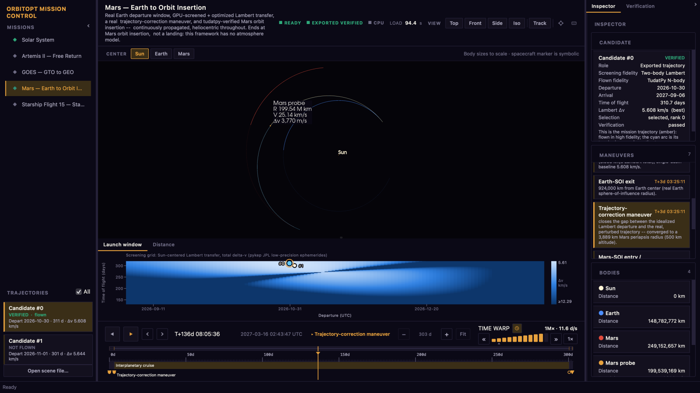

# orbitopt

[](https://github.com/zangjiucheng/orbitopt/actions/workflows/ci.yml)
[](https://github.com/zangjiucheng/orbitopt/actions/workflows/pages.yml)
[](https://zangjiucheng.github.io/orbitopt/docs/)
[](pyproject.toml)
[](LICENSE)

orbitopt searches spacecraft trajectories with pykep and pygmo, then checks
selected candidates with tudatpy. CuPy can accelerate batched screening.
**Flight Lab** simulates launch and booster recovery, in 3-DOF or an optional
6-DOF, and one command chains a launch window, an optimized ascent, orbit
injection and propagation, with a verdict at every handoff. **Mission Control**
displays trajectories, timelines and verification reports, and every report
says which kind of evidence backs each check.



[Documentation](https://zangjiucheng.github.io/orbitopt/docs/) ·
[Quickstart](docs/quickstart.md) · [Mission Control guide](docs/guide.md) ·
[Flight Lab](docs/flightlab.md) · [Verification](docs/verification.md) ·
[Examples and validation](docs/examples.md) · [API reference](docs/api.md)

## Quick start

From a clone of this repository, create the locked CPU environment and install
the project:

```bash
micromamba create -n orbitopt -f envs/cpu.conda-lock.yml
micromamba activate orbitopt
pip install -e . --no-deps

orbitopt                     # Mission Control
orbitopt missions            # list built-in missions
orbitopt view mars           # open the single-scene viewer
```

For GPU, Windows, macOS and optional Flight Lab dependencies, see
[installation](docs/quickstart.md#installation) and
[environment details](envs/README.md).

## CLI

```bash
orbitopt validate examples/mars2020_replay.yaml  # check a config without computing
orbitopt run examples/mars2020_replay.yaml       # compute and export a scene
orbitopt export mars -o mars.json                # export a built-in mission
orbitopt launch-window ksc --rla 9.6 --dla 23.4 --epoch 2020-07-30  # daily launch window
orbitopt launch --site cape-canaveral --vehicle synthetic_two_stage \
  --orbit 400x400@51.6 --date 2026-11-14 -o launch/  # window -> ascent -> injection
orbitopt flight --help                          # launch and recovery tools
orbitopt benchmarks                             # physics benchmarks vs public references
```

Run `orbitopt --help` for all commands. The [quickstart](docs/quickstart.md)
explains configs, outputs and launch windows.

## Mission configs

YAML configs support `geo-raising`, `mars-transfer`, `lunar-free-return`,
`flight-lab` (a Flight Lab ascent) and `two-stage-leo` (the reference
scenario graded from the launch site to the propagated parking orbit). See
[mission configuration](docs/quickstart.md#mission-configs) and the
[examples](examples/). The Solar System scene is an ephemeris visualization,
not an optimized mission.

## Verification reports

Reports record the model, numerical settings, residuals and checks. Each
check is labelled as numerical consistency, model agreement or historical
validation, and a category with no check reads **not checked**, never passed.
A verification verdict applies to those checks and assumptions; it is not
proof of real-world flight safety. A Mars export may be marked **best effort**
if no candidate passes, and GOES loads **not checked** by default.
`orbitopt benchmarks` gates the physics against analytic solutions and
published data. See [verification](docs/verification.md) and
[mission examples](docs/examples.md).

## Mission Control

The desktop app links a 3D view, timeline, charts and verification inspector.
Its Flight Lab mode adds a launch designer, replay and comparison; a Flight Lab
mission opens as one continuous multi-stage timeline with a pass/fail verdict
at each stage handoff. See the [Mission Control guide](docs/guide.md) and
[Flight Lab guide](docs/flightlab.md).

## Checked against real missions

Historical launch-window comparisons and target-based checks answer different
questions. The [validation examples](docs/examples.md) identify which values
are inputs, what was compared, and the limits of each model.

## Performance

On an RTX A3000 Laptop GPU, 2 million Lambert solves took 17.7 s with CuPy
versus 82.8 s with NumPy (4.7×). Performance depends on batch size and hardware;
see the [benchmark](docs/benchmarks/fused_kernel_evaluation.md).

## Layout

| Path | Purpose |
|---|---|
| `src/orbitopt/lambert`, `problems`, `optimize` | Screening and optimization |
| `src/orbitopt/verify` | Propagation, targeting, verification reports, benchmarks and convergence studies |
| `src/orbitopt/flightlab` | Launch and recovery simulation (3-DOF, 6-DOF, recovery Monte Carlo) |
| `src/orbitopt/mission`, `pipeline.py` | Mission segments and handoffs, the unified mission pipeline |
| `src/orbitopt/viz` | Scene export, viewer and Mission Control |
| `examples`, `docs`, `tests` | Examples, guides and regression tests |

The documentation site is built from `docs/` with Jekyll. To preview it, run
`cd docs && bundle install && bundle exec jekyll serve`.

## Installing without conda

The scene format and viewer can be installed without the compute stack; see
[installation options](docs/quickstart.md#installation). Full trajectory
optimization and verification require the locked conda environment.

## Lessons learned

See [engineering notes](docs/engineering-notes.md) for numerical, frame and
UI pitfalls, and the [Mars mission plan](docs/mars_mission_plan.md) for its
phase-boundary assumptions.

## Limitations

- The batched Lambert solver supports zero revolutions; multi-revolution cases
  use pykep's Izzo solver. Low-thrust optimization is not implemented.
- Verification results depend on the specified force model. The orbital
  verification layer omits solar radiation pressure, drag and relativity.
- The cislunar GPU screening ephemeris is a two-body approximation intended for
  spans of about ten days from its SPICE seed.
- Mars mission targeters may fail to converge; a failed or unchecked candidate
  is not a verified result. The Mars scene ends at orbit insertion, not landing.
- Flight Lab's default ascent is a 3-DOF point mass; the 6-DOF backend is
  opt-in and not part of ascent optimization. Vehicle data are public or
  illustrative; the [fidelity and limitations](docs/flightlab.md#fidelity-levels)
  are explicit.

## License

GPL-3.0-or-later. See [LICENSE](LICENSE) and [third-party notices](THIRD_PARTY.md).
Copyright © 2026 Jiucheng Zang.
