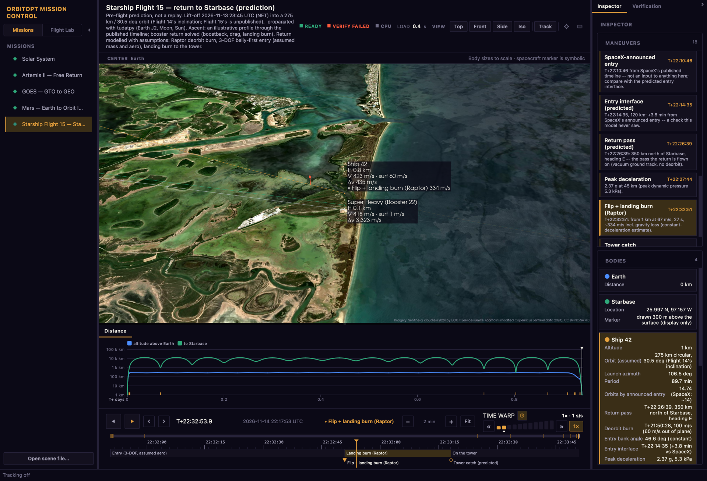
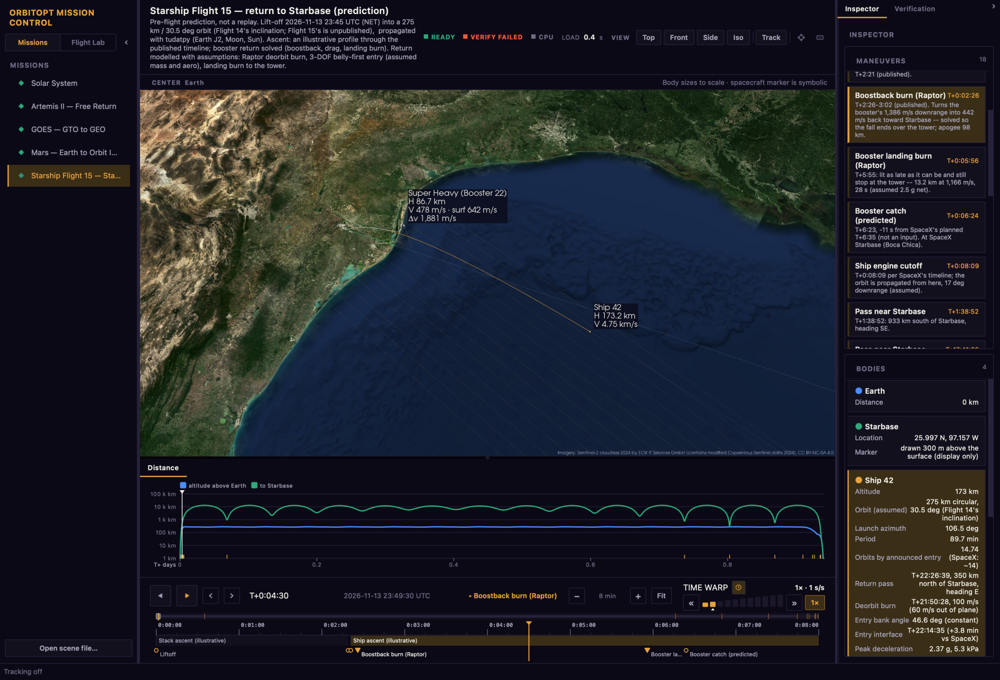
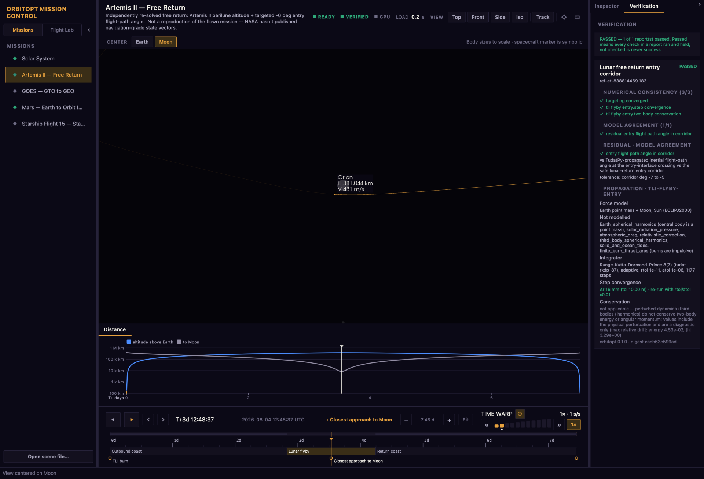
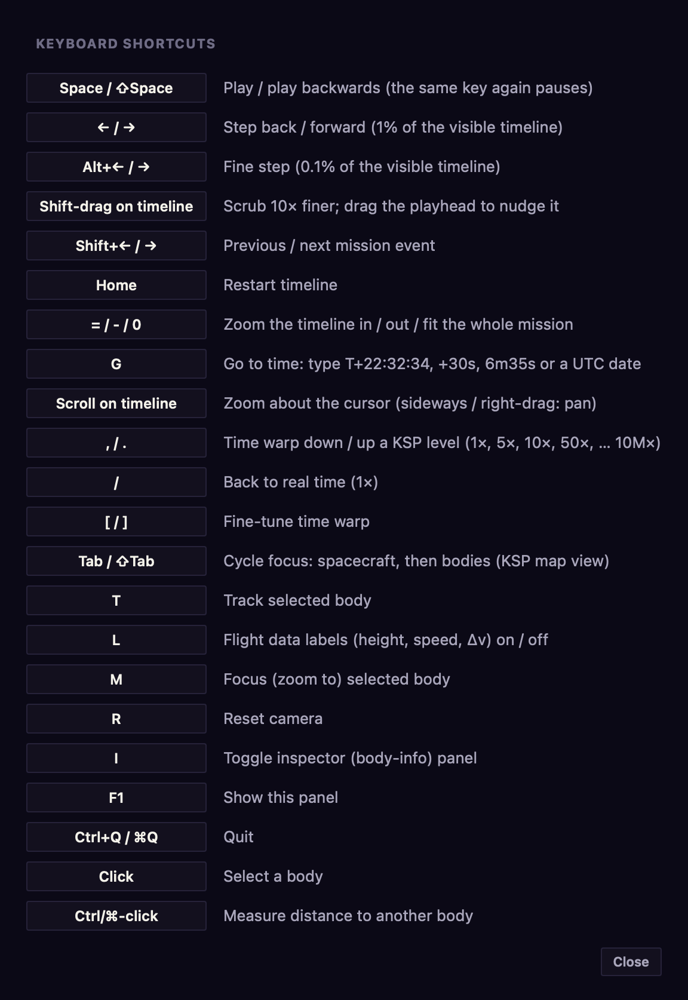

# orbitopt

[](https://github.com/zangjiucheng/orbitopt/actions/workflows/ci.yml)
[](https://github.com/zangjiucheng/orbitopt/actions/workflows/pages.yml)
[](pyproject.toml)
[](LICENSE)
[](https://zangjiucheng.github.io/orbitopt/)

**Screen fast, verify exactly.** orbitopt is an orbital trajectory
optimization framework. It searches huge design spaces with cheap
patched-conic models (**pykep + pygmo**, batched on the GPU with **CuPy**),
then re-flies the winners under high-fidelity numerical propagation
(**tudatpy**) and writes a machine-readable verification report for every
result. Mission Control, a desktop 3D app, plays the missions back and shows
why a trajectory was chosen and how well it was verified.


## What it does

| Stage | What you get | Where |
|---|---|---|
| **Search** | Batched Lambert solver, porkchop grids, pygmo optimizers with GPU batch fitness, multi-basin multistart | `lambert/`, `optimize/`, `problems/` |
| **Launch** | Daily launch windows from a site database (range-safety azimuth corridors), vehicle C3/payload curves as optimizer constraints, LEO parking orbit → TLI/TMI injection | `launch_windows.py`, `launch_constraints.py`, `injection.py` |
| **Verify** | tudatpy N-body propagation (adaptive RKDP8(7)), dense-output event location, Newton/B-plane targeters (TCM, MOI, lunar flyby, GEO insertion), JSON verification reports | `verify/` |
| **Visualize** | Versioned scene file format, single-scene viewer, Mission Control: planet-centered views, candidate comparison, verification reports, linked porkchop / distance charts | `scene_format.py`, `viz/` |

Built-in missions: **Artemis II** free return, **GOES** GTO→GEO raising,
**Earth → Mars** orbit insertion, **Starship Flight 15** return-pass
prediction, and the solar system.

## Checked against real missions

Two different kinds of check, and they should not be read the same way.

**Historical replays.** orbitopt is given only the physics and the real
constraints of the time (launch site, vehicle, departure window) and
predicts what was actually flown. The flown values are *not* inputs, so
these are independent comparisons.

| Mission | orbitopt | Real |
|---|---|---|
| Mars 2020: KSC launch-window optimum, Jul 30 | 11:51:28 UTC | lift-off 11:50 UTC |
| Mars 2020: lowest-C3 departure in the 2020 window | Jul 18 (C3 13.2 km²/s²) | launch period opened Jul 17 |
| Sentinel-2A/2B: Kourou SSO launch time | within 6–9 min | actual lift-off |
| ISS: KSC launch azimuth / daily window drift | 44.9°, ~23 min earlier per day | same |

**Targeting checks.** A published mission figure is fed in as a *target*
and orbitopt checks that its solvers hit it under high-fidelity dynamics.
They show the targeters work. They do not show that orbitopt reproduces the
real trajectory.

| Mission | Input (target) | orbitopt result |
|---|---|---|
| Artemis II-like lunar free return | 6,545 km perilune altitude (Artemis II's published figure); entry flight-path angle −6° | perilune within the 50 km targeting tolerance, and the unpowered return reaches the entry interface inside the [−7°, −5°] corridor (TudatPy Earth+Moon+Sun) |

**Open prediction.** Published before the flight, to be checked against
it afterwards. Starship Flight 15 (NET 2026-11-13) is planned as the first
return of the ship to Starbase. orbitopt launches the ship from Starbase
into the orbit SpaceX describes (~275 km; Flight 14's 30.5° inclination,
since Flight 15's is unpublished), propagates it with TudatPy (Earth J2,
Moon, Sun; no drag) and finds the ground-track pass that can bring it home.
SpaceX's announced entry time is used only as a check, never as an input.
The deorbit burn, the entry and both vehicles' returns to the tower are
solved (below); the ascent is an illustrative profile.

| Flight 15 | orbitopt prediction | Real |
|---|---|---|
| Orbits by the announced entry (T+22:10:46) | 14.74 | SpaceX: "approximately 14" |
| First pass after the announced entry that reaches Starbase | T+22:26:39, 16 min after the announced entry | pending |
| That pass's ground track | 350 km north of Starbase, heading east (with 29.5–31.5°: 280–400 km north) | pending |
| Depends on the launch time? | No: the ground track is fixed by the site and azimuth | — |
| Entry interface (120 km), solved return to the tower | T+22:14:35, 3.8 min after the announced entry | pending |
| Entry interface to landing burn | 18.4 min | earlier flights: ~17–18 min entry to splashdown |
| Deorbit burn (Raptor) | T+21:50:28, 100 m/s, 60 m/s of it out of plane | pending |
| Landing burn (Raptor) | 27 s from 1 km, ~335 m/s incl. gravity loss | pending |
| Ship tower catch | T+22:33:18 | SpaceX plan: T+22:32:34 |
| Super Heavy catch (boostback solved, drag, landing burn) | T+6:24 | SpaceX plan: T+6:35 |

The return to the tower is solved, not drawn: a 3-DOF point-mass entry
([`orbitopt.entry`](src/orbitopt/entry.py): J2 gravity, a co-rotating
US Standard Atmosphere, lift and drag at a constant bank angle) with the
deorbit-burn time and bank angle chosen so the ship reaches the landing-burn
height over Starbase. Starship's mass and aerodynamics are not public, so
they are assumptions (150 t, 400 m², flat-plate L/D 0.47). The ascent is an
illustrative profile through the published event times (MECO, hot staging),
not a powered-flight simulation; the booster's return is solved -- boostback
speed so that its fall under gravity and drag ends over the tower, then a
landing burn lit as late as it can be. With Flight 14's
inclination the entry's cross-range falls ~29 km short of Starbase at the
best constant bank (46.6°), so the solve adds an out-of-plane component to
the deorbit burn.

The return is verified in four reports (Verification tab;
[`starship_verify.py`](src/orbitopt/viz/starship_verify.py)): an independent
re-fly with other integrators (the landing point moves 0.1 m), guided
recovery from eight dispersions (air density ±20%, burn ±1 s / ±1 m/s,
L/D ±10%, re-solving the bank and allowing one bank reversal), loads and
propellant against assumed limits, and the published timeline. It reports
**VERIFY FAILED**, and that is a finding, not a bug: the nominal entry
already flies at its maximum cross-range, so with 10% less lift than assumed
the ship comes down ~58 km to the side of Starbase. That traces to the assumed
(Flight 14) inclination of 30.5°: the report also searches for the inclinations
at which the entry alone reaches Starbase -- up to 29.97°, and up to 29.09° with
10% less lift -- so a Flight 15 orbit near 29° or below would need no
out-of-plane burn and keep that margin. `orbitopt view starship-flight-15` opens the scene;
[`src/orbitopt/viz/starship_flight.py`](src/orbitopt/viz/starship_flight.py)
lists every assumption with its source.

The Artemis II mission (`orbitopt view artemis2`,
[`examples/artemis2_free_return.yaml`](examples/artemis2_free_return.yaml))
departs on a date we chose, **2026-08-01**. The real Artemis II launched on
2026-04-01. Its parking orbit (185 km circular) and departure geometry are
modelling choices too. The run solves a free return of the same class as
Artemis II, with the same perilune and a survivable entry angle. It is not
an independent reconstruction of the flown trajectory: NASA has not
published navigation-grade state vectors to compare against. See
[`docs/engineering-notes.md`](docs/engineering-notes.md#cislunar--artemis-ii-free-return-pipeline-in-full).

The Mars 2020 numbers come from
[`examples/14_mars2020_replay.py`](examples/14_mars2020_replay.py), which runs
the whole chain: porkchop → multistart → launch constraints → launch window →
parking orbit and TMI, numerically verified (9/9 checks pass). The same search
shows a Falcon 9 could not have flown that 4,037 kg payload: its C3 ceiling is
8.6 km²/s², below the 13.2 minimum of the whole window. The tudatpy cruise
(TCM targeted in the B-plane, then Mars orbit insertion at 505 km periapsis)
runs from a config:
`orbitopt run examples/mars2020_replay.yaml`.

## Quick start

pykep, pygmo and tudatpy are only on conda-forge / tudat-team, so the compute
stack comes from a locked conda environment:

```bash
micromamba create -n orbitopt -f envs/cpu.conda-lock.yml   # or envs/gpu.conda-lock.yml (CuPy, CUDA 13)
micromamba activate orbitopt
pip install -e . --no-deps
pytest tests/
```

On Windows, `.\scripts\setup_env.ps1` (add `-Gpu` for CUDA) does the same.
The CPU lock also covers macOS (native `osx-arm64` and `osx-64`; no GPU env on
macOS). See [`envs/README.md`](envs/README.md) for macOS notes, regenerating
the lockfiles and the GPU CI job.

```bash
orbitopt                                   # Mission Control
orbitopt view mars                         # one built-in mission in the plain viewer
orbitopt run examples/mars2020_replay.yaml # optimize, verify in tudatpy, write scene + report
orbitopt launch-window ksc --rla 9.6 --dla 23.4 --epoch 2020-07-30
python examples/14_mars2020_replay.py      # the end-to-end walkthrough above
```

## CLI

| Command | Does |
|---|---|
| `orbitopt` / `orbitopt app` | Mission Control |
| `orbitopt view <mission or scene.json>` | single-scene 3D viewer |
| `orbitopt export <mission> -o scene.json` | cache a built-in mission's scene |
| `orbitopt missions` | list registered missions (built-in and plugins) |
| `orbitopt validate config.yaml` | schema-check a mission config, no compute |
| `orbitopt run config.yaml` | run a config: optimize, verify, write scene + `.verification.json` |
| `orbitopt view config.yaml` | run a config (cached) and open the 3D viewer |
| `orbitopt launch-window <site> ...` | daily launch windows into an orbit plane (`--inclination`, `--raan`/`--ltan`, `--dogleg`) or along a departure asymptote (`--rla/--dla`) |

## Mission configs

Missions can be described in YAML instead of Python. Every section except
`mission` and `output` is optional, and omitted fields fall back to the
built-in mission's values:

```yaml
mission: { id: my-geo-mission, title: My GEO raising campaign, kind: geo-raising }
target: { geostationary_longitude_deg: -101.0 }
campaign_search: { n_burns: { min: 2, max: 6 } }
output: { scene_file: scenes/my-geo-mission.json }
```

Supported kinds: `geo-raising`, `mars-transfer` and `lunar-free-return`
(an Artemis II-like free return; see `examples/artemis2_free_return.yaml`). Schemas are in
`src/orbitopt/schemas/`. `orbitopt view config.yaml` runs a config and opens
the result; the scene is cached like the built-in missions' scenes and is
recomputed when the config or orbitopt's source changes.

The Solar System scene is not a config kind. It is a near-instant ephemeris
export with no optimizer, targeting or verification stage, so there is
nothing for a config to tune or for `run` to verify. It stays a built-in
(`orbitopt view solar-system`).

## Verification reports

Each verification stage emits a JSON report validated against
`schemas/verification-report-1.0.json`. A report lists the dynamics model and
what it leaves out, integrator settings, a step-convergence re-run,
conservation checks against a two-body reference, targeting residuals and
pass/fail checks. `orbitopt run` writes the reports next to the scene and
warns when any check fails.

Launch-site and launch-vehicle data cite a source and are tagged `official`
or `public_estimate`, with accuracy and date. The values are planning-level;
see [`docs/launch-data-sources.md`](docs/launch-data-sources.md).

## Layout

```
src/orbitopt/
  cli.py, missions.py          console command; mission registry (+ entry-point plugins)
  scene_format.py, schemas/    scene / config / report JSON Schemas (stdlib + jsonschema only)
  mission_config.py            YAML mission configs
  core/                        numpy/CuPy switch; OrbitOptProblem (pygmo UDP + batch_fitness)
  lambert/                     batched 0-rev Lambert (GPU); pykep Izzo wrapper (multi-rev)
  dynamics/                    GPU-batched Earth-Moon-Sun screening propagator
  problems/                    transfer, MGA-1DSM, free return, GEO raising
  optimize/                    pygmo runner + GPU batch evaluator, multistart
  launch_*.py, injection.py    sites, vehicles, constraints, windows, parking orbit → TLI/TMI
  verify/                      tudatpy propagation, events, B-plane, targeters, reports
  viz/                         porkchop, mission exporters, renderer, viewer, Mission Control
                               (app.py + state, panels, charts; see its module docstring)
```

To add a problem type, subclass `orbitopt.core.problem.OrbitOptProblem`. If it
implements a vectorized `batch_fitness()`, `optimize.runner.run_optimization`
evaluates it on the GPU. To add a mission without touching orbitopt, register
it from another package:

```toml
[project.entry-points."orbitopt.missions"]
my-mission = "your_package.missions:my_mission"   # returns Mission(id, title, loader)
```

## Installing without conda

The package has three layers, and only the last needs conda:

1. **Scene format**: `pip install orbitopt` gives you `read_scene` /
   `write_scene` / `validate_scene` against the versioned
   `scene-1.0.json`. Adding fields is non-breaking; breaking changes get a
   new schema version.
2. **Viewer**: `pip install orbitopt[viewer]` adds PyVista, PySide6 and
   pyvistaqt, which is enough to open any scene file in the viewer or Mission
   Control.
3. **Compute**: problems, verification and mission exporters need the conda
   environment above. There is deliberately no `[compute]` extra, because
   pip cannot install those packages.

## Mission Control

A desktop app (PySide6 + pyvistaqt) for working through a mission, not just
playing it. **[User guide](https://zangjiucheng.github.io/orbitopt/guide.html)**
([source](docs/guide.html); also *Help > User Guide* in the app) covers how to
drive it. Every panel follows the same selection and mission time:

- **Missions open at once.** The built-in missions ship precomputed
  (`src/orbitopt/data/scenes`, regenerated by `scripts/precompute_scenes.py`).
  If your code differs from the code that made them they still open
  instantly, and the title bar offers to recompute with your code; after an
  edit while the app runs, `⌘R` / `Ctrl+R` reloads with the new code.
- **Missions and trajectories** (left). Switch missions without relaunching;
  `File > Open scene file...` opens any scene JSON. For an optimized mission
  the TRAJECTORIES list shows every distinct candidate the optimizer found,
  with what happened to it at the verification gate. Picking one highlights
  its two-body Lambert screening arc in 3D.
- **3D view, centered where it matters** (middle). The CENTER strip
  re-centers the view on the Sun, Earth, Mars or the Moon, so the Earth
  departure and the Mars capture are visible at their own scale inside a
  heliocentric transfer. It also says whether body sizes are to scale.
- **Linked charts** (below). *Launch window*: the porkchop grid the search
  screened, with the candidates on it; click one to select it. *Distance*:
  the spacecraft's distance to each body over the mission; click or drag to
  move the mission time.
- **Inspector and Verification** (right). The selected candidate's
  numbers, the maneuvers (times as MET, the current one kept in view) and
  the body readouts, each a framed section with its own scroll, sized by
  dragging the borders between them; and the high-fidelity verification reports:
  every check, residuals against their tolerances, force model, integrator
  step convergence, conservation. The title bar always shows VERIFIED,
  VERIFY FAILED or NOT CHECKED.
  **GOES loads unverified by default** (the TudatPy re-fly adds about a
  minute of compute): its badge reads NOT CHECKED, and a smooth animation
  does not mean it passed high-fidelity verification. The Verification tab
  says so and has a **Run high-fidelity verification (TudatPy)** button that
  re-runs GOES with verification on and shows the resulting report (cached
  after the first run). From the CLI, `orbitopt run` a `geo-raising` config
  with `verification.enabled: true`.
- **Timeline** (bottom). A zoomable track, from the whole mission down to
  two seconds across: scroll to zoom about the cursor, scroll sideways or
  right-drag to pan, drag to scrub (continuous time, so sub-second at the
  deepest zoom). An overview strip above the ruler brackets the visible
  window. Below it are the mission's phases (parking orbit, cruise, lunar
  flyby, ...) and the events with their names; click one to jump to it,
  double-click to zoom to it. Type in the time box (G) to jump to
  `T+22:32:34`, `6m35s`, `+30s` or a UTC date. Near the playhead it
  adjusts precisely: grabbing the playhead nudges it from where it is,
  Shift-drag scrubs ten times finer, Alt+←/→ steps 0.1% of the view.
  Playback runs both ways (Space forward, Shift+Space backwards).
- **Time warp** (bottom right). A KSP-style ladder with one bar per warp
  level, 0.1× to 10,000,000×, so each is a single click; a 1× button for
  real time; `«` `»` step a level, scrolling on the ladder fine-tunes.
  Auto-slow (the clock) eases playback down near events. The readout
  shows the rate (`16.7 min/s`), and its tooltip how long the whole
  mission takes at that warp.
- **High-res Earth imagery** (View menu). Near Earth, satellite tiles
  (EOX Sentinel-2 cloudless, ~10 m per pixel) stream in for the part of
  the planet in view, sharper the closer the camera, and are cached on
  disk. CC BY-NC-SA 4.0, non-commercial; `ORBITOPT_EARTH_TILES=off`
  disables the download.
- **Flight data labels** (L). Next to each vehicle: height above the
  ellipsoid, speed (and surface-relative speed below 120 km), delta-v
  spent so far, and the burn in progress.









Shortcuts: Space play/pause · Shift+Space play backwards ·
←/→ step (1% of the visible timeline; Alt: 0.1%) ·
Shift+←/→ previous/next event · Home restart · `=` `-` `0` zoom the
timeline in/out/fit · G go to time · `,` `.` time warp down/up a KSP level (1× = real time, up to
10,000,000×) · `/` back to real time · `[` `]` fine-tune warp ·
Tab / Shift+Tab cycle focus (spacecraft first, as in KSP's map view) ·
T track body · L flight labels · M focus body · I toggle the right panel · F1 shortcut reference · ⌘R / Ctrl+R reload the mission after editing its code.

The screenshots are regenerated with `scripts/capture_screenshots.py`.

<br clear="right">

## Performance

Measured on an RTX A3000 Laptop GPU (6 GB):

| Workload | CPU (numpy) | GPU (CuPy) | Speedup |
|---|---|---|---|
| 2,000,000 Lambert solves | 82.8 s | 17.7 s | 4.7× |
| 90,000-cell Earth–Mars porkchop | — | 1.08 s | — |

Speedup grows with batch size: it is ~2.5× at 200k solves. The GPU is not
always faster: the cislunar screening propagator is slower on the GPU below
~20,000 candidates. Fused-kernel benchmarks are in
[`docs/benchmarks/`](docs/benchmarks/fused_kernel_evaluation.md).

Mission Control (Apple M-series, 120 Hz display): render requests are
coalesced to one draw per event-loop turn (a playback tick used to draw 3-4
times, each waiting for vsync), so playback runs at ~45-55 fps on a 16 ms
tick (was capped at 30) and dragging the camera at 75-115 steps/s (GOES was
27). Streamed imagery is built a few tiles per tick: a 160-tile close-up
fills in ~2 s with stalls under 0.1 s instead of one 0.9 s freeze.

## Lessons learned

Root causes are written up in
[`docs/engineering-notes.md`](docs/engineering-notes.md) and
[`docs/mars_mission_plan.md`](docs/mars_mission_plan.md):

- If a pygmo `bfe` is attached after wrapping the UDA in `pg.algorithm`,
  pygmo silently evaluates one candidate at a time, ~15× slower.
- SPICE `J2000` and `ECLIPJ2000` are 23.4° apart; mixing them puts errors in
  the hundreds of thousands of km.
- Fixed-step RK4 at 600 s put a lunar flyby at 81,733 km closest approach; the
  converged value is 4,379 km.
- Aiming a Mars TCM at a fixed-time point flew the 2020 trajectory *below the
  surface* because gravity focusing bends the approach inward. The TCM now
  targets periapsis in the B-plane.
- A conservation check that used SPICE's Mars GM instead of the GM tudat
  integrates with (1.9e-8 apart) reported 1.2e-7 of energy drift that was not
  there.

## Limitations

- The batched Lambert solver is 0-revolution only. Multi-rev falls back to
  pykep's Izzo solver.
- Verification models point-mass gravity plus optional central-body
  spherical harmonics. It has no SRP, drag or relativity.
- No low-thrust trajectories (pykep's Sims-Flanagan modules would plug in like `mga.py`).
- The GPU screening ephemeris for the Moon and Sun is a two-body osculating
  orbit, good for spans of up to ~10 days from its SPICE seed.
- Missions end at orbit insertion, with no EDL. The TCM/MOI targeters are
  not guaranteed to converge for every geometry. When the TCM doesn't
  close, or a flown candidate's verification is failed / not checked, the
  Mars pipeline moves on to the next candidate. It never exports a trajectory
  that hits Mars, and an export where no candidate passed verification is
  flagged best-effort (`success: false` plus a warning in the pipeline result,
  scene and CLI output).

## License

GPL-3.0-or-later. See [`LICENSE`](LICENSE). Copyright (C) 2026 Jiucheng Zang.
