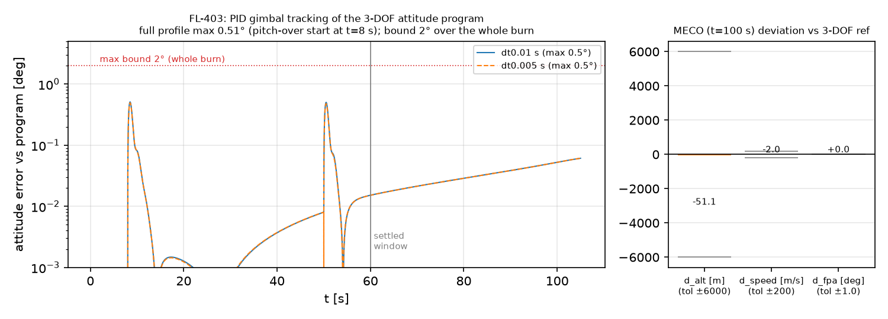
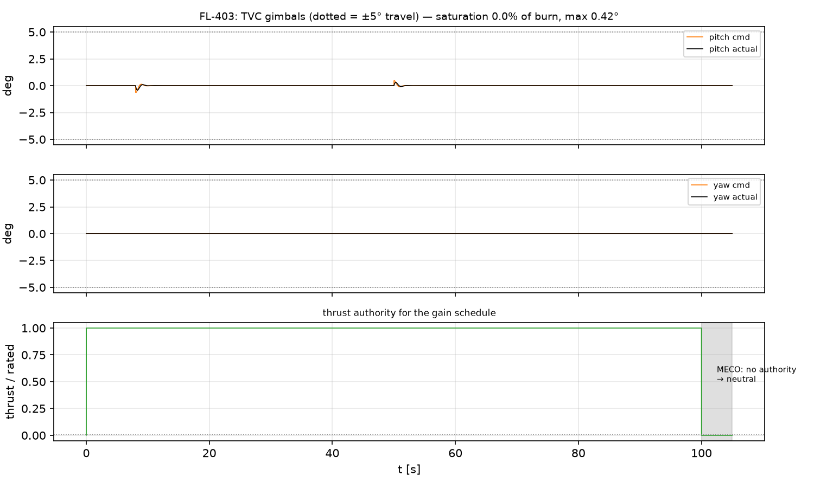
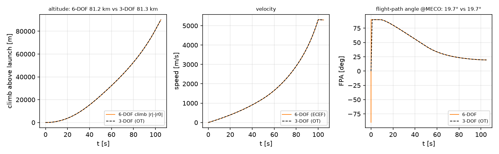

# ADR flightlab-0001: JSBSim as the 6-DOF engine for Flight Lab ascent

- **Status:** Accepted — **GO**
- **Date:** 2026-11-11 (FL-403 numbers corrected 2026-11-11, see "Correction")
- **Deciders:** Flight Lab E4 spike (Epic #196; FL-401 #206, FL-402 #207, FL-403 #208)
- **ContextDB:** `epic187/jsbsim-go-no-go`
- **Aftermath (F-01, task #226):** the GO engine became the formal, config-driven
  6-DOF backend `orbitopt.flightlab.adapters.sixdof` — selectable as
  `backend="6DOF"` in `simulate()` / `orbitopt flight simulate --backend 6DOF`,
  with the vehicle, initial conditions and integration step supplied by scenario
  configs (`orbitopt/data/flightlab/sixdof/fl401_vertical_hop.yaml`,
  `fl402_staging_handoff.yaml`, `fl403_program_tracking.yaml`). The spike drivers
  remain the implementation underneath; the isolated experiment entry point is
  gone (`scripts/fl403_run_spike.py` now just regenerates this ADR's report
  artifacts through the formal backend). MECO is a real throttle cut in the
  formal backend (the spike coasted 5 s with the engine still open; metrics stop
  at MECO, so the numbers here are unchanged).

## Context and problem

Flight Lab's ascent product today is 3-DOF (OpenTsiolkovsky via the FL-004
adapter, Epic #187): it cannot show attitude dynamics, TVC behaviour or
staging artefacts. Epic #196 was a time-boxed spike to answer one question:
**can JSBSim (jsbsim==1.3.3) serve as the 6-DOF engine behind the Flight Lab
contracts** — a liquid stage with gimballed TVC flying the 3-DOF ascent
program, and two vehicles side by side after separation? A NO-GO would mean
falling back to kinematic attitude display over 3-DOF, or re-evaluating
RocketPy / an in-house 6-DOF model.

Three sub-spikes produced evidence:

| Spike | Question | Code |
|---|---|---|
| FL-401 (#206) | Can JSBSim fly our stage model faithfully (thrust, mass, TVC moments, actuator)? | `src/orbitopt/flightlab/sixdof/jsbsim_driver.py`, `src/orbitopt/data/flightlab/jsbsim/aircraft/spike_stage.xml` |
| FL-402 (#207) | Can two independent `FGFDMExec` instances coexist and hand off state (staging)? | `src/orbitopt/flightlab/sixdof/staging.py` |
| FL-403 (#208) | Can a simple PID on the gimbals track the 3-DOF attitude program to MECO (~76–81 km, Mach ~18) and stay close to the 3-DOF trajectory? | `src/orbitopt/flightlab/sixdof/tracking.py` |

## Decision drivers — the GO criteria, declared before the FL-403 run

Declared up front in `tests/test_flightlab_sixdof_tracking_jsbsim.py` (and
the FL-401/402 test files):

1. **Tracking within declared bounds.** Settled phase (t ≥ 60 s, after the
   program-shaping window): attitude error max ≤ 2.0°, RMS ≤ 0.6°.
2. **Gimbal saturation ≤ X % of the burn** with X = 0: the *actuator output*
   (not the command) must never touch the ±5° travel limits while thrusting,
   and commands must stay within travel.
3. **Stable integration.** No non-finite states over the whole flight to
   MECO+5 s (~76 km, Mach 18); dt-halving (0.01 → 0.005 s) agreement:
   MECO altitude < 300 m, speed < 20 m/s, FPA < 0.5°.
4. **Trajectory stays near the 3-DOF reference.** At MECO: |Δalt| ≤ 6 km,
   |Δv| ≤ 200 m/s, |ΔFPA| ≤ 1.0° (generous bounds — the 6-DOF vehicle
   must fly its own attitude schedule, not the 3-DOF one).
5. **Separation works** (FL-402 criteria): momentum residual < 1e-6 rel,
   position continuity < 1 mm, determinism across reruns and step orders.

## Results (FL-403 run, `docs/benchmarks/fl403_tracking_spike.json`,
regenerate with `PYTHONPATH=src python scripts/fl403_run_spike.py`)

Vehicle: the FL-401 spike stage (10 t dry, 60 t prop, Isp 320 s, 1.883 MN,
100 s burn), zero aerodynamics on **both** sides so deviations isolate
attitude/actuator effects; 3-DOF reference: mirrored OpenTsiolkovsky run
(`tests/fixtures/flightlab/opentsiolkovsky/fl403_spike/`,
`scripts/fl403_record_reference.py`). Controller: PID in angular-acceleration
space on the SO(3) geodesic error + pitch rate feed-forward, converted to
gimbal angle through the **live** plant gain `T·arm/I` (gain-scheduled by
instrumented thrust/inertia/CG); actuator lag/slew/travel sit between
command and physics.

| Criterion | Bound | dt = 0.01 s | dt = 0.005 s | Verdict |
|---|---|---|---|---|
| Settled attitude error max (t ≥ 60 s) | ≤ 2.0° | **0.061°** | **0.061°** | PASS |
| Settled attitude error RMS | ≤ 0.6° | **0.036°** | **0.036°** | PASS |
| Whole-burn attitude error max (t ∈ [0.5, 100] s) | report (regression guard ≤ 2.0°) | 0.51° | 0.49° | PASS |
| Gimbal saturation (actuator at ±5° limit) | 0 % of burn | **0.0 %** | **0.0 %** | PASS |
| Peak gimbal deflection (actual; commands also < 5°) | < 5° travel | 0.42° | 0.41° | PASS |
| Body rates (max p / q / r) | report only | ~0 / 2.35 / ~0 °/s | ~0 / 2.32 / ~0 °/s | report |
| MECO altitude deviation (ECEF climb vs OT alt) | ±6 km | **−51 m** (81.20 vs 81.25 km) | −21 m | PASS |
| MECO speed deviation | ±200 m/s | **−2.0 m/s** (5311.8 vs 5313.8) | −1.2 m/s | PASS |
| MECO FPA deviation | ±1.0° | **+0.016°** (19.72° vs 19.71°) | +0.019° | PASS |
| MECO Mach / altitude (stress point) | finite states | Mach 18.9 @ ~81.2 km | Mach 18.9 | PASS |
| dt-halving: MECO altitude / speed / FPA | <300 m / <20 m/s / <0.5° | **30 m / 0.85 m/s / 0.003°** | — | PASS |
| Non-finite states | none | none | none | PASS |
| Separation (FL-402) | momentum 1e-6 rel, pos 1 mm | 1.4e-8 rel / 2.1e-7 m, bit-identical reruns & step orders | — | PASS |

### Correction: the "early program transient" was a bug

The first revision of this ADR reported a **24°** whole-burn error peak in
t < 60 s and explained it as a program the TVC vehicle could not fly near
vertical (`d(el)/dt = q·cos(el)`, "cos(el) → 0 kills pitch authority"). That
explanation was wrong, and acceptance review traced the real cause:

- `tracking.dcm_from_quat` returned the **transpose** of the matrix
  `jsbsim_driver.quat_from_dcm` encodes (body→ECEF instead of `Tec2b`), so
  every attitude quantity the controller and the metrics used was rotated;
- the launch IC `(θ, ψ, φ) = (90°, 90°, 90°)` had been "empirically" tuned so
  that this wrong matrix read zero error at liftoff; in JSBSim's real
  attitude it sat **180° off in roll**, so the pitch-over was steered about
  the wrong body axes (azimuth swung 59°–138° while the program held 90°).

Evidence that it was never the program: the demanded pitch-over is a
constant 1.71 °/s, body pitch rate changes elevation directly (the cos(el)
factor belongs to azimuth), the open-loop plant is decoupled (a pitch
gimbal step produces only q, a yaw step only r, both matching
`T·sin δ·arm/I` to 0.1 %), and the old run used at most 0.86° of the ±5°
gimbal while the error was 20°.

With `dcm_from_quat` fixed (regression test: exact round trip with
`quat_from_dcm`) and the IC set to `(90°, 90°, −90°)` — checked against
JSBSim's `Tec2b` directly: body x = up, y = south, z = east, and a nose-down
gimbal tips the nose east — the same controller and gains track the
whole burn within 0.51°, and the MECO deviation drops from −4.7 km /
−90 m/s to −51 m / −2 m/s. The declared GO criteria are unchanged; the
tests now also guard the whole-burn error (≤ 2°), commands within travel,
and tighter MECO bounds (500 m / 20 m/s / 0.2°).

## Decision: **GO**

All five declared criteria pass with margin. JSBSim 1.3.3, driven through
the thin `SixDofSim` driver, is viable as the E4+ 6-DOF engine:

- physics bookkeeping is exact where it is checkable (FL-401 table:
  Tsiolkovsky to 2e-4 rel, TVC moment exact to 1 %, actuator lag 0.03 %);
- a naïve gain-scheduled PID saturates nothing and holds sub-degree tracking
  over the whole burn (0.51° peak, 0.06° settled) through max-q-free (no
  aero), Mach 19, 81 km — headroom for a real controller and real
  aerodynamics;
- two instances + a proven state-handoff recipe make staging a first-class
  contract (`to_flight_run` already emits a valid three-body FlightRun v1);
- costs are known and bounded: first-order-in-dt convergence (one-frame
  ignition/mass latency), opt-in pip-only dependency (hash-pinned
  `envs/sixdof-requirements.txt`; conda locks untouched), ECEF/geoid altitude
  bookkeeping done in our driver, ~5 k steps/s.

## Consequences

Positive: attitude/actuator effects become simulable inside the Flight Lab
contract types; staging runs are already contract-valid; no new mandatory
dependency.

Negative / accepted: dt-halving convergence is first order (fine for a
display/fidelity layer, would need care in an accuracy budget); jsbsim
wheels exist only for CPython 3.10+/x86_64 macOS+Linux (fine per current
targets); attitude conventions (quaternion/DCM direction, launch IC roll)
are ours to get right and must be tested against JSBSim's own `Tec2b`,
not against our own helpers — the FL-403 correction above is the cautionary
example.

## Follow-up epic draft: "6-DOF ascent & recovery tracking" (E5)

1. Promote the spike driver into `orbitopt.flightlab.sixdof` proper:
   contract-typed `SixDofRun`, config-driven models, no spike fixtures.
2. **Attitude program generator with authority check** (body-rate and
   angular-acceleration limits from plant authority `T·arm/I`), so programs
   faster than FL-403's 1.71 °/s pitch-over are validated before flight.
   Downgraded from "required": the earlier near-vertical infeasibility
   finding was a conversion bug (see Correction), and the FL-403 program
   is flown within 0.51° as is.
3. Real aerodynamics: drag/ST tables on the stage, max-q regression, then
   gravity-turn ascent end-to-end vs 3-DOF with aero on both sides.
4. Staging through the contract: E4 recipe (FL-402) + booster reuse arc and
   upper-stage relight; two-body FlightRun v1 emission in the pipeline.
5. Recovery leg: reentry attitude authority check at declared heat-flux /
   q constraints (`docs/reentry_safety_constraints.md`), landing burn TVC.
6. Perf pass: sample decimation + streaming for the mission-control worker
   (docs/mission-control-worker-lifecycle.md), dt policy study
   (0.02/0.01/0.005) against the FL-403 convergence numbers.
7. Controller upgrade (LQR or gain-scheduled PID+FF on quaternion error)
   only if a driven use-case demands better than the FL-403 sub-degree RMS.

## If this GO is ever overturned, the fallbacks are

1. 3-DOF flight + kinematic attitude display (zero 6-DOF fidelity, zero cost).
2. RocketPy re-evaluation conditions: only if Python-native actuator model
   + aero tables maturity is demonstrated past JSBSim's, incl. the same
   two-instance staging story (RocketPy has no property bus; handoff would
   be a full state re-init each time).
3. In-house 6-DOF re-evaluation conditions: only if a hard requirement
   appears for differentiable or GPU-batched 6-DOF propagation (JSBSim is
   neither), i.e. 6-DOF enters optimisation loops, not just verification.

## Evidence index

- FL-401 findings + gotchas: `docs/flightlab-jsbsim-spike-findings.md` (§FL-401)
- FL-402 proven handoff recipe: same file (§FL-402); ContextDB `e4/staging-handoff/proven-recipe`
- FL-403 spike code: `src/orbitopt/flightlab/sixdof/tracking.py`; tests
  `tests/test_flightlab_sixdof_tracking_jsbsim.py` (thresholds declared at top)
- FL-403 artifacts: `docs/benchmarks/fl403_tracking_spike.json`,
  `docs/assets/fl403_{tracking,gimbal,meco_deviation}.png`, regenerated by
  `scripts/fl403_run_spike.py`; 3-DOF reference by `scripts/fl403_record_reference.py`
- Conventions: ContextDB `e4/jsbsim-spike/conventions`
