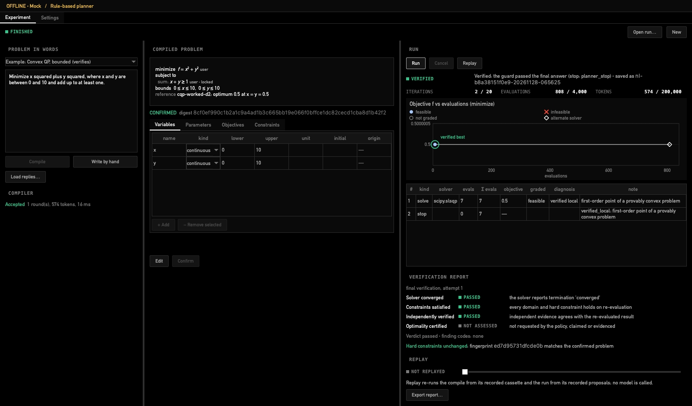
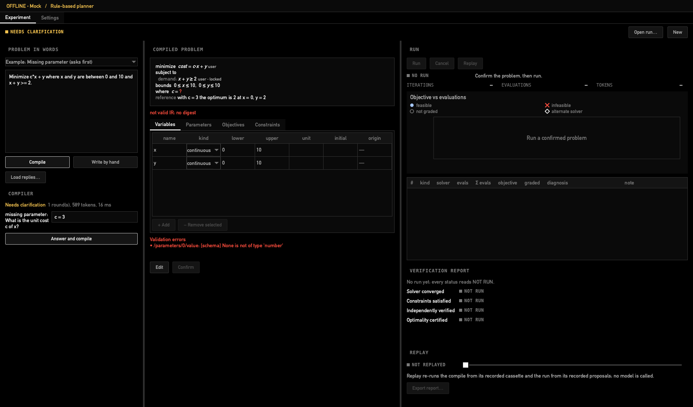
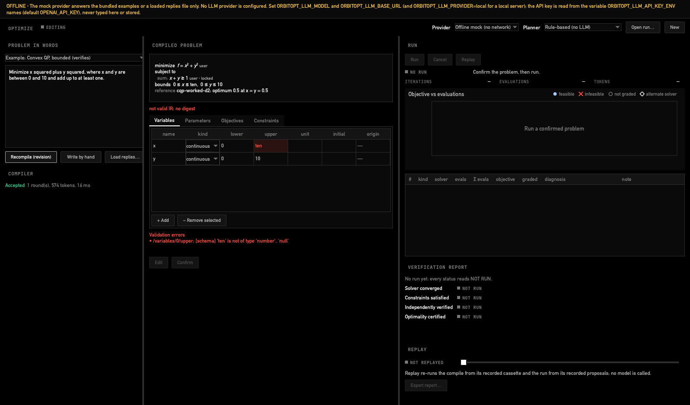
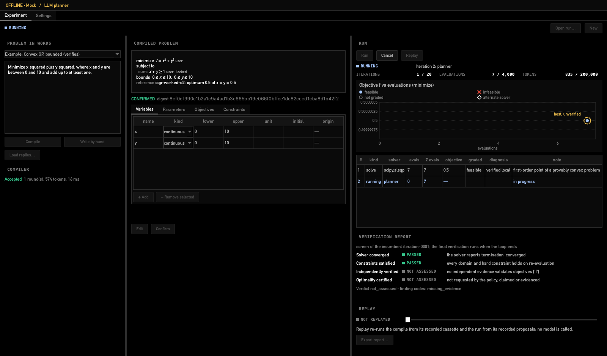
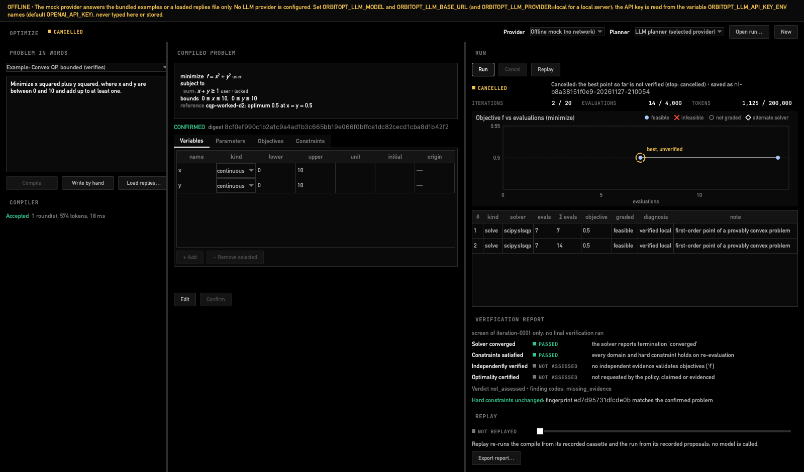
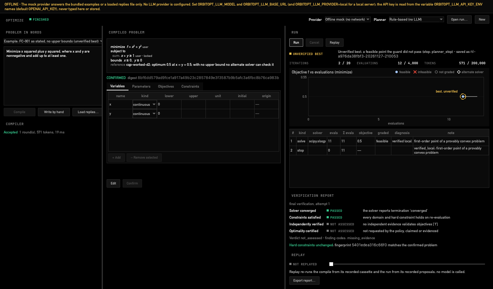
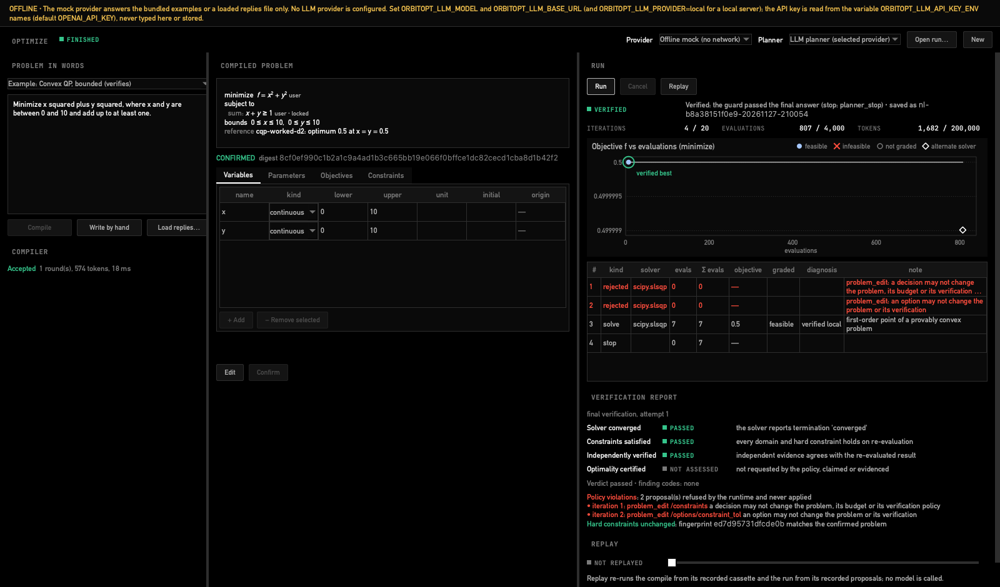
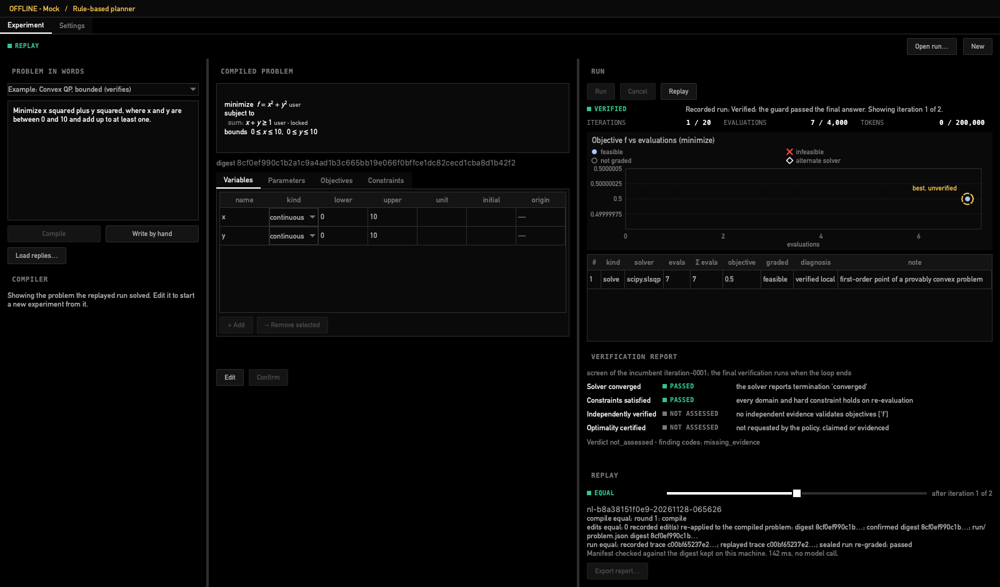

# Optimize workspace

Mission Control's **Optimize** workspace runs the whole E14 chain in one
window. You describe a problem in words, the [compiler](compiler.md) turns it
into an [IR](../optimization/ir.md) problem, and you check and edit that
problem as math. You then confirm it and run the bounded
[runtime](runtime.md). The workspace shows each iteration, the convergence
curve and the [verification guard](../optimization/verification.md)'s four
statuses one by one. A saved run replays without any model call.

Open it from the workspace bar (**Optimize**, or Ctrl/Cmd+5) or from the
command palette. The page has three columns. The left column holds the
problem in words, the centre column the compiled problem, and the right
column the run.

[](../assets/optimization-studio-finished-verified.png)

## Install and providers

The workspace runs the solvers, so it needs the agent extras:

```bash
pip install -e '.[agent]'
```

Without them Mission Control still starts. The Optimize page then shows only
the install hint and the missing modules. Mission Control imports nothing
from `orbitopt.agent` until the page first opens, and no LLM SDK is ever
imported.

The **Provider** list always starts with the offline mock. A real provider
appears only when the environment configures one:

| Variable | Meaning |
|---|---|
| `LLM_MODEL` | The model name. Without it, no real provider is listed. |
| `LLM_BASE_URL` | The endpoint, required for `openai_compat` (`deepseek` and `local` have defaults). |
| `LLM_KIND` | `openai_compat` (default), `deepseek` or `local`. |
| `LLM_API_KEY` | The key. The provider reads it at call time. |
| `LLM_TIMEOUT_S` | Optional request timeout in seconds. |

These are the same variables the CLI's `--provider env` and the E14 campaign
read ([providers](providers.md#configuration-from-the-environment)). To load
them from a file, start Mission Control with `orbitopt --env-file .env app`,
or export them in the shell first with `set -a; . ./.env; set +a`.

The workspace never asks for a key, never shows one and never stores one.
The banner names the key variable and says whether it is set. On the mock,
the amber banner says that only the bundled examples or a loaded replies file
can be compiled. **Load replies…** takes the same JSON list as the CLI's
`--mock-replies`.

The **Planner** list picks the rule-based planner (no LLM, the default) or
the LLM planner on the selected provider. On the mock, the LLM planner solves
once with the most specialised solver offered and then stops.

## Compile

Type a statement or pick one of the bundled examples, then press
**Compile**. The left column shows the outcome with its rounds, tokens and
time.

| Outcome | What you see | Next |
|---|---|---|
| Accepted | The problem opens in the editor, with the compiler's assumptions listed. | Check it, edit it, confirm it. |
| Needs clarification | Each question with an answer field. The compiler's draft opens in the editor, and a missing value shows as a red `?` and a validation error. | Answer and compile again, or finish the draft by hand. |
| Unsupported | The category and the explanation. | Rephrase, or write the problem by hand. |
| Rejected: unauthorised change | The authorisation findings. Your problem is kept as it was. | Say the change in your own words, or keep your version. |
| Compile failed, provider error | The errors. | Compile again, or edit by hand. |

[](../assets/optimization-studio-clarification.png)

An answer is appended to the prompt under `Answers:`, so it becomes the
owner's own words. A later compile can quote it to authorise a change.
**Write by hand** skips the compiler and starts from a one-variable template.

## Edit and confirm

The centre column renders the problem as math: objectives, constraints with
their names, bounds, parameters and units. It also shows the problem class
from `classify` and, for a bundled example, the known reference answer. Each
objective and constraint carries its origin, `user` or `compiler`, and a
constraint shows whether it is locked. There is no math library. The
renderer turns the IR expression into rich text (superscripts, `·`, `Σ`), and
it falls back to the expression text when the expression does not parse.

The tabs under it edit variables, parameters, objectives and constraints
cell by cell. Kinds and senses are picked from a list. Every edit runs the IR
validator, `parse_problem`. Its errors are listed with their JSON-pointer
paths, and the offending cell is tinted with the message as its tooltip. The
digest shows only while the problem is valid.

[](../assets/optimization-studio-editing-error.png)

An edit to an objective or a constraint makes the item yours: its origin
becomes `user`, and a constraint becomes locked. The column lists your
changes to protected items, computed with the compiler's own `revision_diff`.
While you edit, **Compile** becomes **Recompile (revision)**. It sends your
current problem as the base, and the compiler rejects any change to a locked
item that your text does not authorise. Your version then stays as it was.

**Confirm** freezes the problem and shows its digest. Only a confirmed
problem can run, and **Edit** unfreezes it.

## Run, watch and cancel

**Run** solves the confirmed problem on a background thread. The right
column updates after every planner proposal:

- **Meters** show iterations, evaluations and tokens against the run's
  limits. Tokens include the compile's tokens.
- **The convergence curve** plots the objective against cumulative
  evaluations, with the best-so-far line over feasible points only. A filled
  dot is a point the guard found feasible. A red cross is infeasible, a
  hollow circle is a point the guard could not grade, and a diamond is an
  alternate solver's point from the final verification. The best point gets
  a green ring and **verified best** only when the run is verified.
  Otherwise its ring is dashed amber and reads **best, unverified**.
- **The iteration table** lists each proposal: its kind, solver,
  evaluations, objective, the screen's feasibility, the diagnosis and a
  note. A refused proposal is a red `rejected` row.

[](../assets/optimization-studio-running.png)

**Cancel** sets the runtime's cooperative cancel flag. The runtime checks it
before each iteration, so the run stops after the step in flight. The run is
saved like any other with status `cancelled`, and its best point so far is
shown as unverified.

[](../assets/optimization-studio-cancelled.png)

## The verification report

Under **Verification report**, each of the four statuses has its own row,
outcome and reason: solver converged, constraints satisfied, independently
verified and optimality certified. Before any candidate is graded, all four
read `not run`, never `passed`. The line above the rows names the source: the
final verification, or the incumbent's screen while the run is live or when
no final verification ran. The run status badge is green only for
`verified`. An `unverified_best` run is amber and reads
"a feasible point the guard did not pass".

[](../assets/optimization-studio-finished-unverified.png)

The planner can never change the problem. The runtime refuses such a
proposal and never applies it. The workspace lists each refused proposal
with its violation code and path. It also compares the run's
hard-constraint fingerprint with the confirmed problem's.

[](../assets/optimization-studio-policy-violation.png)

**Export report…** writes the report as JSON and as a readable HTML page with
the same four statuses, the violations, the budget and the iterations.

## Experiments and replay

A run saves an experiment directory under `$ORBITOPT_OPTIMIZATION_RUNS`, or
under `./runs/optimization` when that variable is not set:

| Path | Content |
|---|---|
| `studio.json` | Format `orbitopt.studio.experiment/1`: every compile round (prompt, base problem, outcome, result digest), the problem you started editing from, your edits as operations, the provider kind and model, the planner, the seed and the digests. It holds no credential. |
| `compile.cassette.jsonl` | Every compiler call, recorded. A hand-written problem has none. |
| `run/` | The runtime's run directory, as `save_run` writes it. |

The run's manifest digest is also kept in Mission Control's settings, outside
the directory.

**Replay** (this run) and **Open run…** (any experiment or bare run directory)
replay without a model:

1. **compile**: every round runs again from the cassette with a
   `ReplayProvider` and must give the same outcome and result digest.
2. **edits**: the recorded edits run again on the recorded starting problem,
   and the result must match both the confirmed digest and
   `run/problem.json`.
3. **run**: the runtime's `replay` checks every byte and re-executes the
   recorded proposals.

The badge reads **EQUAL** only when no stage diverged. A changed result, a
forged edit list or an edited cassette reads **DIVERGED** and names the
stage. The slider steps through the recorded iterations, and the curve, the
table and the statuses follow it.

[](../assets/optimization-studio-replay.png)

A cancelled run records where the cancel fired (trace 1.1), so `replay`
re-executes it up to that point and reads EQUAL. A cancelled 1.0 trace has no
recorded position and reads DIVERGED, as it does in the runtime.

## Measured latency

Measured offscreen on one machine (macOS arm64, Python 3.12, the
`orbitopt-py312` environment), from the click to the phase change, through
the real background thread. Each value is the median of five repeats, with
the range.

| Action | Median | Range | What limits it |
|---|---|---|---|
| Compile an example (mock) | 55 ms | 54 to 188 ms | The compiler's checks and the cassette write. A real model adds its own latency, which this does not measure. The slow first repeat loads the tool registry. |
| Run the bounded QP to `verified` | 100 ms | 98 to 509 ms | The alternate solvers of the final verification. The slow first repeat imports scipy. |
| Replay that experiment | 141 ms | 139 to 149 ms | Re-running the solvers and the alternate solvers. |
| Run a 10-D Rastrigin (rule planner) | 1.02 s | 1.02 to 1.03 s | Differential evolution's evaluations of the IR expression. |
| Cancel while that run's first solve is in flight | 132 ms | 89 to 199 ms | The rest of the solve in flight (361 ms in all). The runtime checks cancellation only between iterations. |

While a solve runs, a 10 ms UI timer fired with a median gap of 10.4 ms,
a 95th percentile of 24 ms and a worst gap of 142 ms. The solver shares the
Python interpreter lock with the UI thread.

## Tests and screenshots

```bash
QT_QPA_PLATFORM=offscreen PYTHONPATH=src python -m pytest -q tests/test_e14_09_studio.py tests/test_e14_09_studio_widgets.py
QT_QPA_PLATFORM=offscreen PYTHONPATH=src python scripts/capture_optimization_studio.py --out docs/assets
```

`test_e14_09_studio.py` covers the presenter without a window. It checks
legal and illegal transitions, the editor and its validation, locked-item
protection, the clarification flow, and a run to `verified` and to
`unverified_best`. It also checks cancel and replay, replay with no model
call, three kinds of tampering, a malicious scripted planner, and that
providers carry no key. `test_e14_09_studio_widgets.py` drives every state
above through the widgets and their threads, with the same drivers the
screenshot script uses.
