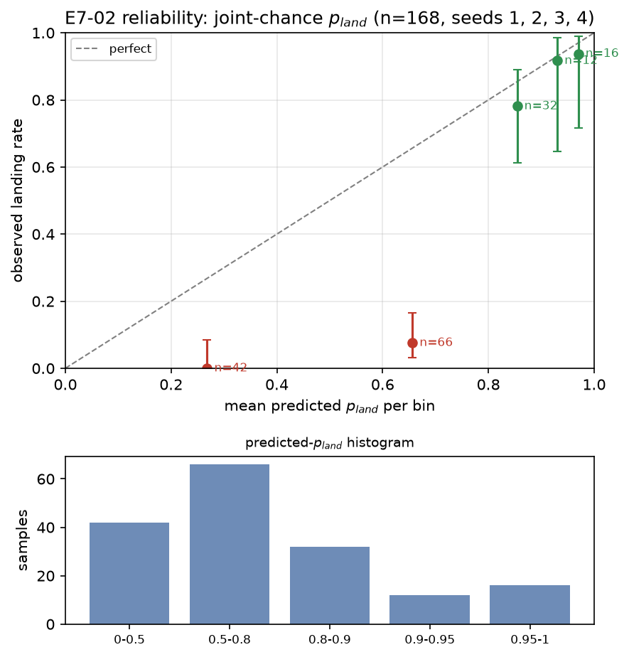

# E7-02 — Probability calibration of the predicted p_land (task #278)

**Evidence:** [e7_02_probability_calibration.json](e7_02_probability_calibration.json)
· **Diagram:** 
· **Script:** [bench_e7_02_probability_calibration.py](../../benchmarks/bench_e7_02_probability_calibration.py)
· **Reader:** [`orbitopt.flightlab.recovery.calibration`](../../src/orbitopt/flightlab/recovery/calibration.py)

## Question and data

The E3-02 joint chance planner forecasts a landing probability (`p_land`,
ADR flightlab-0005 — declared there as *a surrogate, not a guaranteed flight
success rate*). The E3-02 pilot reading (seed 1, n=32) averaged a predicted
**0.705** against an actual success rate of **0.531**, with the low bins
reading as overconfident — but 32 samples cannot say which bins are wrong.
E7-02 grades the forecast on the **E3-03 pooled, multi-seed sample** instead:
the recorded paired rows of
[e3_03_robust_montecarlo.json](e3_03_robust_montecarlo.json), joint-chance
arm, **seeds 1–4, n = 168** (the acceptance floor the script enforces, along
with the multi-seed requirement — the calibration is refused, not quoted, on
less). The benchmark re-runs no physics; the reading is pure post-processing
of recorded evidence and reproduces from the JSON byte-for-byte.

Method: standard classifier calibration — per predicted-probability bin, the
observed conditional landing rate with its 95 % **Wilson score interval**
(the same small-sample-honest interval R-06 quotes), and the verdict
*consistent* / *overconfident* / *underconfident* from whether the bin's
**mean prediction lies inside that interval**; plus the **Brier score**
against the climatology reference (the constant forecast at the pooled rate)
and **ECE / MCE** as the size-weighted mean / maximum of the per-bin gaps.

## Result

Pooled success rate **56/168 = 0.333**; Brier **0.2222** against a
climatology reference of **0.2222** — skill **+0.00006**: as it stands the
per-sample forecast adds *nothing* over quoting the population rate once.
**ECE = 0.313**, **MCE = 0.581**.

| predicted p_land | n | landed | observed | 95 % Wilson | mean pred | verdict |
|---|---|---|---|---|---|---|
| [0.0, 0.5) | 42 | 0 | 0.000 | [0.000, 0.084] | 0.268 | **overconfident** |
| [0.5, 0.8) | 66 | 5 | 0.076 | [0.033, 0.165] | 0.656 | **overconfident** |
| [0.8, 0.9) | 32 | 25 | 0.781 | [0.612, 0.890] | 0.854 | consistent |
| [0.9, 0.95) | 12 | 11 | 0.917 | [0.646, 0.985] | 0.931 | consistent |
| [0.95, 1.0] | 16 | 15 | 0.938 | [0.717, 0.989] | 0.970 | consistent |

The E3-02 pilot pattern is confirmed and quantified: its one pooled number
(0.705 predicted vs 0.531 landed) was the *high-pool* samples of seed 1
carrying the average; the pooled four-seed reading shows the forecast is
**wrong in exactly one direction** — optimistic below 0.8.

## Conclusion — where the model is trustworthy

* **p ≥ 0.8: trustworthy.** All three high bins read *consistent* — the mean
  prediction sits inside the observed Wilson interval (the mild pessimism,
  about 2–7 points, is within what 12–32 samples can distinguish). A
  `min_landing_probability = 0.8`-style constraint is therefore asking the
  surrogate for something it demonstrably delivers, which retroactively
  supports the E3-02/E3-03 acceptance of the joint mode.
* **p < 0.8: not trustworthy, correct before use.** The 0.5–0.8 bin predicts
  0.656 and lands 0.076 (MCE bin, gap −0.58); the 0–0.5 bin predicts 0.268
  and lands 0/42 (Wilson upper bound 0.084 below every prediction in it).
  The surrogate's *ordering* is right (bins are monotone: 0.00 < 0.076 <
  0.781 < 0.917 < 0.938), so the forecast carries information, but its
  *scale* below the 0.8 floor is inflated by roughly 4–9×.

Implications carried to the epic: (a) low-p samples must never be *traded*
on their forecast (a "0.6" plan is empirically a ~0.08 plan — the pilot's
fear of overconfident low bins is now measured); (b) any recalibration
should be monotone with a knot at the 0.8 floor where the model is already
honest (a Platt/isotonic fit on these 168 pooled rows maps the 0.5–0.8 bin
to ≈0.08 and the 0–0.5 bin to ≈0.00, leaving the high bands untouched); (c)
the Brier skill of zero says the *decision-relevant* content of p_land
today is only the threshold comparison at the trustworthy floor, not the
number itself.

Caveats: one mission profile (textbook RTLS ascent) and one dispersion set —
the calibration is for the joint-chance arm's surrogate under the declared
E3-03 uncertainty model, not a general claim about the vehicle; the
n=42–66 low-p Wilson intervals are already tight, but the n=12–16 high-p
intervals are ±14–27 points wide, so "trustworthy" above 0.8 means
"consistent with honest, ±15 points", not "accurate to the third decimal".

## Reproduce

```sh
PYTHONPATH=src python benchmarks/bench_e7_02_probability_calibration.py \
    -o docs/benchmarks/e7_02_probability_calibration.json \
    --plot docs/assets/e7_02_reliability.png
```
