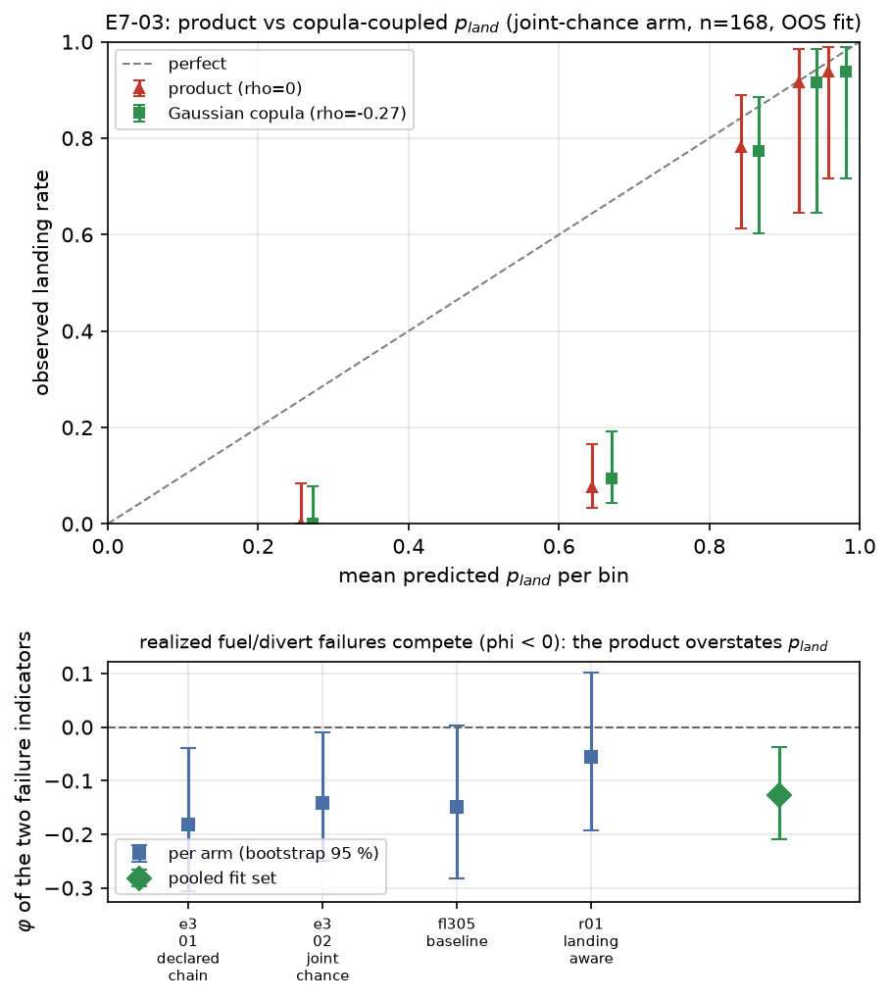

# E7-03 — Joint risk modeling: are fuel and divert failures independent? (task #279)

**Evidence:** [e7_03_joint_risk.json](e7_03_joint_risk.json)
· **Diagram:** 
· **Script:** [bench_e7_03_joint_risk.py](../../benchmarks/bench_e7_03_joint_risk.py)
· **Reader:** [`orbitopt.flightlab.recovery.joint_risk`](../../src/orbitopt/flightlab/recovery/joint_risk.py)
· **Coupling:** [`orbitopt.flightlab.recovery.chance`](../../src/orbitopt/flightlab/recovery/chance.py) (`coupled_joint_probability`)

## Question and data

The joint chance constraint (ADR flightlab-0005) multiplies its two channels:
`p_land = p_fuel × p_divert`. That product is exact **only if the two failure
events are independent** — an assumption E7-03 was opened to test, because
E7-02 had just shown the resulting forecast is systematically optimistic
below 0.8 and an unstated independence error is a candidate mechanism.

The test data is the recorded **E3-03 Monte Carlo**
([e3_03_robust_montecarlo.json](e3_03_robust_montecarlo.json)): all four
arms, seeds 1–4, **168 paired rows per arm** — recorded realized outcomes,
not model output. Each row is read as a pair of failure indicators:

* **fuel failure** — `corridor_fuel_margin_kg < 0`, or governing reason
  `LANDING_PROPELLANT_RESERVE_LOW`;
* **divert failure** — reason `CORRIDOR_MISSED`, or realized position error
  beyond the landing verdict's own tolerance (25.0 m);
* **censored divert** — reason `INSUFFICIENT_PROPELLANT_RESERVE`: the sample
  never reached the corridor, so the fuel channel failed but divert was
  never observed. These 12–38 rows/arm are excluded from the 2×2 (they would
  be counted as divert-*successes* under a fuel-abort — a bias) and their
  effect is reported as Fréchet bounds instead;
* `LANDING_LATERAL_SPEED_EXCEEDED` landings count as **neither** channel:
  a third failure mode the two-channel spec does not model (flagged, not
  hidden); no-corridor/error rows are not evaluated.

## Result 1 — association: independence is rejected

Per-arm 2×2 contingency and Yule **φ** of the two failure indicators
(bootstrap 95 % CI, exact two-sided **Fisher**; the arms share the seed/draw
grid, so per-arm intervals are the conservative reading — they agree in
sign):

| arm | cells [both, fuel, divert, none] | censored | φ | 95 % CI | Fisher p |
|---|---|---|---|---|---|
| e3_01 declared chain | [3, 17, 43, 67] | 38 | **−0.182** | [−0.306, −0.039] | 0.044 |
| e3_02 joint chance | [2, 12, 54, 88] | 12 | −0.141 | [−0.250, −0.010] | 0.088 |
| FL-305 baseline | [3, 14, 44, 69] | 38 | −0.149 | [−0.282, +0.003] | 0.109 |
| R-01 landing-aware | [5, 15, 42, 87] | 19 | −0.055 | [−0.193, +0.102] | 0.610 |
| **pooled (3 non-joint arms)** | [11, 46, 129, 223], n=409 | — | **−0.127** | [−0.208, −0.038] | **0.010** |

**Negative association, significant pooled (exact Fisher p = 0.010; both the
bootstrap and the Fisher-z interval exclude zero).** Fuel and divert
failures *compete*: a sample that burns through its reserve tends to reach
the corridor near its centre (short boostback, small miss), and a big-divert
sample arrives with margin. The pooled observed joint-failure rate is
**0.027 against 0.048 expected under independence** — co-failure is rarer
than the product assumes, so "at least one channel fails" is *more* likely
than `p_fuel × p_divert` admits: **the product overstates `p_land`** — the
same direction E7-02 measured. A Pearson reading of the *continuous* margins
(`corridor_miss_m` vs fuel margin, uncensored rows) agrees: r = −0.13 to
−0.47 per arm, every arm negative.

The censoring is material but does not change the verdict: resolving the
censored rows all-fail / all-succeed on divert moves the pooled φ between
−0.30 and +0.30 (Fréchet bounds) — it widens the interval symmetrically
without moving the point estimate or the significant sign.

## Result 2 — model choice: Gaussian copula

The written basis (also the module docstring):

* **Joint Monte Carlo** — the task's named alternative — *is* this E3-03
  sample: it is what we fit from, not what we plan with. The planner needs
  `p_land` at every corridor handoff of every optimizer step; re-flying the
  campaign per evaluation is exactly the cost the chance constraint exists
  to avoid. A copula is the one-scalar summary of that joint sample the
  chance module can evaluate analytically.
* **Gaussian copula** `p_land = Φ₂(Φ⁻¹(p_fuel), Φ⁻¹(p_divert); ρ)`:
  preserves both declared marginals exactly; monotone in each argument (no
  plan ever buys a higher `p_land` by spending margin — the E7-01/E7-02
  constraint semantics survive); Fréchet-bounded by construction; reduces
  **exactly** to the shipped product at ρ = 0, so the coupling is additive
  to the existing spec (`JointChanceSpec.landing_dependence_rho`), not a
  rewrite. It is radially symmetric, so one ρ couples the failure and the
  success readings with the same correlation.
* A **linear Bernoulli coupling** (`P(both fail) = (1−λ)·p_F p_D +
  λ·min(...)`) was tried and rejected: at the λ the data wants it is
  non-monotone in `p_land` near the corners, which would let the penalized
  optimizer game the constraint.
* ρ is fitted by **one moment match**: the copula's joint-failure
  probability equals the observed joint-failure frequency at the observed
  marginals. One scalar, one moment — the data supports one dependence
  parameter, not a family.

**Fit protocol (honest split):** ρ is fitted on the pooled contingency of
the three arms that did **not** optimize the joint chance
(e3_01 + FL-305 + R-01; ρ_OOS = **−0.273**) and graded on the fourth, the
joint-chance arm. (The joint arm's own in-sample fit, ρ = −0.358, is
reported but never used — the point of the exercise is a coupling the
planner can carry to a new corridor, not a re-fit of the graded sample.)

## Result 3 — the joint model on E7-02's calibration metrics

Same sample, bins and metrics as E7-02 (joint arm, n = 168; ρ = −0.273,
out-of-sample; component probabilities backed out of the recorded
predictions by monotone inversion — reconstruction error against the stored
values is exactly 0.0):

| metric | product (E7-02) | Gaussian copula ρ = −0.273 | Δ |
|---|---|---|---|
| Brier | 0.2222 | **0.2135** | −0.0087 |
| Brier skill vs climatology | +0.0001 | **+0.0392** | +0.039 |
| ECE | 0.3133 | **0.3010** | −0.012 |
| MCE | 0.5807 | **0.5628** | −0.018 |

The reliability table moves exactly where E7-02 said it should: rows slide
down out of the mid-band (0.5–0.8 bin: n 66→63, mean pred 0.656→0.658 as
the weakest members drop into the 0–0.5 bin, n 42→46, pred 0.268→0.260)
and the high bands — the planner's operating region — are untouched
(three `consistent` bins at the top, gaps under 0.08 unchanged).
Sanity anchors confirm the back-out: the implied propellant-loss σ is
1112–1240 kg across the sample against the declared 1169 kg at 29 t
exposure, i.e. the coupled forecast is decomposing the *real* declared
model, not an artifact.

**But the verdict bands do not flip**: after coupling, the 0.5–0.8 bin is
still **overconfident** (0.658 predicted vs 0.095 landed) and the 0–0.5 bin
too. Coupling explains a first, *quantified* chunk of the optimism — a
skill score going from 0.000 to 0.039 on a sample the ρ was never fitted
to — not all of it. E7-02's operational rule is **unchanged**: below 0.8
the forecast still overstates; never trade low-`p_land` samples on it.

## Verdict

**Adopt the Gaussian copula with ρ = −0.273**
(`FITTED_LANDING_DEPENDENCE_RHO`), carried on
`JointChanceSpec.landing_dependence_rho`. Independence is rejected at
p = 0.010, the sign is a mechanism the physics explains, and the OOS model
improves every E7-02 metric on the arm it was not fitted to. The shipped
**default stays ρ = 0.0** (the exact product, byte-identical verdicts) —
flipping the default changes acceptance verdicts across the epic and is
the epic's decision, not this task's; the constant and the record exist so
the flip is a one-field change. The coupling must be quoted as a *partial*
correction: E7-02's calibration verdict and its usage rule stand on top of
this one.
