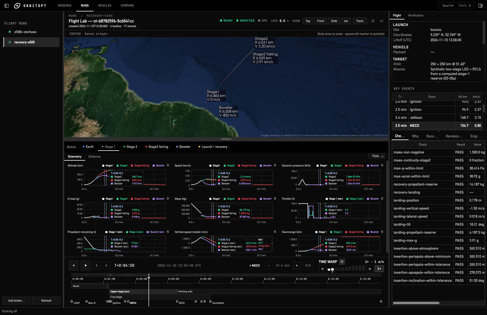

# Flight Lab

Flight Lab simulates ascent and booster recovery from code or the CLI.
Mission Control's **Flight Lab** mode displays saved runs in its shared 3D
view, timeline and inspector.



## Quick start

Install the [compute environment](quickstart.md#installation), fetch the
pinned binary, then run the packaged point-mass example:

```bash
python scripts/fetch_opentsiolkovsky.py
orbitopt flight validate src/orbitopt/data/flightlab/scenarios/leo_two_stage.yaml
orbitopt flight simulate src/orbitopt/data/flightlab/scenarios/leo_two_stage.yaml \
  --vehicle src/orbitopt/data/flightlab/vehicles/synthetic_two_stage.yaml -o runs/leo/
orbitopt
```

Select **Flight Lab** to open the run. To export a standalone scene, use
`orbitopt flight to-scene runs/leo/ -o scene.json`. The
[command reference](https://zangjiucheng.github.io/orbitopt/api/cli/flight/)
lists all options.

## Viewing runs in Mission Control

- **Run list:** scans `./runs`, `ORBITOPT_FLIGHT_RUNS` (platform path separator)
  and remembered **Add folder…** locations. **Refresh** finds new runs;
  `orbitopt launch -o DIR` produces the listed `DIR/ascent` run.
- **Shared view:** selection loads the 3D scene, timeline, Inspector and
  Verification tab. Returning to Missions restores the previous mission.
- **Flight tab:** launch inputs, target/achieved orbit, verdicts, seekable
  events, failure explanations and recovery details.
- **Telemetry:** altitude, speed, dynamic pressure, load, mass and throttle;
  clicking a chart seeks the timeline. **Compare runs…** compares two runs.

Targets and vehicles are edited in YAML or through the Python designer API;
the desktop mode renders runs rather than configuring or flying them.

## Mission pipeline

`flight-lab` runs an ascent through the unified pipeline. `two-stage-leo`
also grades station order, staging, mass, orbit insertion and optional
propagation/recovery:

```bash
orbitopt run src/orbitopt/data/flightlab/mission_leo_two_stage.yaml -o run/scene.json
orbitopt run src/orbitopt/data/mission_two_stage_leo.yaml
```

After separation, upper-stage and booster tracks have separate timeline
lanes and boundary checks. A central-gravity + J2 coast bridges staging gaps;
the post-insertion **display coast** is not verification.
`ascent.mode: run_dir` replays recorded input rather than optimizing an ascent.

The packaged `src/orbitopt/data/mission_two_stage_leo_recovery.yaml` is the
**E2-04 frozen integration fixture**: two-sample, illustrative ascent arcs
with a prescribed 400 km insertion and 35 t of booster propellant at
separation. Its recovery is simulated, but ascent is not re-flown and parking
propagation is explicitly out of scope. It is not evidence of one physically
propagated launch-to-orbit-and-return trajectory. See
[regression procedure](flightlab-regression-ci.md#e2-04-the-frozen-dual-branch-reference-mission-task-257)
and the [acceptance results](acceptance-e1-e4.md).

<span id="fidelity-levels"></span>

## Backend identities and fidelity levels

Canonical identities are recorded in run manifests, verification inputs and
`scene.flightRun.backend`:

| Backend | Scope | Boundary |
|---|---|---|
| `opentsiolkovsky` | Prescribed-attitude point-mass ascent, Cd(Mach), GCRS output. | Default ascent/optimization lineage; no attitude dynamics or TVC. |
| `native-pointmass` | Native US76/J2/rotating-Earth twin with kinematic attitude. | Native comparison plant, distinct from OpenTsiolkovsky. |
| `native-rigidbody` | Native rigid body, coefficient-table aero and lag/rate-limited TVC tracking. | Illustrative reference plant; no complete roll autopilot. |
| `jsbsim` | JSBSim rigid body with live mass/CG/inertia and gimballed TVC, ECEF output. | Base spike aircraft are zero-aero; `spike_stage_aero` is the generated aero-bearing reference. Opt-in, outside ascent optimization. |

`flight simulate --backend opentsiolkovsky|jsbsim` takes a vehicle YAML for
the former and a **JSBSim scenario YAML** for the latter. For the aero-bearing
reference (requires `orbitopt[sixdof]`):

```bash
orbitopt flight simulate src/orbitopt/data/flightlab/scenarios/leo_two_stage.yaml \
  --backend jsbsim --vehicle src/orbitopt/data/flightlab/sixdof/e104_aero_ascent.yaml \
  --no-refly -o runs/e104/
```

This held-vertical ascent exercises the airframe; the 400 km orbit-target
checks are expected to fail. `--no-refly` leaves independent physics
verification unassessed.
`flight mission --backend native-pointmass|native-rigidbody|BOTH` runs the
native comparison. Legacy `3DOF`/`6DOF` aliases resolve within their original
entry point; they are not canonical output identities.

### Aligned-scenario parity (E1-01)

The [parity document](../src/orbitopt/data/flightlab/parity/spike_stage_parity.yaml)
drives native stage construction and checks packaged JSBSim mass, inertia,
propellant, mounting and aero geometry. Shared parameters do not make the
engines identical: the JSBSim spike retains a vacuum-like nozzle and fixed
propellant flow. The generated production airframe adds the aero tables and
cancels the fixed-AERORP/live-CG force couple. See
[ADR 0007](adr/flightlab-0007-production-jsbsim-aero-path.md) for measured
residuals; [ADR 0001](adr/flightlab-0001-jsbsim-6dof.md) covers the base spike.

Recovery remains a separate Earth-fixed 3-DOF chain with J2, rotation,
atmosphere and engine/event models. Selecting a 6-DOF ascent does not make
recovery six-dimensional.

## Verification verdicts

| Run field | Meaning |
|---|---|
| `backend_self_check` | The producing backend's own checks. |
| `physics_verified` | Independent insertion/coast re-flight using TudatPy; JSBSim ECEF output is first bridged to GCRS. |
| `optimizer_converged` | Optimizer verdict, when present. |
| `mission_constraints_passed` | Declared flight-target constraints. |

`null` means unassessed. These fields are independent; a self-check is not an
independent re-flight. See [ADR 0004](adr/flightlab-0004-independent-physics-verification.md).
The mission rollup preserves this flag as independent-model evidence. A false
flag fails orbit injection and the full-mission gate; null remains unassessed.
See the [acceptance results](acceptance-e1-e4.md).

<span id="native-aero-model-and-the-reference-plant-f-02"></span>
<span id="tvc-actuator-and-attitude-tracking-f-04"></span>
<span id="6-dof-vs-3-dof-gravity-turn-ascent-f-05"></span>
<span id="two-stage-separation-and-upper-stage-ignition-f-06"></span>
<span id="mission-outputs-selectable-backends-reports-and-mission-control-f-07"></span>

## 6-DOF studies

**F-05 / E1-02:** grade the powered phase separately from coast. In the
[recorded gravity-turn study](benchmarks/fl605_gravity_turn_ascent.json),
burnout occurs at 99.85 s in a 180 s flight. Powered 6-DOF attitude error is
4.77° peak / 2.78° RMS, alpha 14.34°, max-Q 71.4 kPa and peak
`q·alpha` 483 kPa·deg. The later 62.8° alpha peak occurs in near-vacuum
coast (coast max-Q 0.18 Pa), not at peak aerodynamic loading. The study's
2.13 km altitude, 2.08 m/s speed and 0.47° flight-path-angle differences
are scenario results.

**F-07 / E1-03:** both native backends use the same state-feedback
upper-stage steering law, command limits and periapsis cutoff:

```bash
orbitopt flight mission --backend BOTH -o runs/f07-mission
```

The [guided comparison](benchmarks/fl607_mission_outputs.json) records
226.1/231.5 km peri/apo for the point mass and 221.5/228.6 km for the rigid
body, inside the declared ±25 km bands. The former 235 km altitude difference
falls to 1.65 km. This is a disclosed **non-parity variant** (1 t upper dry
mass, 7 t propellant, 3° gimbal), not the original F-06 vehicle. Shared law
does not mean identical commands along different states or general accuracy.
Runs, handoffs, reports, scenes and residual-attribution data are exported.

**E6-04:** the sampled-data TVC loop is audited against the RK4 plant: the
control law and the stateful guidance are sampled once per integration step
at the step boundary and held across the four stages, so no mid-stage
estimate advances controller state. The audit removed a first-order
integration plateau (1st-order plateau → 2.3e-8 m flat loop output) and a
guidance slew-limiter corruption; the convergence curves and the
`dt_s = dt_c_s = 0.02` default justification live in
[ADR 0008](adr/flightlab-0008-sampled-data-control-and-rk4-plant.md) and
[the recorded sweep](benchmarks/e604_step_convergence.json).

## Hard gates

Orbit and touchdown checks apply the declared velocity, position, orbital,
load and propellant limits. Reports record frames, epochs, units, provenance
and failure reason codes. A pass reaches only the modeled checks and limits;
[full-mission phase verdicts](verification.md#full-mission-verification-gate-e2-03-task-256)
show where evidence is absent or a branch failed.

## What is not modelled

The default ascent is point mass. The models omit CFD-grade aero, structural
loads, slosh, stage collisions, turbulence and range safety. Recovery may use
one steady dispersed wind vector; its re-planning is not an onboard-computer
simulation.

## Vehicle data, provenance and uncertainty

The [vehicle catalog](../src/orbitopt/data/flightlab/vehicles/) contains an
illustrative synthetic vehicle and a Falcon-9-class public estimate, not
official SpaceX performance data. Fields record source/date/provenance;
uncertainty bands can supply Monte Carlo defaults.

## Recovery uncertainty (R-04)

```bash
orbitopt flight montecarlo src/orbitopt/data/flightlab/scenarios/leo_two_stage.yaml \
  --vehicle src/orbitopt/data/flightlab/vehicles/synthetic_two_stage.yaml \
  -n 32 --seed 7 --capture-tracks 240 -o montecarlo.json
```

Pass `--uncertainty unc.yaml` to configure sources independently:

```yaml
uncertainty:
  thrust: {enabled: true, distribution: uniform_pct, half_width_pct: 5.0}
  wind: {enabled: true, distribution: normal, sigma_east_m_s: 4.0,
         sigma_north_m_s: 3.0, sigma_up_m_s: 0.5}
```

Wind affects acceptance re-flight, not the boostback optimizer rollout.
Sampling is fixed-seed deterministic and independent of `--jobs`.

## Recovery Monte Carlo statistics (R-06)

Reports include failure classes, Wilson success-rate intervals and per-source
sensitivity. Joint-dispersion associations are not isolated causal effects.
`--solo-sensitivity` adds one sample pass per active source; `--capture-tracks N`
retains at most N ENU samples per trajectory without changing random draws.

## Nominal / dispersed comparison (R-07)

The [32-sample evidence](benchmarks/r07_nominal_dispersed.json) records 14
landings in each arm. The baseline assumes unlimited TVC bandwidth; the stack
flies 20°/s slew plus 0.2 s lag with compensation. They are not an actuator-
matched comparison. The stack's nominal touchdown is 0.03 m from the pad;
position failures rise from 4 to 7. See
[ADR 0006](adr/flightlab-0006-rate-limited-landing-guidance.md) and
[ADR 0003](adr/flightlab-0003-landing-aware-boostback-objective.md).

## Joint chance-constrained planning (E3-02)

`plan_boostback_entry(joint_chance=...)` replaces the R-01 soft objective
terms with joint fuel, divert/scatter and landing-probability constraints,
combined through a worst-violation penalty. The recorded 32-sample joint arm
lands 17; see [ADR 0005](adr/flightlab-0005-joint-recovery-chance-constraints.md)
and [paired results](benchmarks/e3_02_joint_recovery.json) for assumptions.
Its planning probability is a surrogate, not a guaranteed flight success rate.

## Robust Monte Carlo qualification (E3-03)

The [four-seed study](benchmarks/e3_03_robust_montecarlo.json) uses 168 paired
samples per arm with matched draws and declared 20°/s / 0.2 s actuator physics:

| Arm | Landed / 168 | 95% Wilson interval |
|---|---|---|
| FL-305 baseline | 45 | 20.7–33.9% |
| E3-01 compensation | 49 | 22.8–36.4% |
| R-01 objective | 55 | 26.1–40.2% |
| E3-02 joint chance | 56 | 26.6–40.8% |

Against baseline, exact McNemar p-values are 0.125, 0.0309 and 0.0192,
respectively. These are **unadjusted pairwise** tests, not family-wise
significance claims. E3-02 versus R-01 remains unresolved (two versus one
discordant landings); paired landed-only scatter tests reject nothing.
The [benchmark script](../benchmarks/bench_e3_03_robust_montecarlo.py) records
all sample rows, failure classes and sensitivities. Statistics were recomputed
from those rows in the current acceptance review; the 672 flights were not
re-run.
