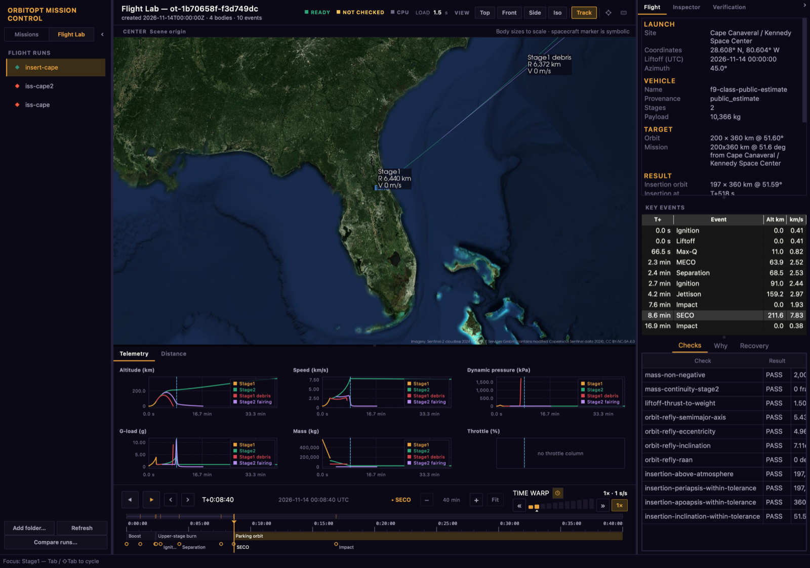

# Flight Lab

Flight Lab simulates rocket ascent and booster recovery. Runs are made from
code or the CLI; Mission Control's **Flight Lab** mode renders them in the same
3D view, timeline and inspector as a mission.



## Quick start

Install the [compute environment](quickstart.md#installation), then fetch the
pinned OpenTsiolkovsky binary and run the included example:

```bash
python scripts/fetch_opentsiolkovsky.py
orbitopt flight validate src/orbitopt/data/flightlab/scenarios/leo_two_stage.yaml
orbitopt flight simulate src/orbitopt/data/flightlab/scenarios/leo_two_stage.yaml \
  --vehicle src/orbitopt/data/flightlab/vehicles/synthetic_two_stage.yaml -o runs/leo/
orbitopt view        # switch to Flight Lab: runs/leo is in the list
```

`orbitopt flight to-scene runs/leo/ -o scene.json` exports the same run as a
plain scene file. See the [command reference](https://zangjiucheng.github.io/orbitopt/api/cli/flight/)
for target export, optimization, simulation and recovery options.

## Viewing runs in Mission Control

Flight Lab only renders runs; it has no designer. Edit the target and vehicle
YAML (or call `orbitopt.flightlab.designer` from code), run the CLI, and the
result shows up in Mission Control.

- **Run list.** The Flight Lab side of the sidebar lists every run directory
  under `./runs`, the folders in `ORBITOPT_FLIGHT_RUNS` (separated by `:`; `;`
  on Windows) and folders added with **Add folder…**, which are remembered.
  `orbitopt launch -o DIR` writes `DIR/ascent`, listed as `DIR`. **Refresh**
  picks up new runs; the marker shows whether the run passed its mission
  constraints.
- **Same view as a mission.** Selecting a run loads it into the 3D view,
  timeline (dragging the playhead pauses), **Inspector** and **Verification**
  tab (staging handoffs included). Switching back to Missions restores the
  mission that was open.
- **Flight tab.** The launch site and coordinates, liftoff epoch and azimuth;
  vehicle and payload; target and achieved insertion orbit; optimizer,
  physics and mission verdicts; the key events (liftoff, max-Q, MECO,
  separation, SECO, …) with altitude and speed at each, which seek the
  timeline when clicked; and **Checks**, **Why** (each failure in plain
  language, with a fix) and **Recovery**.
- **Telemetry tab.** Altitude, speed, dynamic pressure, g-load, mass and
  throttle against mission time, under the view; click a chart to seek.
- **Compare runs…** opens two runs side by side: inputs, outcomes and why
  they differ.

## Mission pipeline

The `flight-lab` mission kind runs an ascent through the unified pipeline. Its
handoff includes frame, epoch, position, velocity and mass; failures produce a
best-effort warning. The `two-stage-leo` reference scenario also grades the
stage boundaries, injection and propagated parking orbit:

```bash
orbitopt run src/orbitopt/data/flightlab/mission_leo_two_stage.yaml -o run/scene.json
orbitopt run src/orbitopt/data/mission_two_stage_leo.yaml
```

Mission Control shows the stages and handoff checks on one timeline. The
post-insertion display coast is not verification. For the reference chain,
only the ascent lineage is graded; a two-body + J2 coast (the gravity the
ascent model flies) bridges the staging gap.
`ascent.mode: run_dir` replays an existing run instead of optimizing it. See
[verification](verification.md) for report meanings.

## Fidelity levels

| Model | Scope |
|---|---|
| Ascent | OpenTsiolkovsky 3-DOF point mass with a prescribed attitude program and Cd(Mach). |
| Recovery | 3-DOF Earth-fixed point mass with J2, rotation, atmosphere, engines and event detection. Monte Carlo re-plans for each dispersed sample. |
| JSBSim 6-DOF | Optional `flight simulate --backend 6DOF` backend. The packaged illustrative vehicles use zero aero; it is outside the optimization loop. See [ADR 0001](adr/flightlab-0001-jsbsim-6dof.md). |
| Native 6-DOF study | A separate RK4 rigid-body reference plant with coefficient-table aerodynamics and TVC tracking; it is not the JSBSim backend. |

<span id="native-aero-model-and-the-reference-plant-f-02"></span>
<span id="tvc-actuator-and-attitude-tracking-f-04"></span>
<span id="6-dof-vs-3-dof-gravity-turn-ascent-f-05"></span>
<span id="two-stage-separation-and-upper-stage-ignition-f-06"></span>
<span id="mission-outputs-selectable-backends-reports-and-mission-control-f-07"></span>

## 6-DOF studies

The native plant uses illustrative Mach/angle coefficient tables, US76,
Earth rotation, J2, thrust and a lag- and rate-limited gimbal. Its basic
tracker does not control roll or represent a complete autopilot. In the
[gravity-turn study](benchmarks/fl605_gravity_turn_ascent.json), the maximum
6-DOF minus 3-DOF differences were 2.13 km in altitude, 2.08 m/s in speed
and 0.47° in flight-path angle for that scenario.

The two-stage study applies equal and opposite separation impulses, then
propagates each stage independently. Compare its native point-mass and
rigid-body backends with:

```bash
orbitopt flight mission --backend BOTH -o runs/f07-mission
```

Outputs include FlightResult runs, handoffs, verification reports, scenes and
a comparison report. In the [recorded comparison](benchmarks/fl607_mission_outputs.json),
the upper stages differed by 235 km at the end: the 6-DOF upper stage was
inertially pointed, while the 3-DOF model followed its prescribed program.
These figures are scenario results, not general accuracy bounds.

## Hard gates

Runs record frames, epochs, units and provenance. Orbit requires the declared
velocity, perigee and inclination checks; landing requires all declared
position, speed and load limits. Verdicts are reproducible through the CLI,
and failures include reason codes. A pass applies only to the stated models
and limits.

## What is not modelled

The default ascent has no 6-DOF attitude dynamics. The models omit CFD-grade
aerodynamics, structural loads, propellant slosh, stage collisions, wind
fields and range safety. Recovery samples can include one steady wind vector,
but no turbulence; guidance re-planning is not an onboard computer simulation.

## Vehicle data, provenance and uncertainty

The [vehicle catalog](../src/orbitopt/data/flightlab/vehicles/) includes an
**illustrative** synthetic vehicle and a Falcon-9-class **public estimate**,
not official SpaceX performance data. Numeric fields record source, date and
provenance; uncertainty bands can supply Monte Carlo defaults. The Flight tab
shows the vehicle's provenance.

## Recovery uncertainty (R-04)

Run recovery dispersions with a target and vehicle:

```bash
orbitopt flight montecarlo src/orbitopt/data/flightlab/scenarios/leo_two_stage.yaml \
  --vehicle src/orbitopt/data/flightlab/vehicles/synthetic_two_stage.yaml \
  -n 32 --seed 7 --capture-tracks 240 -o montecarlo.json
```

`--uncertainty unc.yaml` configures wind, density, thrust, Isp, drag and
separation-state distributions individually. For example:

```yaml
uncertainty:
  thrust: {enabled: true, distribution: uniform_pct, half_width_pct: 5.0}
  wind: {enabled: true, distribution: normal, sigma_east_m_s: 4.0,
         sigma_north_m_s: 3.0, sigma_up_m_s: 0.5}
```

The report records the distributions. Wind enters the acceptance re-flight,
not the boostback optimizer rollout. Sampling is deterministic for a fixed
seed and independent of `--jobs`.

## Recovery Monte Carlo statistics (R-06)

`montecarlo.json` reports failure classes, a Wilson success-rate interval and
per-source sensitivity. Joint-dispersion associations are not isolated
causal effects. `--solo-sensitivity` re-flies each active source alone and
costs one additional sample pass per source. `--capture-tracks N` records up
to N site-ENU points per sample for the envelope plots without changing draws.

## Nominal / dispersed comparison (R-07)

In the recorded 32-sample comparison (seed 1, identical dispersions and
referee), the baseline landed 14 and the newer objective landed 17. The
latter's Wilson interval was [0.36, 0.69]; position failures rose from 4 to 7.
See [ADR 0003](adr/flightlab-0003-landing-aware-boostback-objective.md) and
[the recorded results](benchmarks/r07_nominal_dispersed.json) for the setup
and failure breakdown.

For implementation and reproducibility details, see [JSBSim findings](flightlab-jsbsim-spike-findings.md),
[regression CI](flightlab-regression-ci.md) and
[landing guidance](adr/flightlab-0002-closed-loop-landing-guidance.md).
