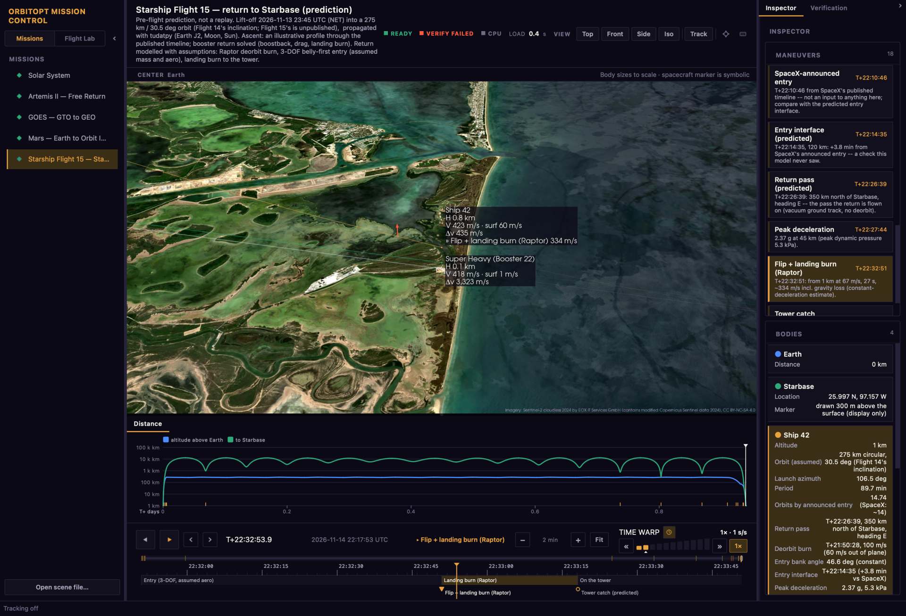

# Using Mission Control

Mission Control links a 3D view, timeline, charts and verification reports.
[Install orbitopt](quickstart.md#installation), then run `orbitopt` and select
a mission in the sidebar.

<figure>

<figcaption>Sentinel-2 cloudless 2024 by EOX IT Services GmbH, containing modified Copernicus Sentinel data 2024 (CC BY-NC-SA 4.0).</figcaption>
</figure>

## Install and open

Built-in scenes open from packaged data. The title bar offers to recompute a
scene if it was made with older code; computed scenes are cached. Open a JSON
scene with *File › Open scene file…*, or use `orbitopt view <mission>` for the
single-scene viewer.

## The window

- **Sidebar:** select a mission or switch to [Flight Lab](flightlab.md).
- **3D view:** select a body; use **CENTER** to change the reference body.
- **Charts:** click or drag the distance chart to change time; the launch-window
  chart shows screened candidates when available.
- **Inspector:** inspect bodies, maneuvers and the selected candidate. Its
  Verification tab shows checks and their tolerances.
- **Timeline:** play, scrub and zoom through the mission.

Panels share the selected body and mission time. Collapse them with their
header chevrons; `I` toggles the right panel.

## Moving around in 3D

| Control | Action |
|---|---|
| Left-drag | Rotate |
| Scroll or right-drag | Zoom |
| Shift-drag or middle-drag | Pan |
| Click a body | Select it |
| Command/Ctrl-click a second body | Measure distance |
| Tab / Shift+Tab | Focus next / previous body |
| `T` / `M` / `R` | Track / focus / reset camera |

The *View* menu also offers fixed camera angles. Selecting a maneuver jumps
to and frames its burn.

## Time and the timeline

### Playing

`Space` plays or pauses forward; `Shift+Space` plays backward. Use
`Shift+Left/Right` for the previous or next event, and `Home` to restart.

### The track

| Control | Action |
|---|---|
| Scroll on track / right-drag | Zoom around cursor / pan |
| Drag the overview bracket | Pan the visible interval |
| Click or drag the ruler | Move time; dragging pauses playback |
| Drag the playhead | Nudge without jumping |
| Shift-drag | Scrub ten times finer |
| Click / double-click an event or phase | Jump / zoom to it |
| `=` / `-` / `0` | Zoom in / out / fit mission |
| Left / Right | Step 1% of visible interval; `Alt` steps 0.1% |

### Going to a time

Click the MET readout or press `G`. Enter an elapsed time such as
`T+22:32:34`, `6m35s` or `1d 02:00:00`; use `+30s` for a relative jump, or
enter a UTC date for a mission with a calendar epoch. A bare number uses the
timeline's unit. Invalid input is outlined in red.

## Time warp

The ladder selects a rate from 0.1× to 10,000,000×; 1× is real time.
Use `,` and `.` to step between levels, `[` and `]` to fine-tune, and `/`
to return to 1×. The clock enables auto-slow near events.

## Reading the flight

### Flight-data labels

Press `L` to toggle labels. **H** is height above the ellipsoid, or **R** is
distance from the scene center. **V** is inertial speed; **surf** is speed
relative to the rotating ground below 120 km. Labels also show cumulative Δv
and the current burn.

### Inspector

Select a body, maneuver or candidate to see its details. Click a maneuver to
jump to its time. The Verification tab lists model assumptions, residuals and
tolerances.

### Charts

The distance chart follows the playhead; clicking or dragging changes mission
time. The launch-window chart shows candidates for supported missions.

## Earth imagery

*View › High-res Earth imagery* enables streamed Sentinel-2 tiles near Earth.
They are cached under `~/Library/Caches/orbitopt/tiles` on macOS or
`~/.cache/orbitopt/tiles` on Linux. Set `ORBITOPT_TILE_CACHE` to change the
cache location or `ORBITOPT_EARTH_TILES=off` to disable downloads.

{: .note }
> Sentinel-2 cloudless 2024 by EOX IT Services GmbH contains modified
> Copernicus Sentinel data 2024 and is licensed
> [CC BY-NC-SA 4.0](https://creativecommons.org/licenses/by-nc-sa/4.0/)
> for non-commercial use. Attribution appears when tiles are displayed.

## Candidates and verification

For optimized missions, select a trajectory to inspect its screening arc and
verification. The badge reads **VERIFIED**, **VERIFY FAILED** or **NOT
CHECKED**. GOES opens unchecked; use its Verification tab to run the TudatPy
re-flight. Verification is conditional on its model and tolerances.

Each check in the Verification tab is labelled as numerical consistency,
model agreement or historical validation; a kind of evidence with no check
reads **not checked**, never passed. See [verification](verification.md).

The Starship Flight 15 report includes independent re-flight, recovery
dispersions, loads and timeline checks. It fails for the assumed 10% lift
reduction. See [mission examples](examples.md) for the assumptions and the
difference between a prediction and a historical comparison.

## Launch missions

A Flight Lab run can also open as a mission in the main view, one continuous
timeline from the pad to orbit: export it with `orbitopt flight to-scene
run/ -o scene.json`, or run a `flight-lab` or `two-stage-leo` config with
`orbitopt run`, then open the scene with *File › Open scene file…*.

- The **phase row** tiles the whole mission: on the pad, boost, staging,
  upper-stage burn, then parking orbit and propagation (a two-body display
  coast after engine cutoff, labelled as display data, not verification).
- Each **stage handoff** carries a verdict. At separation the state and mass
  must be continuous between the stages; at engine cutoff the insertion is
  checked against the target orbit. The verdict appears in the event's note
  on the timeline and in the Verification tab's **MISSION HANDOFFS** section.

See [Flight Lab](flightlab.md#mission-pipeline) for the gates.

## Your own missions

```bash
orbitopt validate my_mission.yaml
orbitopt run my_mission.yaml
orbitopt view my_mission.yaml
```

See [mission configs](quickstart.md#mission-configs). After editing code, use
the title-bar **Reload** button or Command/Ctrl+R to restart the compute worker
and recompute the current mission.

## Keyboard shortcuts

Press `F1` in the app for the complete reference. In addition to the controls
above, `I` toggles the inspector and Command/Ctrl+Q quits.

## Troubleshooting

- **A mission takes minutes to open:** a custom or recomputed scene is being
  calculated; subsequent loads can use the cache.
- **No satellite imagery:** check the View setting, network connection and
  `ORBITOPT_EARTH_TILES`; tiles appear only near Earth.
- **Black 3D area in a screenshot:** use `scripts/capture_screenshots.py`,
  which captures and composites the OpenGL view.
- For other problems, [open an issue](https://github.com/zangjiucheng/orbitopt/issues)
  with the mission and steps to reproduce.
