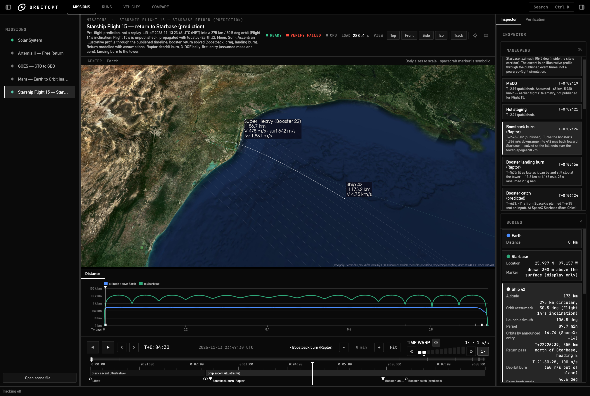

<p align="center">    </p>

<h1 align="center">轨道opt </h1>

<div align="center">

[](https://github.com/zangjiucheng/orbitopt/actions/workflows/ci.yml) [](https://github.com/zangjiucheng/orbitopt/actions/workflows/pages.yml) [](https://zangjiucheng.github.io/orbitopt/docs/) [](https://github.com/zangjiucheng/orbitopt/blob/main/pyproject.toml) [](https://github.com/zangjiucheng/orbitopt/blob/main/LICENSE)

</div>

轨道opt对轨迹与pykep和pygmo进行优化,用tudatpy验证候选人,并探索**Mission Control**的结果. **Flight Lab**模拟发射和助推器恢复,比较保存的运行,并显示车辆剖面与申报的对流数据. CuPy加速批量筛选.



## 快速启动

从仓库检出 :

```bash
micromamba create -n orbitopt -f envs/cpu.conda-lock.yml
micromamba activate orbitopt
pip install -e . --no-deps
orbitopt
```

[installation](https://github.com/zangjiucheng/orbitopt/blob/main/docs/quickstart.md#installation)表示GPU,macOS,Windows和只查看器选项. 命令使用 `orbitopt --help` 。

## 探索

- [Quickstart](docs/quickstart.md):运行YAML任务配置并检查产出.
- [Mission Control](docs/guide.md): 3D view, timeline, telemetry and verification.
- [Flight Lab](docs/flightlab.md):上升段,恢复和运行比较;
  [Vehicle view](https://github.com/zangjiucheng/orbitopt/blob/main/docs/flightlab.md#vehicle-view)显示目录和飞行覆盖.
- [Orbital rendezvous](docs/rendezvous-quickstart.md):打开预先计算的目标与追逐者重播,或从密封计划中建造一个.
- [Closed-loop rendezvous](https://github.com/zangjiucheng/orbitopt/blob/main/docs/rendezvous.md#closed-loop-guidance-e13):参见导航,反馈和安全监督结果.
- [Optimization Studio](docs/agent/studio.md):构建优化问题,运行解析器并检查验证证据.
- [Computed mission](docs/computed-mission.md):重播上升段与恢复,
  然后传播到tudatpy和G-FOLD环境;
  [Kourou/Starbase designs](docs/e5-08-new-vehicle-report.md)报告仍存在资格差距.
- [API reference](docs/api.md):Python接口,CLI命令和计划.

验证适用于已申报的模型和容忍度. 证据界限和限制见[verification](docs/verification.md)和[Flight Lab fidelity](https://github.com/zangjiucheng/orbitopt/blob/main/docs/flightlab.md#backend-identities-and-fidelity-levels).

## 许可证

GPL-3.0-or-later · [License](https://github.com/zangjiucheng/orbitopt/blob/main/LICENSE) · [Third-party notices](https://github.com/zangjiucheng/orbitopt/blob/main/THIRD_PARTY.md).
Copyright © 2026 Jiucheng Zang.
