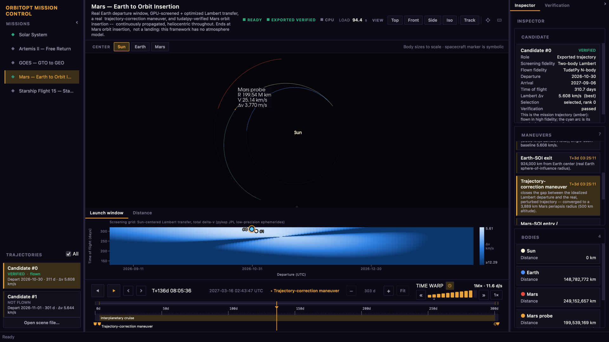

# 轨道选择

[](https://github.com/zangjiucheng/orbitopt/actions/workflows/ci.yml) [](https://github.com/zangjiucheng/orbitopt/actions/workflows/pages.yml) [](https://zangjiucheng.github.io/orbitopt/docs/) [](https://github.com/zangjiucheng/orbitopt/blob/main/pyproject.toml) [](https://github.com/zangjiucheng/orbitopt/blob/main/LICENSE)

轨迹与pykep与pygmo一起进行轨道搜索,用tudatpy验证被选中的候选人,并在**Mission Control**中可视化. **Flight Lab**模拟发射和助推器恢复. CuPy可以加速分批筛选.



[Documentation](https://zangjiucheng.github.io/orbitopt/docs/) · [Quickstart](docs/quickstart.md) · [Mission Control](docs/guide.md) · [Flight Lab](docs/flightlab.md) · [Verification](docs/verification.md) · [API reference](docs/api.md)

## 快开始

从仓库取出 :

```bash
micromamba create -n orbitopt -f envs/cpu.conda-lock.yml
micromamba activate orbitopt
pip install -e . --no-deps

orbitopt             # Mission Control
orbitopt missions    # list missions
orbitopt view mars   # single-scene viewer
```

[installation](https://github.com/zangjiucheng/orbitopt/blob/main/docs/quickstart.md#installation) 对于GPU,Windows,macOS和只查看器选项.

## CLI

```bash
orbitopt validate examples/mars2020_replay.yaml
orbitopt run examples/mars2020_replay.yaml
orbitopt launch --site cape-canaveral --vehicle synthetic_two_stage \
  --orbit 400x400@51.6 --date 2026-11-14 -o launch/
orbitopt benchmarks
```

`orbitopt --help`列出命令;[quickstart](docs/quickstart.md)包含输出和需要的依赖.

## 任务配置

YAML种类包括`geo-raising`,`mars-transfer`,`lunar-free-return`,`flight-lab`和`two-stage-leo`. 见[mission configs](https://github.com/zangjiucheng/orbitopt/blob/main/docs/quickstart.md#mission-configs)和[examples](docs/examples.md).

## 验证报告

报告记录模型,数字设置,剩余和证据类别. 通行证仅适用于所声明的检查和假设;GOES默认装载**未检查**,未经验证的火星结果可能是**尽最大的努力**. 见[verification](docs/verification.md).

## Mission Control

桌面应用程序链接到 3 D 视图、时间表、图表和 验证 检查员。 其Flight Lab模式使出并比较了运载火箭的运行. 见[guide](docs/guide.md)和[Flight Lab](docs/flightlab.md).

## 与实际任务核对

[Validation examples](docs/examples.md)区分历史对比与基于目标的检查.

## 业绩

在RTX A3000 笔记本电脑GPU上,2百万兰伯特解想将17.7与CuPy对82.8与NumPy(4.7××). 结果取决于硬件和批量大小;见[performance overview](https://zangjiucheng.github.io/orbitopt/#results).

## 版式

`src/orbitopt/`包含优化,验证,Flight Lab,任务管和可视化;`examples/`,`docs/`和`tests/`包含它们的例子,向导和回归测试. 用 `cd docs && bundle install && bundle exec jekyll serve` 预览网站 。 自动中文评论副本见[translation workflow](https://github.com/zangjiucheng/orbitopt/blob/main/translations/README.md).

## 无相机安装

场景格式和取景器可以单独安装;完整的轨迹优化和验证需要[conda environment](https://github.com/zangjiucheng/orbitopt/blob/main/envs/README.md).

## 二. 经验教训

See [engineering notes](docs/engineering-notes.md) for numerical and UI
pitfalls and the [Mars plan](docs/mars_mission_plan.md) for model assumptions.

## 限制

- 批量的兰伯特解析器支持零革命;多革命案例
  使用 pykep. 低-推力优化未被实施.
- 轨道验证省略了太阳辐射压力,拖动和相对性.
- Cislunar GPU 筛选使用一种大致的麻黄素,其范围包括:
  距其SPICE种子约十天.
- 火星目标可能无法汇合;模拟任务在轨道上结束
  插入,而不是着陆。 Flight Lab使用简化动态和公用或
  说明性车辆数据;其6-DOF后端是选入和外接.
  上升段优化器. 见[fidelity and limitations](https://github.com/zangjiucheng/orbitopt/blob/main/docs/flightlab.md#fidelity-levels).

## 许可证

GPL-3. 0-或-后. 见[LICENSE](https://github.com/zangjiucheng/orbitopt/blob/main/LICENSE)和[third-party notices](https://github.com/zangjiucheng/orbitopt/blob/main/THIRD_PARTY.md). 版权所有:2026 Jiucheng Zang.
