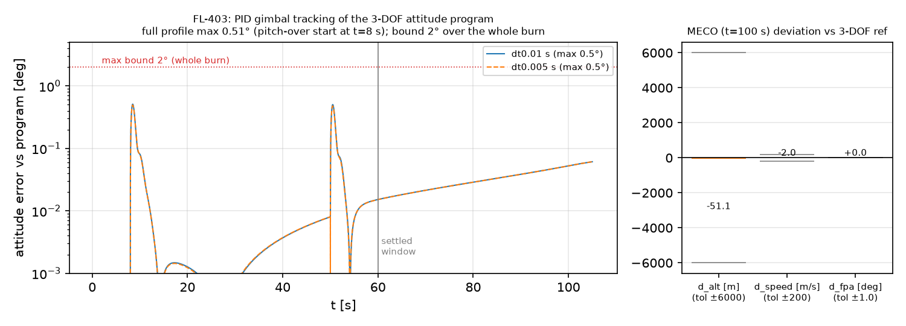
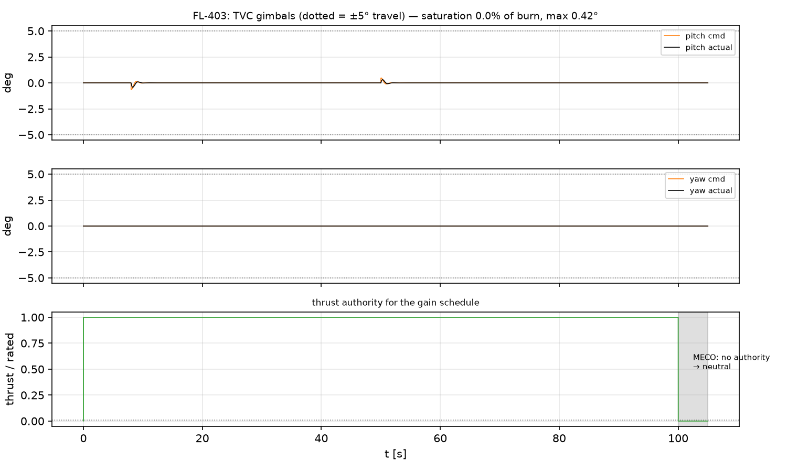
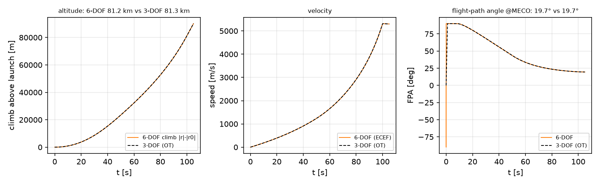

# ADR flightlab-0001: JSBSim as the 6-DOF engine for Flight Lab ascent

- **Status:** Accepted — **GO**
- **Date:** 2026-11-11 (FL-403 numbers corrected 2026-11-11, see "Correction")
- **Deciders:** Flight Lab E4 spike (Epic #196; FL-401 #206, FL-402 #207, FL-403 #208)
- **ContextDB:** `epic187/jsbsim-go-no-go`
- **Aftermath (F-01, task #226):** the GO engine became the formal, config-driven
  6 - DOF后端 `orbitopt.flightlab.adapters.sixdof` - 可选为
  `backend="6DOF"`在`simulate()`/`orbitopt flight simulate --backend 6DOF`,
  车辆、初始条件和根据设想提供的整合步骤
  配置(`orbitopt/data/flightlab/sixdof/fl401_vertical_hop.yaml`,
  `fl402_staging_handoff.yaml`, `fl403_program_tracking.yaml`). The spike drivers
  继续下面的执行; 孤立的试验切入点是:
  (`scripts/fl403_run_spike.py`现在刚刚重现ADR的报告)
  文物通过正式的后端). MECO是一个真正的油门切
  正式的后端(发动机仍开着的尖端海岸5; 公制停止)
  at MECO, so the numbers here are unchanged).

## 背景和问题

Flight Lab's ascent product today is 3-DOF (OpenTsiolkovsky via the FL-004
adapter, Epic #187): it cannot show attitude dynamics, TVC behaviour or
staging artefacts. Epic #196 was a time-boxed spike to answer one question:
**can JSBSim (jsbsim==1.3.3) serve as the 6-DOF engine behind the Flight Lab
contracts** — a liquid stage with gimballed TVC flying the 3-DOF ascent
program, and two vehicles side by side after separation? A NO-GO would mean
falling back to kinematic attitude display over 3-DOF, or re-evaluating
RocketPy / an in-house 6-DOF model.

三个分公司提供了证据:

| 斯派克语Name | 问题 | 代码 |
|---|---|---|
| FL-401 (#206) | JSBSim能否忠实地驾驶我们的舞台模型(推力,质量,TVC瞬间,动力)? | `src/orbitopt/flightlab/sixdof/jsbsim_driver.py`, `src/orbitopt/data/flightlab/jsbsim/aircraft/spike_stage.xml` |
| FL-402 (#207) | 两个独立的`FGFDMExec`例能共存并交出状态(Stage)吗? | `src/orbitopt/flightlab/sixdof/staging.py` |
| FL-403 (#208) | Can a simple PID on the gimbals track the 3-DOF attitude program to MECO (~76–81 km, Mach ~18) and stay close to the 3-DOF trajectory? | `src/orbitopt/flightlab/sixdof/tracking.py` |

## 决策驱动程序——GO标准,FL-403运行前宣布.

`tests/test_flightlab_sixdof_tracking_jsbsim.py`(以及FL-401 / 402测试文件)中宣布:

1. **Tracking within declared bounds.** Settled phase (t ≥ 60 s, after the
   程序形状窗口: 姿态错误 最大 ≤ 2.0 Z °, RMS 0.6 Z °.
2. **Gimbal 饱和度**与X=0:*激活器输出*
   (不是命令)不得在推力时触碰±5 °的旅行限制,
   命令必须留在旅行中。
3. **Stable integration.** No non-finite states over the whole flight to
   MECO+5 s (~76 km, Mach 18); dt-halving (0.01 → 0.005 s) agreement:
   MECO海拔 < 300,速度 < 20/s,FPA < 0.5°.
4. **Trajectory stays near the 3-DOF reference.** At MECO: |Δalt| ≤ 6 km,
   |Δv| ≤ 200 m/s, |QQ: 计划生育| • 1.0 °(通用界限——6-DOF车)
   must fly its own attitude schedule, not the 3-DOF one).
5. **离职工作**(FL-402标准):动力残基 < 1e-6雷尔,
   位置连续性 < 1 mm, 跨越重排和步令的确定性。

## 结果(FL-403运行,`docs/benchmarks/fl403_tracking_spike.json`,
与 `PYTHONPATH=src python scripts/fl403_run_spike.py` 重生 )

Vehicle: the FL-401 spike stage (10 t dry, 60 t prop, Isp 320 s, 1.883 MN,
100 s burn), zero aerodynamics on **both** sides so deviations isolate
attitude/actuator effects; 3-DOF reference: mirrored OpenTsiolkovsky run
(`tests/fixtures/flightlab/opentsiolkovsky/fl403_spike/`,
`scripts/fl403_record_reference.py`). Controller: PID in angular-acceleration
space on the SO(3) geodesic error + pitch rate feed-forward, converted to
gimbal angle through the **live** plant gain `T·arm/I` (gain-scheduled by
instrumented thrust/inertia/CG); actuator lag/slew/travel sit between
command and physics.

| 标准 | 约束 | dt = 0.01 s | dt = 0.005 s | 判决 |
|---|---|---|---|---|
| 解析姿态误差最大值(t ≥ 60 s) | ≤ 2.0° | **0.061°** | **0.061°** | PASS |
| 解决姿态错误 RMS | ≤ 0.6° | **0.036°** | **0.036°** | PASS |
| Whole-burn attitude error max (t ∈ [0.5, 100] s) | report (regression guard ≤ 2.0°) | 0.51° | 0.49° | PASS |
| Gimbal 饱和度( ± 5 ° 极限 ) | 0 % of burn | **0.0 %** | **0.0 %** | PASS |
| 峰值 gi偏移( 实际; 命令也 < 5 °) | < 5 ° 旅行 | 0.42° | 0.41° | PASS |
| 体率(最高p/q/r) | 只报告 | ~ 0 / 2.35 / ~ 0 °/s | ~ 0 / 2.32 / ~ 0 °/s | 报告 |
| MECO高度偏差(ECEF攀比OT alt). | ± 6公里 | **−51 m** (81.20 vs 81.25 km) | −21 m | PASS |
| MECO 速度偏移 | ± 200 m/s | **- 2.0米/秒**(5311.8对5313.8). | - 1.2米/秒 | PASS |
| MECO FPA deviation | ±1.0° | **+0.016°**(19.72 °对19.71 °). | +0.019° | PASS |
| MECO 马赫/高度(压力点) | 有限国家 | Mach 18.9 @~81.2公里 | Mach 18.9 | PASS |
| dt-hallving: MECO高度/速度 / FPA | < 300 m / < 20 m/s / < 0.5 ° | **30 m / 0.85 m/s / 0.003°** | — | PASS |
| 非无限国家 | 无 | 无 | 无 | PASS |
| 离职(FL-402) | 1e-6雷尔, pos 1毫米 | 1.4e-8 rel / 2.1e-7 m,位数相同的重运行和步骤命令 | — | PASS |

  

### 校正: "早期程序瞬间" 是一个错误

这辆ADR的第一修订版在t < 60 s中报告了**24°**全烧误差峰值,并解释说,TVC型机车不能在垂直附近飞行(`d(el)/dt = q·cos(el)`,"cos(el)~0杀死投球权威")是一个程序. 这种解释是错误的,接受审查追溯到真正的原因:

- `tracking.dcm_from_quat` 返回矩阵的 **转写**
  `jsbsim_driver.quat_from_dcm` encodes (body→ECEF instead of `Tec2b`), so
  控制器和所用测量尺度的每个姿态量均被旋转;
- the launch IC `(θ, ψ, φ) = (90°, 90°, 90°)` had been "empirically" tuned so
  在JSBSim的真实中
  它坐着**180 ° 滚开**的姿态, 所以投手被引导在
  the wrong body axes (azimuth swung 59°–138° while the program held 90°).

Evidence that it was never the program: the demanded pitch-over is a
constant 1.71 °/s, body pitch rate changes elevation directly (the cos(el)
factor belongs to azimuth), the open-loop plant is decoupled (a pitch
gimbal step produces only q, a yaw step only r, both matching
`T·sin δ·arm/I` to 0.1 %), and the old run used at most 0.86° of the ±5°
gimbal while the error was 20°.

With `dcm_from_quat` fixed (regression test: exact round trip with
`quat_from_dcm`) and the IC set to `(90°, 90°, −90°)` — checked against
JSBSim's `Tec2b` directly: body x = up, y = south, z = east, and a nose-down
gimbal tips the nose east — the same controller and gains track the
whole burn within 0.51°, and the MECO deviation drops from −4.7 km /
−90 m/s to −51 m / −2 m/s. The declared GO criteria are unchanged; the
tests now also guard the whole-burn error (≤ 2°), commands within travel,
and tighter MECO bounds (500 m / 20 m/s / 0.2°).

## 决定:**GO**

All five declared criteria pass with margin. JSBSim 1.3.3, driven through
the thin `SixDofSim` driver, is viable as the E4+ 6-DOF engine:

- 物理簿记的准确位置是可以核对的(FL-401表:
  Tsiolkovsky 到 2e-4 rel, TVC 精确到 1%, 起动器落后 0.03% ;
- 一个天真增益的PID饱和无所事事,并拥有亚度跟踪
  整个燃烧(0.51 °峰值,0.06 °定居)通过最大-q自由(无)
  Aero),Mach 19,81 km——一个真正的控制器和真实的室.
  空气动力学;
- two instances + a proven state-handoff recipe make staging a first-class
  合同(`to_flight_run`已经发出有效的三体飞行Run v 1);
- 成本是已知的和有限度的:一阶即时汇合(一个框架)
  点火/质量耐久性),仅限选择进入的依赖性(hash-pind)
  `envs/sixdof-requirements.txt`;孔达锁未动),ECEF/地理高度
  我们的司机做了记账 ~ 5 k steps/s.

## 后果

积极因素:Flight Lab合同类型中的态度/演算效应变得具有模拟性;中转运行已经具有合同效力;没有新的强制性依赖性。

Negative / accepted: dt-halving convergence is first order (fine for a
display/fidelity layer, would need care in an accuracy budget); jsbsim
wheels exist only for CPython 3.10+/x86_64 macOS+Linux (fine per current
targets); attitude conventions (quaternion/DCM direction, launch IC roll)
are ours to get right and must be tested against JSBSim's own `Tec2b`,
not against our own helpers — the FL-403 correction above is the cautionary
example.

## Follow-up epic draft: "6-DOF ascent & recovery tracking" (E5)

1. Promote the spike driver into `orbitopt.flightlab.sixdof` proper:
   合同型`SixDofRun`,配置驱动模型,无悬索固定装置.
2. **带权限检查的态度程序生成器**(体率和
   `T·arm/I`),所以程序
   比FL-403的1.71 °/s的投球在飞行前被验证快.
   从"要求"降级:较早的近垂直不可行性
   查找是一个转换错误( 参见更正) , 和 FL-403 程序
   在0.51°以内飞行。
3. 真正的空气动力学:在舞台上拖动/ ST表,最大-q回归,然后
   重力转动上升段端对3-DOF两侧有气.
4. 通过合同粘贴:E4配方(FL-402)+助推器再利用弧和
   上级复光; 双体FlightRun v 1在管道中的排放.
5. 回收段:在申报的热流进行再入境姿态权威检查。
   q限制(`docs/reentry_safety_constraints.md`),登陆燃烧TVC.
6. 佩尔夫通行证:供任务控制人员使用的销毁样本+流线
   (文件/任务控制-工人生命周期.md), dt政策研究
   (0.02 / 0.01 / 0.005 )与FL-403的汇合数对齐.
7. 控制器升级(LQR或增益计划PID+FF关于四角错误).
   只有在驱动的用例要求优于FL-403次度RMS时.

## 如果GO被推翻了 倒计时就是

1. 3 - DOF飞行+运动姿态显示(零 6 - DOF忠誠,零成本).
2. RocketPy 重新评价条件: 只有当 Python - 内在作用者 模型
   + 空气表的成熟度在JSBSim的,包括. 同样的
   (RocketPy没有地产总线;交接会)
   成为一次完全的状态再动一次。
3. 内部 6 - DOF 重新评价条件:只有在硬性要求时
   appears for differentiable or GPU-batched 6-DOF propagation (JSBSim is
   6-DOF进入优化循环,而不只是验证.

## 证据指数

- FL-401 调查结果 + 获得:`docs/flightlab-jsbsim-spike-findings.md`(§FL-401)
- FL-402 已验证的交接配方:相同文件(§FL-402);背景DB `e4/staging-handoff/proven-recipe`
- FL-403钉码:`src/orbitopt/flightlab/sixdof/tracking.py`;测试.
  `tests/test_flightlab_sixdof_tracking_jsbsim.py`(在顶端宣布的阈值)
- FL-403文物:`docs/benchmarks/fl403_tracking_spike.json`,
  `docs/assets/fl403_{tracking,gimbal,meco_deviation}.png`,由
  `scripts/fl403_run_spike.py`; 3 - DOF 引用 `scripts/fl403_record_reference.py`
- 公约:背景DB `e4/jsbsim-spike/conventions`
