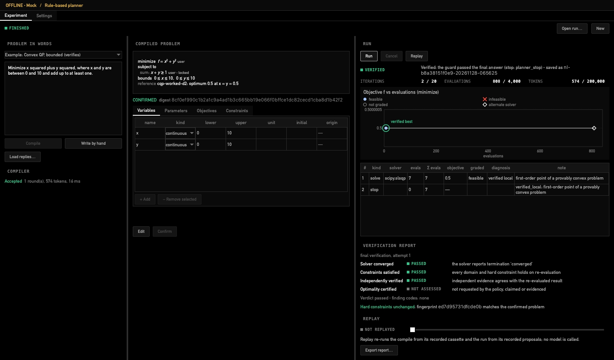
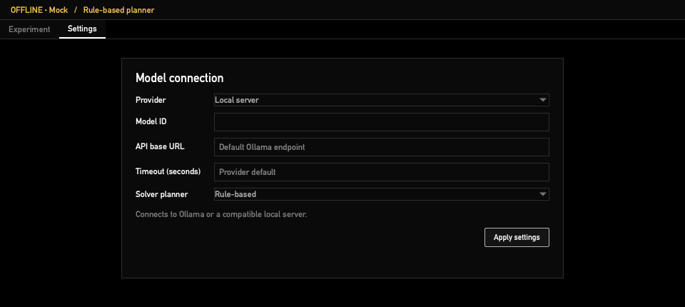
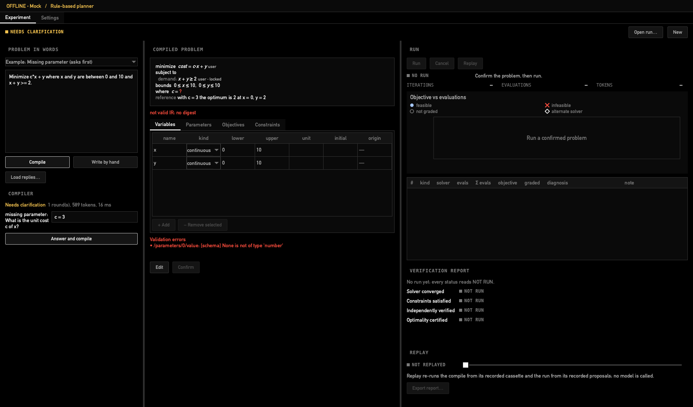
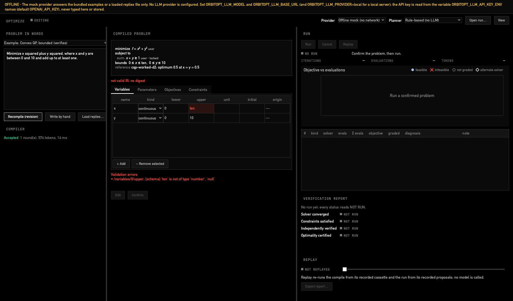
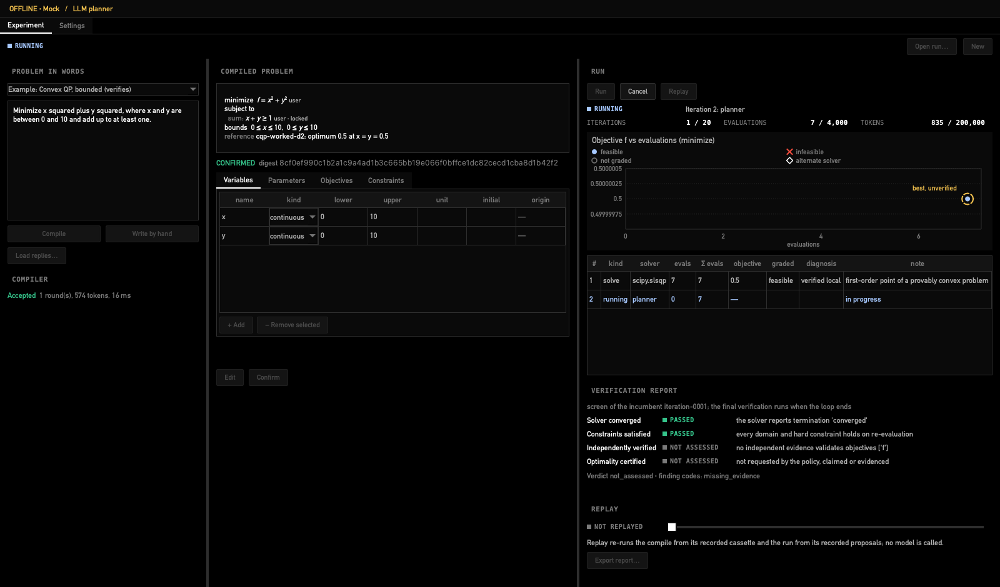
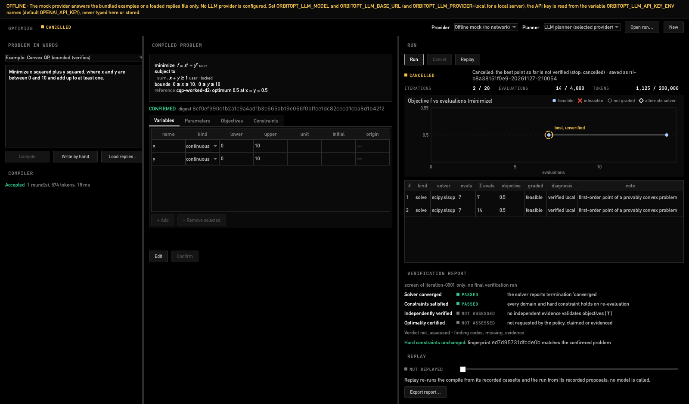
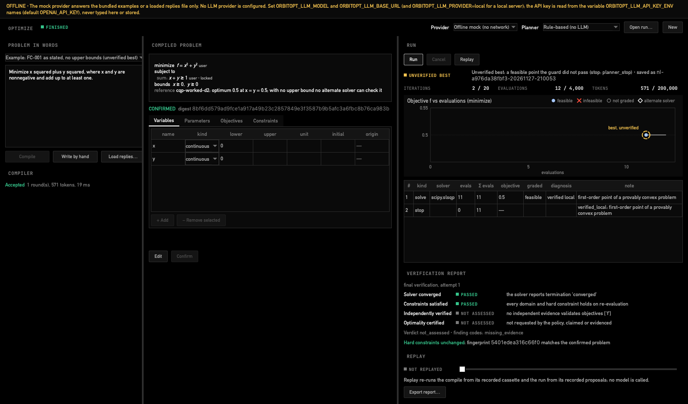
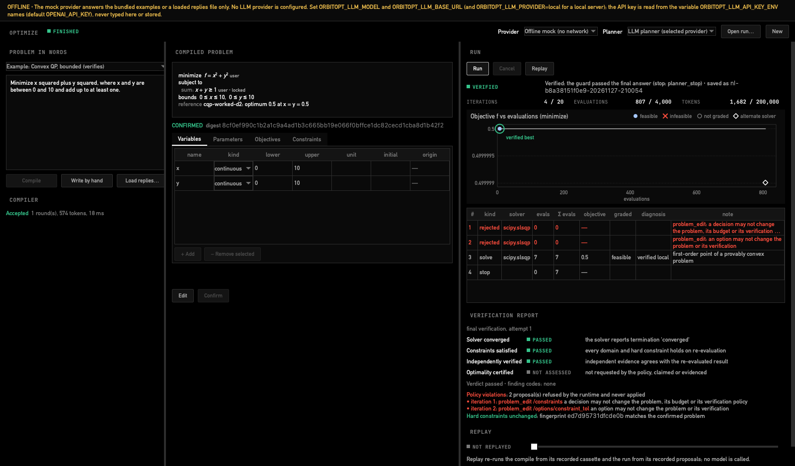
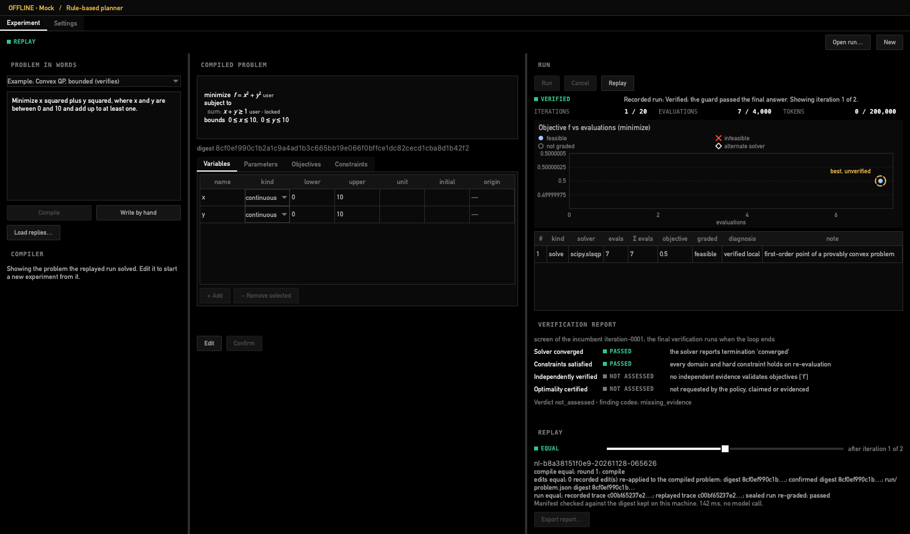

# 优化工作空间

Mission Control的**优化**工作空间在一个窗口中运行整个E14链. 您用文字描述一个问题,[compiler](compiler.md)将它变成[IR](../optimization/ir.md)问题,您将这个问题作为数学来检查和编辑. 然后确认并运行[runtime](runtime.md) 工作空间显示每个迭代,汇合曲线和[verification guard](../optimization/verification.md)的四个状态逐一显示. 保存的运行回放没有模型呼叫.

Open it from the workspace bar (**Optimize**, or Ctrl/Cmd+5) or from the
command palette. **Experiment** has three columns. The left column holds the
problem in words, the centre column the compiled problem, and the right
column the run.

[](https://raw.githubusercontent.com/zangjiucheng/orbitopt/main/docs/assets/optimization-studio-finished-verified.png)

## 安装和提供者

工作空间运行解析器,所以需要代理外加:

```bash
pip install -e '.[agent]'
```

Without them Mission Control still starts. The Optimize page then shows only
the install hint and the missing modules. Mission Control imports nothing
from `orbitopt.agent` until the page first opens, and no LLM SDK is ever
imported.

Open **Optimize → Settings** to select a provider and a solver planner.
**Offline mock** compiles bundled examples or a JSON replies file loaded in
**Experiment**. **Environment (LLM_*)** uses the same
[variables as the CLI](https://github.com/zangjiucheng/orbitopt/blob/main/docs/agent/providers.md#configuration-from-the-environment).
Start with `orbitopt --env-file .env app` to load them from a file.

**本地服务器**,**OpenAI 兼容**或**深层搜索**,进入模型 ID和任何需要的API基座URL. 您也可以设定每个请求的超时 。 密钥提供者在通话时间读作`LLM_API_KEY`. **应用设置**在本地保存连接细节和计划员,而不保存证书.

**规则**计划者选择没有模型调用的解析器. 选择 **LLM** 来使用该步骤的选定提供者 。 横幅显示活跃的模型和规划者两页.

[](https://raw.githubusercontent.com/zangjiucheng/orbitopt/main/docs/assets/optimization-studio-settings.png)

## 编译

键入语句或选择一个捆绑的示例,然后按 **编译**. 左栏以回合,符号和时间显示结果.

| 结果 | 你看见的 | 下一个 |
|---|---|---|
| 获得接受 | 问题在编辑器中打开,其中列出了编译器的假设. | 检查它,编辑它,确认它。 |
| 需要澄清 | 每个问题都有答案字段。 编译器的草稿在编辑器中打开,一个缺失的值显示为红色的`?`和验证错误. | 回答和再编译,或手写草稿. |
| 不支持 | 分类和解释。 | 重写,或用手写问题. |
| 拒绝:未经批准更改 | 授权结论。 你的问题一直没变 | 说你自己的话,或者保留你的版本。 |
| 编译失败, 提供者错误 | 错误 | 再次编译,或手工编辑. |

[](https://raw.githubusercontent.com/zangjiucheng/orbitopt/main/docs/assets/optimization-studio-clarification.png)

`Answers:`下的提示后附有一个答案,因此它成为了主人自己的单词. 后来的编译可以引用它来授权更改. **手写**跳过编译器,并从一个可变模板开始.

## 编辑和确认

中心列使问题成为数学:目标,限制及其名称,界限,参数和单位. 它还显示了来自`classify`的问题类,对于一个捆绑的例子,也显示了已知的参考答案. 每个目标和约束都带有它的起源,`user`或`compiler`,一个约束表明它是否被锁定. 没有数学库。 渲染器将IR表达式变为丰富的文本(上标,`·`,`Σ`),当表达式不解析时,它又回到表达式文本.

它下面的标签按单元格编辑变量,参数,目标和约束单元格. 善良和感官是从列表中挑选出来的. 每次编辑都会运行IR验证器,`parse_problem`. 它的错误用他们的JSON-指针路径列出,违法的细胞以信息作为工具提示来涂色. 摘要仅在问题有效时显示 。

[](https://raw.githubusercontent.com/zangjiucheng/orbitopt/main/docs/assets/optimization-studio-editing-error.png)

编辑到一个目标或一个约束使项目成为你的:它的起源变为`user`,一个约束变为锁定. 列列出您对保护项的更改, 用编译器自己的 `revision_diff` 计算 。 在您编辑时, **编译**变成 **汇编(修订)**. 它将您当前的问题作为基础发送, 编译器拒绝对您文本不授权的锁定项目的任何更改 。 然后,你的版本保持不变。

**确认**冻结问题并展示其文摘. 只有确认的问题才能运行,**编辑**解冻.

## 运行、 监视和取消

**运行**解决了背景线上确认的问题. 右栏在每个规划员提案后更新:

- **计量** 显示重复、评价和符号,
  限制。 托肯斯包括编译符号.
- **交汇曲线** 将目标设定为累积
  评估,仅以可行点为准。 满
  点是警卫认为可行的点。 红色十字架是行不通的,一个
  空心圆是守卫不能分级的点 钻石是
  交替解析器的点从最后的 验证. 最好的点是
  绿色戒指和**校验最佳** 只有在运行被证实时
  Otherwise its ring is dashed amber and reads **best, unverified**.
- **重复表**列出每项提案:其种类,解题者,
  评价、目标、屏幕的可行性、诊断和
  注释。 一个被拒绝的提议是红色的`rejected`行.

[](https://raw.githubusercontent.com/zangjiucheng/orbitopt/main/docs/assets/optimization-studio-running.png)

**取消**设置运行时间合作取消旗. 运行时间在每次迭代前检查,因此运行在飞行步骤后停止. 运行像其它状态的`cancelled`一样被保存,其迄今为止的最佳点被显示为未验证.

[](https://raw.githubusercontent.com/zangjiucheng/orbitopt/main/docs/assets/optimization-studio-cancelled.png)

## 验证报告

在**验证报告**下,四个状态中每个状态都有自己的行,结果和理由:解子汇合,约束满足,独立核实和优化认证. 在任何候选人被评分之前,所有四人都读作`not run`,从未读作`passed`. 行上方的行命名了源:最终的验证,或者在运行时或没有最终的验证运行时的现任者屏幕. 运行状态徽章只有`verified`的绿色. `unverified_best`跑是琥珀,读作"警卫没有通过的一个可行的点".

[](https://raw.githubusercontent.com/zangjiucheng/orbitopt/main/docs/assets/optimization-studio-finished-unverified.png)

计划者永远无法改变问题。 运行时间拒绝了这样的提议,并且从未应用过. 工作空间列出了每个被拒绝的提案及其违反代码和路径. 这也比较了跑步硬约束的指纹与确认的问题的指纹.

[](https://raw.githubusercontent.com/zangjiucheng/orbitopt/main/docs/assets/optimization-studio-policy-violation.png)

**导出报告...**将报告写成JSON, 以及可读的HTML页面,

## 实验和重播

运行在 `$ORBITOPT_OPTIMIZATION_RUNS` 下或 `./runs/optimization` 未设置变量时保存实验目录 :

| 路径 | 内容 |
|---|---|
| `studio.json` | 格式 `orbitopt.studio.experiment/1`:每个编译回合(即时,基础问题,结果,结果摘要),您开始编辑的问题,您作为操作编辑的问题,提供者类型和模型,计划者,种子和摘要. 它没有证书。 |
| `compile.cassette.jsonl` | 每一个编译器呼叫,记录。 一个手写的问题没有。 |
| `run/` | 运行时间的运行目录,如`save_run`所写. |

运行的表单摘要也保存在目录外的Mission Control的设置中.

**重播**(此运行)和**打开运行...**(任何实验或裸运行目录)重播,没有模型:

1. **编译**:每轮再次从磁带中运行,
   `ReplayProvider`,必须给出同样的结果和结果摘要.
2. **编辑**:录制的编辑在录制的开始问题上再次运行,
   并且结果必须与确认的文摘和
   `run/problem.json`.
3. **运行**:运行时间的`replay`检查每一个字节并重新执行.
   记录提案。

The badge reads **EQUAL** only when no stage diverged. A changed result, a
forged edit list or an edited cassette reads **DIVERGED** and names the
stage. The slider steps through the recorded iterations, and the curve, the
table and the statuses follow it.

[](https://raw.githubusercontent.com/zangjiucheng/orbitopt/main/docs/assets/optimization-studio-replay.png)

A cancelled run records where the cancel fired (trace 1.1), so `replay`
re-executes it up to that point and reads EQUAL. A cancelled 1.0 trace has no
recorded position and reads DIVERGED, as it does in the runtime.

## 计量延迟

Measured offscreen on one machine (macOS arm64, Python 3.12, the
`orbitopt-py312` environment), from the click to the phase change, through
the real background thread. Each value is the median of five repeats, with
the range.

| 行动 | 中间 | 范围 | 什么限制 |
|---|---|---|---|
| 编译示例( mock) | 55 ms | 54至188 ms | 编译员的支票和录音带 真正的模型增加了自己的耐久性,这并不能衡量. 缓慢的首次重复加载工具注册. |
| 运行已绑定的 QP 到 `verified` | 100 ms | 98至509 ms | 最终验证的候补解析者. 缓慢的首次重复进口 切片。 |
| 重播实验 | 141 ms | 139至149 ms | 复运行解者及别解者. |
| 运行 10 - D Rastrigin(规则规划器) | 1.02 s | 1.02 to 1.03 s | 差异演化对IR表达的评价. |
| 当运行的第一个解答在飞行中时取消 | 132 ms | 89至199 ms | 其余的解析在飞行中(361 ms in all). 运行时间检查仅在迭代之间取消. |

While a solve runs, a 10 ms UI timer fired with a median gap of 10.4 ms,
a 95th percentile of 24 ms and a worst gap of 142 ms. The solver shares the
Python interpreter lock with the UI thread.

## 测试和截图

```bash
QT_QPA_PLATFORM=offscreen PYTHONPATH=src python -m pytest -q tests/test_e14_09_studio.py tests/test_e14_09_studio_widgets.py
QT_QPA_PLATFORM=offscreen PYTHONPATH=src python scripts/capture_optimization_studio.py --out docs/assets
```

`test_e14_09_studio.py`无窗覆盖介绍者. 它检查合法和非法的过渡,编辑器及其验证,锁定的项目保护,澄清流程,并运行到`verified`和`unverified_best`. 它还检查取消和重播,重播时没有模型呼叫,有三种篡改,恶意的脚本策划者,提供商不携带密钥. `test_e14_09_studio_widgets.py`通过部件及其线程驱动上面的每个州,与截图脚本使用的驱动程序相同.
