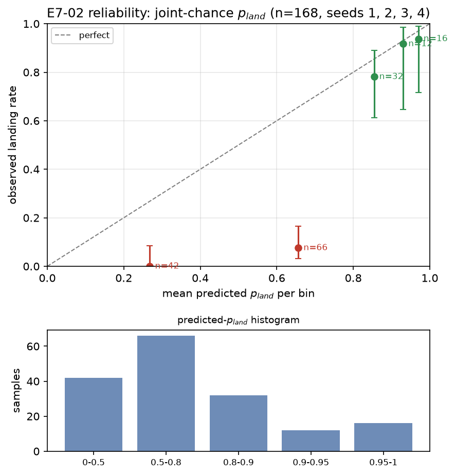

# E7-02 — Probability calibration of the predicted p_land (task #278)

**Evidence:** [e7_02_probability_calibration.json](https://github.com/zangjiucheng/orbitopt/blob/main/docs/benchmarks/e7_02_probability_calibration.json) · **Diagram:**  · **Script:** [bench_e7_02_probability_calibration.py](https://github.com/zangjiucheng/orbitopt/blob/main/benchmarks/bench_e7_02_probability_calibration.py) · **Reader:** [`orbitopt.flightlab.recovery.calibration`](https://github.com/zangjiucheng/orbitopt/blob/main/src/orbitopt/flightlab/recovery/calibration.py)

## 问题和数据

E3-02联合机会规划师预测着陆概率(`p_land`,ADR飞行实验室-0005——在那里宣布为*代理机,不能保证飞行成功率*). E3-02飞行员读数(种子1,n=32)平均为预测的**0.705**与实际成功率为**0.531**,低位的弹匣读数为过度自信——但32样本不能说哪个弹匣错了. E7-02 排名为**E3-03 集合多种子样本**的预测:记录的对齐的[e3_03_robust_montecarlo.json](https://github.com/zangjiucheng/orbitopt/blob/main/docs/benchmarks/e3_03_robust_montecarlo.json), 联合支架,**种子 1 – 4,n = 168**(脚本执行的接受层,以及多种子要求——校准被拒绝,而不是引用较少). 基准重运行无物理;读取纯粹是记录证据的后处理,并从JSON字节转录.

方法:标准分级器校准——按预测概率本计算,观测到的有条件着陆率以95%**威尔逊得分间隔**(同样的小-抽样-诚实间隔R-06引号),以及从该站是否为**预言就在那个间隔之内**的判决*一致*/*过度自信*/*信心不够*; 加上**布莱尔分数**与气候学参考(按集合率的恒定预测),**ECE / MCE**作为尺寸加权平均值/每个宾空的最大值.

## 结果

**56/168 = 0.333**; Brier **0.2222** 与气候学参考的**0.2222** ——技能**+0.00006** :目前每例预测中,*无* 比引用人口比率一次。 **ECE = 0.313**,**MCE = 0.581**.

| 预测的_土地 | 无 | 着陆 | 观察 | 95 % Wilson | 预值 | 判决 |
|---|---|---|---|---|---|---|
| [0.0, 0.5) | 42 | 0 | 0.000 | [0.000, 0.084] | 0.268 | **overconfident** |
| [0.5, 0.8) | 66 | 5 | 0.076 | [0.033, 0.165] | 0.656 | **overconfident** |
| [0.8, 0.9) | 32 | 25 | 0.781 | [0.612, 0.890] | 0.854 | 一致 |
| [0.9, 0.95) | 12 | 11 | 0.917 | [0.646, 0.985] | 0.931 | 一致 |
| [0.95, 1.0] | 16 | 15 | 0.938 | [0.717, 0.989] | 0.970 | 一致 |

The E3-02 pilot pattern is confirmed and quantified: its one pooled number
(0.705 predicted vs 0.531 landed) was the *high-pool* samples of seed 1
carrying the average; the pooled four-seed reading shows the forecast is
**wrong in exactly one direction** — optimistic below 0.8.

## 结论——模型值得信赖

* **p ≥ 0.8: trustworthy.** All three high bins read *consistent* — the mean
  预测位于观测到的威尔逊间隔内(温和的悲观主义,
  about 2–7 points, is within what 12–32 samples can distinguish). A
  因此,`min_landing_probability = 0.8` - 式约束要求
  代用它可以证明的东西, 追溯
  支持 E3-02 / E3-03 接受联合模式.
* **p < 0.8: not trustworthy, correct before use.** The 0.5–0.8 bin predicts
  0.656与土地0.076(MCE bin,空隙~0.58);0 – 0.5 bin预测0.268.
  并着陆0 /42(维尔逊上部将0.084 绑在它的每一个预测之下).
  替补的*命令*是正确的(宾为单音:0.00 < 0.076 >
  0.781 < 0.917 < 0.938),因此预测中包含信息,但其信息.
  *比额表*下方的0.8楼面被大约4 – 9 ×充气.

Implications carried to the epic: (a) low-p samples must never be *traded*
on their forecast (a "0.6" plan is empirically a ~0.08 plan — the pilot's
fear of overconfident low bins is now measured); (b) any recalibration
should be monotone with a knot at the 0.8 floor where the model is already
honest (a Platt/isotonic fit on these 168 pooled rows maps the 0.5–0.8 bin
to ≈0.08 and the 0–0.5 bin to ≈0.00, leaving the high bands untouched); (c)
the Brier skill of zero says the *decision-relevant* content of p_land
today is only the threshold comparison at the trustworthy floor, not the
number itself.

Caveats: one mission profile (textbook RTLS ascent) and one dispersion set —
the calibration is for the joint-chance arm's surrogate under the declared
E3-03 uncertainty model, not a general claim about the vehicle; the
n=42–66 low-p Wilson intervals are already tight, but the n=12–16 high-p
intervals are ±14–27 points wide, so "trustworthy" above 0.8 means
"consistent with honest, ±15 points", not "accurate to the third decimal".

## 重现

```sh
PYTHONPATH=src python benchmarks/bench_e7_02_probability_calibration.py \
    -o docs/benchmarks/e7_02_probability_calibration.json \
    --plot docs/assets/e7_02_reliability.png
```
