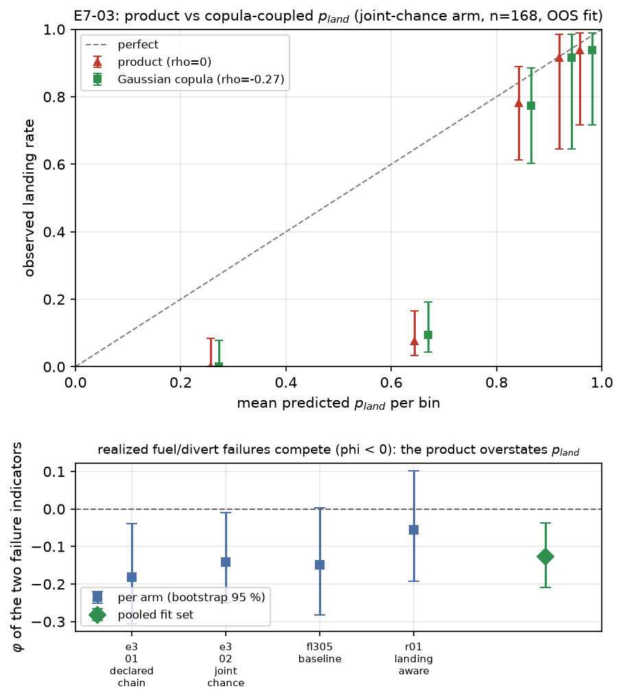

# E7-03 — Joint risk modeling: are fuel and divert failures independent? (task #279)

**Evidence:** [e7_03_joint_risk.json](https://github.com/zangjiucheng/orbitopt/blob/main/docs/benchmarks/e7_03_joint_risk.json) · **Diagram:**  · **Script:** [bench_e7_03_joint_risk.py](https://github.com/zangjiucheng/orbitopt/blob/main/benchmarks/bench_e7_03_joint_risk.py) · **Reader:** [`orbitopt.flightlab.recovery.joint_risk`](https://github.com/zangjiucheng/orbitopt/blob/main/src/orbitopt/flightlab/recovery/joint_risk.py) · **Coupling:** [`orbitopt.flightlab.recovery.chance`](https://github.com/zangjiucheng/orbitopt/blob/main/src/orbitopt/flightlab/recovery/chance.py) (`coupled_joint_probability`)

## 问题和数据

联合机缘限制(ADR飞行实验室-0005)乘以其两个频道:`p_land = p_fuel × p_divert`. 该产品是准确的**只有两个失败事件是独立的**——一个假设是E7-03被打开测试的,因为E7-02刚刚表明所产生的预测在0.8以下是系统性乐观的,一个未声明的独立错误是一个候选机制.

测试数据是所记录的**E3-03 Monte Carlo**([e3_03_robust_montecarlo.json](https://github.com/zangjiucheng/orbitopt/blob/main/docs/benchmarks/e3_03_robust_montecarlo.json)):全部四臂,种子1 – 4,**168每臂对排** – 记录的实现结果,而不是模型输出. 每行读作一对失败指标:

* **燃料故障** — `corridor_fuel_margin_kg < 0`,或治理原因.
  `LANDING_PROPELLANT_RESERVE_LOW`;
* **转移失败** — 原因 `CORRIDOR_MISSED`, 或已实现的位置错误
  超过着陆判决本身的容忍度(25.0);
* **经审查的分流**——原因`INSUFFICIENT_PROPELLANT_RESERVE`:样本.
  从来没有到达过走廊, 所以燃料通道失败了,但转移了
  从来没有观察到。 这些12 – 38行/臂不包含在2 → 2(它们会
  - *成绩*在燃料破坏下,
  效果报告为Fréchet约束;
* `LANDING_LATERAL_SPEED_EXCEEDED`登陆计为**都没有**频道:
  第三个失败模式,双通道光谱不为 模型(标记,不是)
  隐藏);无孔/错误行不进行评估。

## 结果1——结社:拒绝独立.

两种故障指标中的单臂2×2意外事故和Yule **φ**(bootstrap 95%CI,精确双侧**费舍尔**; 武器共享种子/拖网,

| 手臂 | [ 两者,燃料,分流,无] | 已审查 | φ | 95 % CI | 费舍尔p |
|---|---|---|---|---|---|
| e 3 _ 01 申报链 | [3, 17, 43, 67] | 38 | **−0.182** | [−0.306, −0.039] | 0.044 |
| e 3 _ 02 联合机会 | [2, 12, 54, 88] | 12 | −0.141 | [−0.250, −0.010] | 0.088 |
| FL-305基线 | [3, 14, 44, 69] | 38 | −0.149 | [−0.282, +0.003] | 0.109 |
| R-01 登陆意识 | [5, 15, 42, 87] | 19 | −0.055 | [−0.193, +0.102] | 0.610 |
| **pooled (3 non-joint arms)** | [11, 46, 129, 223], n=409 | — | **−0.127** | [−0.208, −0.038] | **0.010** |

**Negative association, significant pooled (exact Fisher p = 0.010; both the bootstrap and the Fisher-z interval exclude zero).** 燃料和分流故障 *竞争* :一个通过储备燃烧的样本往往会到达其中心附近的走廊(短的回升,小的失落),一个大凹槽样本带着边角到达. 集合观测到的联赛失败率是**0.027对0.048期望独立.**——联赛失败率比产品假设的少,因此"至少一个信道失败"是*更多*很可能比`p_fuel × p_divert`承认:**产品超标 `p_land`**——测量的同一个方向是E7-02. 皮尔逊读到*连续*差值(`corridor_miss_m` vs 燃料差值,未经检查的行数)后,同意:r = − 0.13到~0.47每条手臂,每条手臂负数.

The censoring is material but does not change the verdict: resolving the
censored rows all-fail / all-succeed on divert moves the pooled φ between
−0.30 and +0.30 (Fréchet bounds) — it widens the interval symmetrically
without moving the point estimate or the significant sign.

## 结果 2 — 模型 选择:高斯木板

书面基础( 也为模块标记) :

* **联合蒙特卡洛**——任务命名替代——*这是*这个E3-03
  样本:这是我们所适应的,而不是我们所规划的。 计划员需要
  `p_land`在每一个优化步骤的每个走廊交接;
  每个评价的竞选活动恰恰是存在的机会制约的成本。
  以避免。 剪刀是联合样本的单板总结
  机会模块可以进行分析评估。
* **Gaussian copula** `p_land = Φ₂(Φ⁻¹(p_fuel), Φ⁻¹(p_divert); ρ)`:
  准确地保留两个已声明的边; 每个参数中的单调( 无)
  plan ever buys a higher `p_land` by spending margin — the E7-01/E7-02
  限制语义生存; Fréchet 由构造约束;
  **没错**到运出的产品在 ^ = 0,所以配合物是添加剂.
  改为现有光谱(`JointChanceSpec.landing_dependence_rho`),而不是a
  重写. 光线对称,所以一对夫妇的失败和
  成功读数的关联性相同。
* A **linear Bernoulli coupling** (`P(both fail) = (1−λ)·p_F p_D +
  QQMIN(...)`)被试并被拒绝:在QQ数据中,它想要的是.
  在`p_land`的角落附近无人居住,这会使受惩罚的人
  优化游戏约束。
* ^ 由 **一分钟匹配** 装配: codula 的联赛失败
  概率等于观测到的联衰频率
  marginals. One scalar, one moment — the data supports one dependence
  参数,不是家庭。

**Fit protocol (honest split):** ρ is fitted on the pooled contingency of
the three arms that did **not** optimize the joint chance
(e3_01 + FL-305 + R-01; ρ_OOS = **−0.273**) and graded on the fourth, the
joint-chance arm. (The joint arm's own in-sample fit, ρ = −0.358, is
reported but never used — the point of the exercise is a coupling the
planner can carry to a new corridor, not a re-fit of the graded sample.)

## 结果3——E7-02校准度量衡上的模型联合.

与E7-02(联臂,n = 168)相同的样本,桶和度量衡; ^ = − 0.273,无样本; 由单调反演取代所记录的预测的组件概率——相对于存储值的重建误差正好是0.0 :

| 计量 | 产品 (E7-02) | 高斯椰子 ^ = − 0.273 Z | Δ |
|---|---|---|---|
| 布莱尔 | 0.2222 | **0.2135** | −0.0087 |
| Brier 技巧与气候学 | +0.0001 | **+0.0392** | +0.039 |
| ECE | 0.3133 | **0.3010** | −0.012 |
| MCE | 0.5807 | **0.5628** | −0.018 |

The reliability table moves exactly where E7-02 said it should: rows slide
down out of the mid-band (0.5–0.8 bin: n 66→63, mean pred 0.656→0.658 as
the weakest members drop into the 0–0.5 bin, n 42→46, pred 0.268→0.260)
and the high bands — the planner's operating region — are untouched
(three `consistent` bins at the top, gaps under 0.08 unchanged).
Sanity anchors confirm the back-out: the implied propellant-loss σ is
1112–1240 kg across the sample against the declared 1169 kg at 29 t
exposure, i.e. the coupled forecast is decomposing the *real* declared
model, not an artifact.

**但判决组不翻**:在组合后,0.5 – 0.8 bin仍然是**过度自信**(0.658预言对0.095登陆),0 – 0.5 bin也是. 拼接说明了第一个,*数量*的一整块乐观——在样本上从0.000到0.039的技巧分数从未配上——不是全部。 E7-02的操作规则是**不变**:在0.8以下,预测仍然过高; 永远不要在它上进行低价交易... ...`p_land`的样本。

## 判决

**Adopt the Gaussian copula with ρ = −0.273**
(`FITTED_LANDING_DEPENDENCE_RHO`), carried on
`JointChanceSpec.landing_dependence_rho`. Independence is rejected at
p = 0.010, the sign is a mechanism the physics explains, and the OOS model
improves every E7-02 metric on the arm it was not fitted to. The shipped
**default stays ρ = 0.0** (the exact product, byte-identical verdicts) —
flipping the default changes acceptance verdicts across the epic and is
the epic's decision, not this task's; the constant and the record exist so
the flip is a one-field change. The coupling must be quoted as a *partial*
correction: E7-02's calibration verdict and its usage rule stand on top of
this one.
