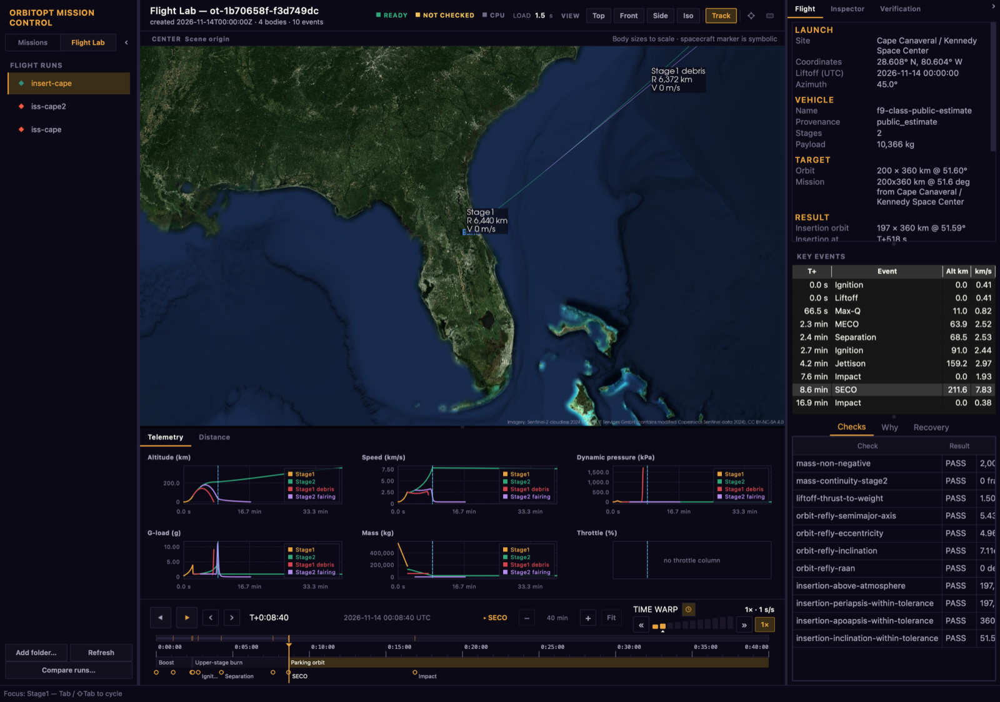

# Flight Lab

Flight Lab模拟火箭上升段和助推器恢复. 运行由代码或CLI;Mission Control's **Flight Lab**模式使其处于与任务相同的3 D视图,时间表和检查员.



## 快开始

安装 [compute environment](https://github.com/zangjiucheng/orbitopt/blob/main/docs/quickstart.md#installation), 然后获取被绑定的 OpenTsiolkovsky 二进制并运行包含的例子 :

```bash
python scripts/fetch_opentsiolkovsky.py
orbitopt flight validate src/orbitopt/data/flightlab/scenarios/leo_two_stage.yaml
orbitopt flight simulate src/orbitopt/data/flightlab/scenarios/leo_two_stage.yaml \
  --vehicle src/orbitopt/data/flightlab/vehicles/synthetic_two_stage.yaml -o runs/leo/
orbitopt view        # switch to Flight Lab: runs/leo is in the list
```

`orbitopt flight to-scene runs/leo/ -o scene.json`输出与平面场景文件相同的运行. 目标导出,优化,模拟和回收选项见[command reference](https://zangjiucheng.github.io/orbitopt/api/cli/flight/).

## 查看运行于 Mission Control

Flight Lab只使运行;它没有设计师. 编辑目标及车辆YAML(或从代码中调用`orbitopt.flightlab.designer`),运行CLI,结果以Mission Control出现.

- **Run list.** The Flight Lab side of the sidebar lists every run directory
  `./runs`下,`ORBITOPT_FLIGHT_RUNS`的文件夹(由`:`分出;`;`分出.
  在Windows上),并添加了**添加文件夹...**的文件夹,这些被记住.
  `orbitopt launch -o DIR`写作`DIR/ascent`,列表为`DIR`. **刷新**.
  抓取新运行; 标记显示运行是否通过了任务
  限制。
- **Same view as a mission.** Selecting a run loads it into the 3D view,
  时间表(拖动播放头暂停),**检查员**和**验证**
  选项卡(包括了发放)。 切换回任务恢复
  任务是开放的。
- **Flight tab.** The launch site and coordinates, liftoff epoch and azimuth;
  飞行器和有效载荷; 目标并实现入轨; 优化器,
  物理和任务判决;关键事件(升起,最大-Q;MECO;
  分离,SECO, 有高度和速度 在每个,它寻求
  点击时的时间线;以及 **检查**, **为什么**(每个故障都用平面
  语言,带有固定)和**恢复**.
- **Telemetry tab.** Altitude, speed, dynamic pressure, g-load, mass and
  与任务时间相对应, 在视图下; 点击图表查找 。
- **比较运行...**同时开启两个运行:投入,结果和原因
  两者不同

## 特派团管道

`flight-lab`任务型通过统一管线运行上升段. 它的交接包括帧,历元,位置,速度和质量;故障产生最佳的警告. `two-stage-leo`参考情景也分级了舞台界限,注入并宣传了停放轨道:

```bash
orbitopt run src/orbitopt/data/flightlab/mission_leo_two_stage.yaml -o run/scene.json
orbitopt run src/orbitopt/data/mission_two_stage_leo.yaml
```

Mission Control显示一个时间表上的阶段和交接检查. 后插入显示的海岸不是验证. 就参考链而言,只有上升段分级;一个双体+J2海岸(重力为上升段 模型苍蝇)将中转相隔. `ascent.mode: run_dir`重放已存在的运行而不是优化. 报告含义见[verification](verification.md).

## 忠诚程度

| 模型 | 范围 |
|---|---|
| 上升段 | OpenTsiolkovsky 3-DOF point mass with a prescribed attitude program and Cd(Mach). |
| 恢复 | 3-DOF. 以J2为单位的地定点质量,自转,大气层,发动机和事件探测. Monte Carlo重新规划了每个分散的样本。 |
| JSBSim 6-DOF. | Optional `flight simulate --backend 6DOF` backend. The packaged illustrative vehicles use zero aero; it is outside the optimization loop. See [ADR 0001](adr/flightlab-0001-jsbsim-6dof.md). |
| 原生6-DOF研究 | 一个单独的RK4硬体参考厂,具有系数表空气动力学和TVC跟踪;它不是JSBSim后端. |

<span id="native-aero-model-and-the-reference-plant-f-02"></span> <span id="tvc-actuator-and-attitude-tracking-f-04"></span> <span id="6-dof-vs-3-dof-gravity-turn-ascent-f-05"></span> <span id="two-stage-separation-and-upper-stage-ignition-f-06"></span> <span id="mission-outputs-selectable-backends-reports-and-mission-control-f-07"></span>

## 6-DOF研究.

原生植物使用示意图的Mach/angle系数表,US76,地球自转,J2,推力和有滞后和速率限制的 gi. 它的基本跟踪器不控制卷或代表一个完整的自动驾驶. 在[gravity-turn study](https://github.com/zangjiucheng/orbitopt/blob/main/docs/benchmarks/fl605_gravity_turn_ascent.json)中,6-DOF减3-DOF的最大相差为2.13公里高地,2.08米/秒快地,0.47°为航迹角.

两阶段研究应用了等同和相向的分离冲动,再独立地宣传每个阶段. 将其原生点质量和刚性体后端与:

```bash
orbitopt flight mission --backend BOTH -o runs/f07-mission
```

Outputs include FlightResult runs, handoffs, verification reports, scenes and
a comparison report. In the [recorded comparison](https://github.com/zangjiucheng/orbitopt/blob/main/docs/benchmarks/fl607_mission_outputs.json),
the upper stages differed by 235 km at the end: the 6-DOF upper stage was
inertially pointed, while the 3-DOF model followed its prescribed program.
These figures are scenario results, not general accuracy bounds.

## 硬门

运行记录框架、时代、单位和出处。 轨道需要申报的速度,近地点和轨道倾角检查;着陆需要所有申报的位置,速度和负载限制. 判罚通过CLI可以复制,失败包括了理性代码. 通行证只适用于规定的模型和限额.

## 什么不是模拟

默认 上升段没有6-DOF态度动态. 模型省略了CFD-级空气动力学,结构载荷,推进剂散射,相相撞,风场和射程安全. 回收样品可以包括一个稳定的风向矢量,但无扰动;指导再规划不是机上计算机模拟.

## 车辆数据、出处和不确定性

[vehicle catalog](https://github.com/zangjiucheng/orbitopt/tree/main/src/orbitopt/data/flightlab/vehicles/)包括一款**说明**合成机车和一款猎鹰-9-级**公众估计数**-,不是SpaceX的官方性能数据. 数字字段记录出处,日期和出处;不确定波段可以提供蒙特卡洛默认. 飞行标签显示车辆的出处.

## 恢复的不确定性(R-04)

使用目标和车辆运行回收散射:

```bash
orbitopt flight montecarlo src/orbitopt/data/flightlab/scenarios/leo_two_stage.yaml \
  --vehicle src/orbitopt/data/flightlab/vehicles/synthetic_two_stage.yaml \
  -n 32 --seed 7 --capture-tracks 240 -o montecarlo.json
```

`--uncertainty unc.yaml`分别配置了风,密度,推力,Isp,拖放和分离态分布. 例如:

```yaml
uncertainty:
  thrust: {enabled: true, distribution: uniform_pct, half_width_pct: 5.0}
  wind: {enabled: true, distribution: normal, sigma_east_m_s: 4.0,
         sigma_north_m_s: 3.0, sigma_up_m_s: 0.5}
```

报告记录了分发情况。 风能进入接受回飞,而并非助推器优化推出. 采样是一个固定种子的决定因素,独立于`--jobs`.

## 蒙特卡洛统计(R-06)

`montecarlo.json`报告故障班,威尔逊成功率间隔和每源敏感. 联合分散协会不是孤立的因果关系。 `--solo-sensitivity`只向每个活源重新飞行,每个活源需要额外一个样本通过. `--capture-tracks N`记录最高为N站点-ENU每个样本对信封地块的分数不作更改.

## 名义/分散比较(R-07)

In the recorded 32-sample comparison (seed 1, identical dispersions and
referee), the baseline landed 14 and the newer objective landed 17. The
latter's Wilson interval was [0.36, 0.69]; position failures rose from 4 to 7.
See [ADR 0003](adr/flightlab-0003-landing-aware-boostback-objective.md) and
[the recorded results](https://github.com/zangjiucheng/orbitopt/blob/main/docs/benchmarks/r07_nominal_dispersed.json) for the setup
and failure breakdown.

关于实施和可复制的细节,见[JSBSim findings](flightlab-jsbsim-spike-findings.md),[regression CI](flightlab-regression-ci.md)和[landing guidance](adr/flightlab-0002-closed-loop-landing-guidance.md).
