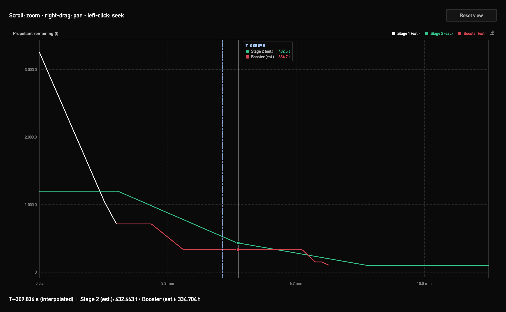

# Flight Lab

Flight Lab模拟上升段和助推器从代码或CLI恢复. Mission Control的**运行**,**车辆**和**比较**工作空间显示节省的飞行,车辆定义和运行比较. [rendezvous workflow](rendezvous.md)为同一观众生成了已保存的目标与追逐者轨迹.

<figure>
  <a href="assets/flightlab-runs-starbase.png"></a>
  <figcaption>Sentinel-2 cloudless 2024 by EOX IT Services GmbH, containing modified Copernicus Sentinel data 2024 (CC BY-NC-SA 4.0).</figcaption>
</figure>

## 快速启动

安装 [compute environment](https://github.com/zangjiucheng/orbitopt/blob/main/docs/quickstart.md#installation), 获取绑定的二进制, 然后运行被包的点质量示例 :

```bash
python scripts/fetch_opentsiolkovsky.py
orbitopt flight validate src/orbitopt/data/flightlab/scenarios/leo_two_stage.yaml
orbitopt flight simulate src/orbitopt/data/flightlab/scenarios/leo_two_stage.yaml \
  --vehicle src/orbitopt/data/flightlab/vehicles/synthetic_two_stage.yaml -o runs/leo/
orbitopt
```

选择 **运行** 打开运行 。 要导出独立的场景,请使用 `orbitopt flight to-scene runs/leo/ -o scene.json` 。 [command reference](https://zangjiucheng.github.io/orbitopt/api/cli/flight/)列出所有选项.

## 查看运行于 Mission Control

- **运行列表 :**扫描 `./runs`, `ORBITOPT_FLIGHT_RUNS` (平台路径分隔符)
  还记得**添加文件夹...**的位置 **刷新**找到新的运行;
  `orbitopt launch -o DIR`生产列出的`DIR/ascent`运行.
- **共享视图 :** 选择运行加载 3 D 场景,时间表,飞行和
  验证标签. 返回**特派团**恢复了之前的任务.
- **飞行标签 :**发射投入,瞄准并到达轨道,以及可寻求的事件.
  **恢复**列出每个助推器燃烧,其油门范围,使用的推进剂.
  并录制引擎启动。 **发动机**跟随重播时钟和
  显示运行中的阶段。 计数来源于车辆定义
  或记录的遥测。 发动机布局为图型.
- **面板:** 选择显示和使用 **扩展细节** 的详细标签
  为了更多的空间。 观众记得标签的能见度, 并显示 **GNC**
  当选中的运行包含该数据时, **约会** 。
- **验证:**显示通过运行保存的检查,包括轨道
  即时复飞. 没有评估判决的跑步显示**未检查**.
- **遥测:**点击图表寻找时间线. **比较** 打开两个
  保存并肩运行 。

**机构**条留在地块上方:点击地球,一个舞台,助推器或一个站点来集中并跟踪它. 阶段按钮在其记录的寿命内启用。 当有匹配的目标定义时,发射/回收标记会固定在旋转地球;RTLS使用一个共享标记. 未解决的离岸目标不由垫子取代.

**点燃发动机**使用记录的引擎计数. 标注`(est.)`的喉咙是相对于赛道峰值燃烧率的质量流量. 标有`(est.)`的推进剂使用轨迹质量减干重和任何附着的上级,从车辆文件中与跑道文摘相匹配. 未知的干燥质量仍然缺失。

在 **运行=遥测** 中,在图表上徘徊,以读取插值同时横跨所有图表. 滚动到缩放和右拖拉或 Shift-drag 以覆盖共享的时间范围 。 单击或拖曳以查找,然后在图表有焦点时使用 **← / →** 。 时间表显示每条车道有一条连续条,沿途标有相位边界.

**双击图表** 打开更大的视野,遵循任务时钟. 使用 **重置视图** 恢复全时范围 。

在 **运行=遥测** 中,在标签旁边打开 **绘图**,以选择要显示的图表 。 Mission Control记得您所选择的横跨运行和重启. 选择 **显示全部图** 以恢复全网格 。

**网格鳍**图表示绝对鳍偏转,攻击角度和银行角度. **发动机**标签说明了鳍布局和气流. 两者都使用记录的鳍遥测. 在没有它的情况下, **网格鳍( 无数据)** 被禁用.

使用 **下载此图** 按钮保存 PNG 或当有数据时,使用 CSV . 遥测CSVs旗估计序列. 引擎和网格-fin插图导出为图像.

将 **机构** 上方的分割符上方的中央抓住拖曳, 以调整图案的大小 。 在短窗口中,使用遥测滚动条或**移动 + 滚动**到达下方的地块.

在**距离**中,垂直滚动到缩放,然后横向或右擦拭以移动时间. 左键单击或拖曳以查找 。 双击以适应全时范围.

分离工具提示显示速度差异和适用的极限. 录音任务重播在运行和输入文摘匹配时使用其任务配置. 其他运行使用独立的中继检查 。

[](https://raw.githubusercontent.com/zangjiucheng/orbitopt/main/docs/assets/flightlab-telemetry-detail.png)

目标和车辆在YAML或通过Python设计师API进行编辑;桌面模式使运行而非配置或飞行.

## 车辆视图

在顶层工作空间栏打开**车辆**,并选择一个目录载体. 这个只读的页面显示了它的舞台轮廓,质量,推力,理想的QΔv,恢复储备和申报的推力/stage调度. 配置文件在可用时使用已声明的几何;否则它们会被标记为**图表, 不用于缩放**. 来源、日期和说明的不确定性。

[](https://raw.githubusercontent.com/zangjiucheng/orbitopt/main/docs/assets/flightlab-vehicle.png)

要将定义与飞行相比较,请选择 **运行**中保存的运行,然后返回 **车辆**. 该时间表增加了飞行事件标记;**宣告为飞行**列出了时间和质量差异. 车头说明运行是否使用了准确的车辆文件或其文摘不同. 缺失值为`—`;差异本身并不是验证判决.

截图使用说明性`synthetic_two_stage_rtls`车和录制的[E5-05a ascent](computed-mission.md). 理想XQV排除引力,拖动和引导损失. 编辑YAML型机车改变设计;返回**运行**型机车,用于3 D型机车的飞行视野和遥测.

## 特派团管道

`flight-lab` runs an ascent through the unified pipeline. `two-stage-leo`
also grades station order, staging, mass, orbit insertion and optional
propagation/recovery:

```bash
orbitopt run src/orbitopt/data/flightlab/mission_leo_two_stage.yaml -o run/scene.json
orbitopt run src/orbitopt/data/mission_two_stage_leo.yaml
```

分离后,上层轨道和助推器轨道分别设有时间表车道和边界检查. 中央重力+J2海岸桥梁,架设缺口; 后插入的**显示海岸**不是验证. `ascent.mode: run_dir`重播录制输入,而不是优化一个上升段.

The packaged `src/orbitopt/data/mission_two_stage_leo_recovery.yaml` is the
**E2-04 frozen integration fixture**: two-sample, illustrative ascent arcs
with a prescribed 400 km insertion and 35 t of booster propellant at
separation. Its recovery is simulated, but ascent is not re-flown and parking
propagation is explicitly out of scope. It is not evidence of one physically
propagated launch-to-orbit-and-return trajectory. See
[regression procedure](https://github.com/zangjiucheng/orbitopt/blob/main/docs/flightlab-regression-ci.md#e2-04-the-frozen-dual-branch-reference-mission-task-257)
and the [acceptance results](acceptance-e1-e4.md). For the
recorded **computed-ascent RTLS mission**, use the
[E5-05 workflow](computed-mission.md): it has a fixed-program OT ascent,
one shared separation handoff and optional cross-environment parking
propagation.

<span id="fidelity-levels"></span>

## 后端身份和忠诚程度

验证输入和`scene.flightRun.backend`:

| 后端 | 范围 | 边界 |
|---|---|---|
| `opentsiolkovsky` | 限定态点-质量 上升段,Cd(Mach),GCRS输出. | 默认 上升段/优化血统;没有姿态动态或TVC. |
| `native-pointmass` | 原生US76 / J2 / 旋转-地球双胞胎有动静的态度. | 原生比较植物,区别于OpenTsiolkovsky. |
| `native-rigidbody` | 原生硬体,系数表空气和落后/速率限制的TVC跟踪. | 说明参考厂;无完整卷自动驾驶. |
| `jsbsim` | JSBSim僵硬的身体,有活体质量/CG/inertia,并被赋予TVC,ECEF输出. | 基座悬索式飞机为零气;`spike_stage_aero`是生成的含气参考. Opt-in,位于上升段优化外. |

`flight simulate --backend opentsiolkovsky|jsbsim`为前者搭载YAML,后者搭载**JSBSim 情景 YAML**. 关于含空气的参考文献(需要`orbitopt[sixdof]`):

```bash
orbitopt flight simulate src/orbitopt/data/flightlab/scenarios/leo_two_stage.yaml \
  --backend jsbsim --vehicle src/orbitopt/data/flightlab/sixdof/e104_aero_ascent.yaml \
  --no-refly -o runs/e104/
```

这种持有的垂直上升段演练机身;400公里轨道-目标检查预计会失败. `--no-refly`离开独立物理 验证未评估. `flight mission --backend native-pointmass|native-rigidbody|BOTH`运行本地比较. 遗产 `3DOF` / `6DOF`别名在其最初的切入点内解析;它们不是犬类输出身份.

### 相符合的实际情况(E1-01)

The [parity document](https://github.com/zangjiucheng/orbitopt/blob/main/src/orbitopt/data/flightlab/parity/spike_stage_parity.yaml)
drives native stage construction and checks packaged JSBSim mass, inertia,
propellant, mounting and aero geometry. Since E6-01 the engines share the
propulsion law too: a choked `T_vac/(Isp_vac*g0)` = 599.083 kg/s flow through
the same physical 2 m^2 exit, so both sides pay the same ambient back-pressure
debit and agree on 1.6774 MN of pad thrust. The generated production airframe
adds the aero tables and cancels the fixed-AERORP/live-CG force couple. See
[ADR 0009](adr/flightlab-0009-engine-and-mass-flow-parity.md) for the aligned
residuals, [ADR 0007](adr/flightlab-0007-production-jsbsim-aero-path.md) for
the aero path, [ADR 0001](adr/flightlab-0001-jsbsim-6dof.md) for the base spike.

回收仍是一个单独的地球固定3 - DOF链带J2,旋转,大气层和发动机/活动模型. 选择 6 - DOF 上升段不会使恢复六维.

## 验证判决

| 运行字段 | 含义 |
|---|---|
| `backend_self_check` | 生产后端的自己的支票。 |
| `physics_verified` | 使用 tudatpy 进行独立插入/海岸重飞; JSBSim ECEF 输出首先连接到 GCRS . |
| `optimizer_converged` | 乐观的判决,当在场。 |
| `mission_constraints_passed` | 宣布飞行目标限制。 |

`null`表示未分摊. 这些领域是独立的;自我检查不是独立的重新飞行。 见[ADR 0004](adr/flightlab-0004-independent-physics-verification.md). 任务卷起后保留了这面旗帜作为独立的模型证据. 假旗故障轨道注射及全任务门;无效仍未评估. 见[acceptance results](acceptance-e1-e4.md).

<span id="native-aero-model-and-the-reference-plant-f-02"></span> <span id="tvc-actuator-and-attitude-tracking-f-04"></span> <span id="6-dof-vs-3-dof-gravity-turn-ascent-f-05"></span> <span id="two-stage-separation-and-upper-stage-ignition-f-06"></span> <span id="mission-outputs-selectable-backends-reports-and-mission-control-f-07"></span>

## 6 - DOF研究.

记录涵盖了引擎等值,抽样控制和原生/JSBSim引导矩阵. 这些是申报的学习车辆和管制员,而不是任何合格的生产车辆:

| 学习 | 记录结果 | 范围/来源 |
|---|---|---|
| F-05 / E1-02 | 动力姿态错误 4.77 °峰值,α 14.42 °,最大-71.2 kPa. | 动力和海岸大门不同;后来的62.6 °α峰位于近真空海岸. [Record](https://github.com/zangjiucheng/orbitopt/blob/main/docs/benchmarks/fl605_gravity_turn_ascent.json). |
| F-07 / E1-03 | 原点质量:225.3 / 228.5 km peri/apo;硬体:220.5 / 226.5 km,在± 25 km范围内. | 共享关于已披露的 1 t 干 / 7 t 推进剂上级与 3 ° gimbal 的反馈定律;非原 F-06 等价. [Record](https://github.com/zangjiucheng/orbitopt/blob/main/docs/benchmarks/fl607_mission_outputs.json). |
| E6-02 | 引导 JSBSim 中程:动力误差 0.44 ° 峰值,α 11.7 °;上动力姿态误差 6.13 ° 峰值 / 5.32 ° RMS . | 缩写70 t stack; 上层边框与助推器边框不同. [ADR 0010](adr/flightlab-0010-guided-jsbsim-ascent.md),[record](https://github.com/zangjiucheng/orbitopt/blob/main/docs/benchmarks/e6_02_guided_ascent.json). |
| E6-03 / E10-08 | 12 of 17 points insert on both native backends (6 before E10-08), with no unexpected verdict; 180-300 km at every declared inclination. | The terminal-radius radial channel converts the guidance-class misses. The 400 km, heavy-stage, F-06 and A3-servo cells stay misses with named vehicle/actuator causes. [ADR 0011](adr/flightlab-0011-guidance-generalisation-envelope.md), [matrix](https://github.com/zangjiucheng/orbitopt/blob/main/docs/benchmarks/e6_03_guidance_matrix.json). |
| E6-05 / E10-08 | JSBSim和本地判决同意16/17细胞,所有130对等检查通过; 12.0/3.1 km。 | 共享冻结分离状态. 只有 A3 服务器边界单元格不同,并按预期宣布差异(JSBSim插入); 推进剂同意在共同插入的细胞上使用0.11%. [Record](https://github.com/zangjiucheng/orbitopt/blob/main/docs/benchmarks/e6_05_jsbsim_matrix.json). |
| E6-04 | 每一步抽查一次国家指导/控制,并在RK4阶段进行。 | The study justifies `dt_s = dt_c_s = 0.02`; this is not a universal backend step. [Sampled-control ADR](adr/flightlab-0008-sampled-data-control-and-rk4-plant.md), [sweep](https://github.com/zangjiucheng/orbitopt/blob/main/docs/benchmarks/e604_step_convergence.json). |

运行本地双后端任务并打开其保存的产出 :

```bash
orbitopt flight mission --backend BOTH -o runs/f07-mission
orbitopt
```

For the guided JSBSim study (requires the six-DOF dependency):

```bash
PYTHONPATH=src python benchmarks/bench_e6_02_guided_ascent.py -o runs/e602.json
```

指导矩阵(内在)及其JSBSim的可适用性双胞胎从其基准中再生;两者都独立飞行每个细胞,因此`--jobs`比例带核心(每个细胞需要几分钟):

```bash
PYTHONPATH=src python benchmarks/bench_e6_03_guidance_matrix.py --jobs 4 -o docs/benchmarks/e6_03_guidance_matrix.json
PYTHONPATH=src python benchmarks/bench_e6_05_jsbsim_matrix.py --jobs 4 -o docs/benchmarks/e6_05_jsbsim_matrix.json
```

研究书写了测量JSON,而不是Flight Lab运行目录. [API reference](https://github.com/zangjiucheng/orbitopt/blob/main/docs/api.md#mission-and-qualification-interfaces)涵盖其情景,跑步和比较功能.

## 硬门

轨道和触地得分检查适用申报的速度、位置、轨道、载荷和推进剂限制。 报告记录帧,时代,单位,出处和故障原因代码. 通行证仅到达模型检查和限制;[full-mission phase verdicts](https://github.com/zangjiucheng/orbitopt/blob/main/docs/verification.md#full-mission-verification-gate-e2-03-task-256)显示没有证据或分支失败的地方.

## 什么不是模拟

默认 上升段是点质量. 模型省略CFD-级空气,结构负载,slosh,阶段碰撞,扰动和射程安全. 恢复可能使用一个稳定的分散风向器;其重新规划不是机载计算机模拟。

## 车辆数据、来源和不确定性

[vehicle catalog](https://github.com/zangjiucheng/orbitopt/tree/main/src/orbitopt/data/flightlab/vehicles/)包含一个说明性合成飞行器和Falcon -9-级公共估计,而不是官方SpaceX性能数据. Fields记录来源/日期/证明;不确定波段可以提供蒙特卡洛默认.

## 恢复的不确定性(R-04)

```bash
orbitopt flight montecarlo src/orbitopt/data/flightlab/scenarios/leo_two_stage.yaml \
  --vehicle src/orbitopt/data/flightlab/vehicles/synthetic_two_stage.yaml \
  -n 32 --seed 7 --capture-tracks 240 -o montecarlo.json
```

通过 `--uncertainty unc.yaml` 独立配置源 :

```yaml
uncertainty:
  thrust: {enabled: true, distribution: uniform_pct, half_width_pct: 5.0}
  wind: {enabled: true, distribution: normal, sigma_east_m_s: 4.0,
         sigma_north_m_s: 3.0, sigma_up_m_s: 0.5}
```

风力影响接受重飞,而非助推器优化推出. 采样是固定种子定型,独立于`--jobs`.

## 蒙特卡洛统计(R-06)

Reports include failure classes, Wilson success-rate intervals and per-source
sensitivity. Joint-dispersion associations are not isolated causal effects.
`--solo-sensitivity` adds one sample pass per active source; `--capture-tracks N`
retains at most N ENU samples per trajectory without changing random draws.

## 名义/分散比较(R-07)

[32-sample evidence](https://github.com/zangjiucheng/orbitopt/blob/main/docs/benchmarks/r07_nominal_dispersed.json)记录14每臂登陆. 基线假设无限制TVC带宽;堆叠飞行20 °/s shot + 0.2 的延迟补偿. 它们是不匹配的精算师。 堆栈的标称触地得分是0.03距离垫子;位置故障从4上升到7. 见[ADR 0006](adr/flightlab-0006-rate-limited-landing-guidance.md)和[ADR 0003](adr/flightlab-0003-landing-aware-boostback-objective.md).

## 联合机会限制规划(E3-02)

`plan_boostback_entry(joint_chance=...)`用联合燃料取代R-01软客观术语,分流/散射和着陆概率限制,解为**受罚优化**(Nelder上最恶劣的违反精确处罚-  Mead 搜索——而不是一个受约束的解析器. 自E7-01以来,强制判决得到了执行,而不是刑罚的暗示:最恶劣的违反规定超过`JointChanceSpec.violation_tolerance`的计划会以`JOINT_CHANCE_VIOLATED`的理由代码返回`feasible=False`. 所记录的32-样本联合臂着陆17;假设见[ADR 0005](adr/flightlab-0005-joint-recovery-chance-constraints.md)和[paired results](https://github.com/zangjiucheng/orbitopt/blob/main/docs/benchmarks/e3_02_joint_recovery.json). 其规划概率为代机,而非保证飞行成功率.

## 强力蒙特卡洛资格(E3-03).

[four-seed study](https://github.com/zangjiucheng/orbitopt/blob/main/docs/benchmarks/e3_03_robust_montecarlo.json)使用168配对的样品,每只手臂配对的图纸,并申报20 °/s / 0.2 的导体物理:

| 武装 | 着陆/168 | 95% 威尔逊间隔 |
|---|---|---|
| FL-305基线 | 45 | 20.7–33.9% |
| E3-01赔偿 | 49 | 22.8–36.4% |
| R-01目标 | 55 | 26.1–40.2% |
| E3-02 联合机会 | 56 | 26.6–40.8% |

根据基线,McNemarp的精确值分别为0.125,0.0309和0.0192. 这是**未调整配对**测试,不是家庭意义索赔。 E3-02对R-01仍未解决(两个对一个不和谐的着陆);配对的只着陆的散射试验拒绝任何东西. [benchmark script](https://github.com/zangjiucheng/orbitopt/blob/main/benchmarks/bench_e3_03_robust_montecarlo.py)记录了所有的样本行,故障类和敏感性. 在本次验收审查中,从这些列中重新计算了统计数据;672航班没有重新运行。

**The E3-02 row predates E7-01.** It measures the old penalty-only mode.
With feasibility enforced, E7-04 re-flies the same draws and lands **35/168**;
99 plans are rejected as `JOINT_CHANCE_VIOLATED`. The baseline comparison has
McNemar p = 0.110. The old p = 0.0192 does not describe today's enforced mode.

## Probability calibration of p_land (E7-02)

[calibration report](benchmarks/e7_02_probability_calibration.md)重用168记录成对样本. 0.5 – 0.8 bin预测0.656但登陆0.076;0 – 0.5 bin登陆0 / 42. 在0.8以上, 平均预测值属于观测到的威尔逊间隔, 其小的高盆样本留下了广泛的不确定性。 这只支持记录的情景/分散集,而不是保证成功的概率. API:`orbitopt.flightlab.recovery.calibration`.

## 联合风险模型(E7-03)

The [joint-risk report](benchmarks/e7_03_joint_risk.md) rejects independent
fuel/divert failure channels (Fisher p = 0.010). A Gaussian copula fitted on
three other arms uses ρ = −0.273; on the held-out joint arm, Brier score
improves 0.222 → 0.214. The mid-band remains overconfident. The shipped
`JointChanceSpec.landing_dependence_rho` default is **0.0** (the product);
the fitted constant is opt-in. API: `orbitopt.flightlab.recovery.joint_risk`.

## 故障驱动优化(E7-04).

The [paired re-fly report](benchmarks/e7_04_failure_driven.md) compares the
same 168 dispersion draws with TVC lag compensation and an optional lateral
cutoff gate. Lateral-speed failures fall 24 → 18 and landings rise 45 → 49;
this is **not significant after Holm correction** (raw category p = 0.0703,
adjusted 0.3516). The gate alone reproduces baseline verdicts; compensation
carries the measured change. The enforced joint arm stays 35/168 with or
without the fix. Default cutoff and corridor-aim knobs remain off; see
`orbitopt.flightlab.recovery.failure_driven` for the paired analysis.

## 样本外可靠性(E7-05)

The [reliability report](benchmarks/e7_05_out_of_sample_reliability.md)
diagnoses E7-04's 99/168 `JOINT_CHANCE_VIOLATED`: reconstructing the three
normalized violations from each recorded verdict (identity checked on all
99 rows) shows **51 bind on the divert budget, 48 on the fuel quantile, 0 on
the landing-probability term** -- and under the shipped spec the probability
term provably cannot bind alone (the sweep test in
`tests/test_flightlab_recovery_reliability.py`). The rejections are physical
(51/99 deep: the dispersion band itself misses the spec), with 20 of 99
rejected worlds landing anyway under FL-305 grading. Re-analysing the E7-03
headline per-seed instead of pooled: Mantel-Haenszel p = 0.017 and a
cluster-bootstrap CI of [-0.185, -0.058] survive, but seed 1 sits at phi = 0,
Fisher-combined p = 0.154 and no per-arm Holm p reaches 0.05. Hold-out flights
on disjoint seeds reproduce the pattern (39/168 landed, Brier skill -0.62,
overconfident mid-bins, 0 probability-bound rejections); widened bands (x1.5)
collapse to 2/84 and an independent ~180 t-class RTLS vehicle to 0/48, all
deep fuel-bound. The probability model generalizes only in shape, not level:
it stays unskilled out of sample. No success-rate improvement is claimed.
API: `orbitopt.flightlab.recovery.reliability`.

## 分级录取(E10-06).

The [chance-constraint redesign report](benchmarks/e10_06_chance_constraint_redesign.md)
replaces the E7-01 binary gate with a graded rule over the same reconstructed
violations: reject only deep violations (worst > 0.5), a second binding
channel (> 0.15), or a calibrated landing probability below the recorded
joint-arm climatology (0.208). The probability is a logistic refit on
fuel-quantile z and divert violation -- monotone by fit, and the only fit
that stays short of severe overconfidence when the dispersion bands shift
x1.5 (skill -0.09, ECE 0.03, against -9.38 / 0.43 for the raw surrogate).
Regrading the recorded grid row-for-row: 99 -> 84 rejections, false
rejections (joint-rejected, FL-305 landed) 20 -> 10, all 51 deep violations
kept, nothing previously accepted re-rejected; on the E7-05 hold-out the
calibrated model scores Brier skill +0.565 (raw: -0.62) with no
high-probability bin significantly below its own prediction. Wired into
FL-302 as `plan_boostback_entry(..., joint_admission=...)`; the search
objective is unchanged and no success-rate improvement is claimed.
API: `orbitopt.flightlab.recovery.redesign`.

## Grid-fin规划和重播(E11-01)

车辆可宣布`booster.grid_fins`区块在[vehicle schema](https://zangjiucheng.github.io/orbitopt/api/schemas/flight-vehicle-1.0/)区. 使用`plan_boostback_entry(entry_burns=0, entry_aero=...)`来计划无动力的有鳍的输入. 将降空高度中的门列表为 `(altitude_m, bank_deg[, alpha_deg])` 。 双值门采用制导的默认攻击角度. 三值门自设.

To re-fly the plan with `propagate`, pass `mission_command` as `thrust_cmd`
and `mission_aero_command` as `aero_cmd`. Build both callbacks from the
same plan, separation state and booster model. See the
[grid-fin study](benchmarks/e11_01_grid_fin_authority.md) for the model
assumptions and DC8 results.

## 反事实录取鉴定(E11-04).

The graded policy landed 24 of 32 newly admitted cases (75%, Wilson 95%
interval 58–87%). Paired re-flights found 19 gains and zero losses
(exact McNemar p = 3.8 × 10⁻⁶). The older training grid landed 8 of 15
cases and showed guidance-era drift. The
[benchmark report](benchmarks/e11_04_counterfactual_admission.md) separates
these results from the earlier FL-305 estimates.
